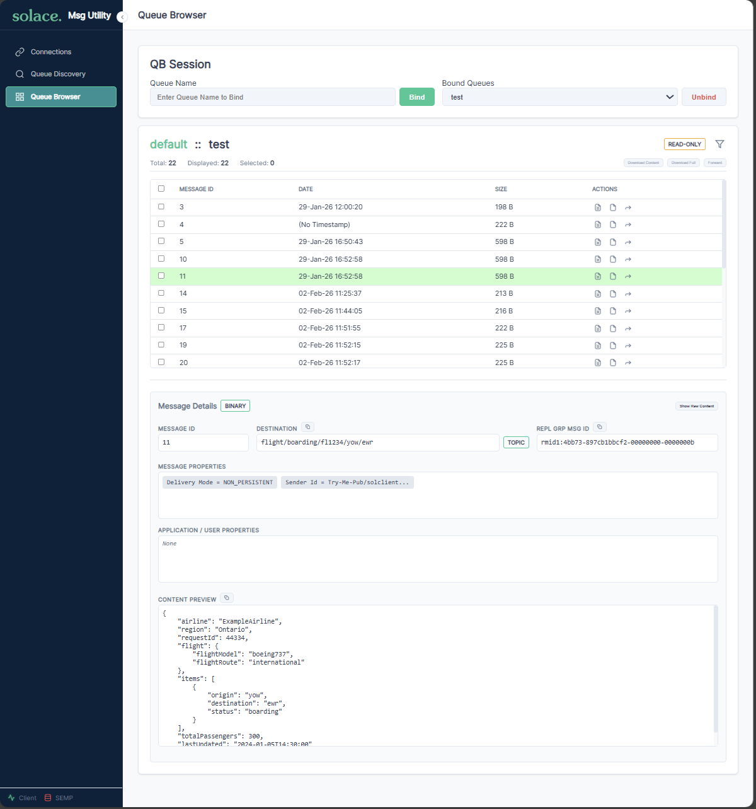

# Solace Message Utility

A browser-based tool for managing Solace PubSub+ Event Brokers events/messages. Browse queues, inspect messages, forward, delete, copy across brokers, and search subscriptions — all from a single self-contained HTML page. No installer, no backend.



## Three ways to run it

| Mode | What it is | Broker credentials | Start | Try it offline |
| --- | --- | --- | --- | --- |
| **Standalone** | The app as a single HTML file, from GitHub Pages or any web server. Your browser connects to the broker. | each user types them | open the page | `demo.html` |
| **Gateway** | The app served by the gateway container, which connects to your brokers for it. Browsers reach and trust only the gateway. | each user types them | `SMU_VERSION=<release> docker compose -f docker/compose.gateway.yaml up -d` | `demo.html` |
| **Provisioned** | Gateway mode plus sign-in. An administrator stores the broker credentials and grants each user brokers, VPNs and queues. | stored on the gateway; users sign in | `SMU_VERSION=<release> docker compose -f docker/compose.provisioned.yaml up -d`, after [its setup](#provisioned----sign-in-and-administration) | `provisioned-demo.html` |

Both container modes run the same image: Gateway mode by default, Provisioned mode with `SMU_CONN_MODES=provisioned`. [deployment.md](docs/deployment.md#choosing-a-mode) compares them; [provisioned-mode.md](docs/provisioned-mode.md) covers Provisioned mode in full.

**Demos.** Both demos are attached to every Release and run from disk with nothing else: no broker, no gateway, no network request.

- `demo.html` -- Standalone and Gateway mode: the Direct form and every module against a broker inside the page. Use Broker Host `broker.solace.com` and any non-empty credentials, or **Fill the connection form** in its Demo controls panel. See [demo.md](docs/demo.md#direct-demo-demohtml).
- `provisioned-demo.html` -- Provisioned mode: sign in with a demo account, then browse, copy and administer against a fake gateway. See [demo.md](docs/demo.md#provisioned-demo-provisioned-demohtml).

## Quick Start

None of these need a build toolchain.

### Standalone -- the hosted page (zero install)

Open <https://solacelabs.github.io/solace-msg-utility/> in a browser. Done. (You'll still need network reachability to your broker, and the broker must allow CORS for SEMP.)

### Standalone -- self-host the static files

Take `index.html` from the latest [GitHub Release](https://github.com/SolaceLabs/solace-msg-utility/releases) and the two vendor libraries `solclient.js`, `jszip.min.js` from the `dist` branch. Drop them in any folder served over HTTP (`npx http-server`, nginx, IIS, ...). See [deployment.md -> Self-host](docs/deployment.md#self-host-the-static-files) for sources and supported layouts.

### Gateway -- one container

The image includes the Solace JavaScript API and JSZip, so nothing else is needed. To try it with the newest release:

```bash
docker run --rm -p 9443:9443 -v solace-tls:/tls \
  ghcr.io/solacelabs/solace-msg-utility:latest
```

Then open <https://localhost:9443/>. The container connects to your broker for the app, so the browser needs to reach and trust only the container. For production, pin a release, never `latest`: `SMU_VERSION=<release> docker compose -f docker/compose.gateway.yaml up -d` from a checkout of that release (compose refuses to start without `SMU_VERSION`); see [deployment.md -> Gateway mode](docs/deployment.md#gateway-mode).

### Provisioned -- sign-in and administration

From a checkout of the release you deploy, put the first administrator's password (12 to 128 characters) in `docker/admin-password`, then give it and the backup directory to the gateway's UID (65532) alone, and start it:

```bash
cd docker
chmod 400 admin-password && sudo chown 65532 admin-password
mkdir -p backup && chmod 700 backup && sudo chown 65532 backup
SMU_VERSION=<release> docker compose -f compose.provisioned.yaml up -d
```

Left to Docker, `backup/` would be root's and the scheduled backups could not be written. Open `https://<host>:9443/`, sign in as `admin` and change the password, add brokers and users at `/solAdmin`, and set a backup schedule and passphrase on its Backup & Restore page. The steps, settings and recommended values are in [provisioned-mode.md -> Start it](docs/provisioned-mode.md#start-it).

## Connecting to a broker

Once the app is loaded:

1. **Fill in two connections** (both share the same Broker Host):
   - **Solace Client** (WebSocket, for message operations) — VPN, username, password, port `8008` (ws) or `1443` (wss).
   - **SEMP** (REST, for management operations) — admin username, password, port `8080` (http) or `1943` (https).
2. **Click Connect** on each. The two dots in the sidebar turn green when ready.
3. **Save All Config** — your settings persist in the browser for next time.
4. **Use the sidebar** to switch between Queue Browser, Queue Copy, and Queue Subscriptions.

> **Provisioned mode:** Connections offers a **Provisioned** tab instead of (or beside) the form above -- sign in with an account an administrator created and pick from the brokers and VPNs you are entitled to, instead of typing credentials at all. See [Provisioned Connections](docs/user-guide.md#provisioned-connections).

> **Self-signed TLS certificates:** if `wss://` connection is blocked, the app shows a helper dialog with one-click instructions to trust the broker certificate.

## Features

### Connections

- Two independent connections (Solace Web Messaging + SEMP REST), shared broker host.
- **Direct** or **Provisioned** tab in Provisioned mode, where the deployment offers both -- Provisioned signs you in and hands you only the brokers/VPNs you are entitled to, with no credentials to type.
- **Basic** or **OAuth2** authentication for the Solace client.
- **Save / Load / Reset** connection profiles (localStorage).
- **Advanced settings** — connect/reconnect retries, timeouts, per-queue message cap (1–10 000).
- Live status dots in the sidebar for both connections.
- SSL trust helper for self-signed broker certificates.

### Queue Browser

- Bind up to **3 queues simultaneously** and switch between them; each keeps its own message history.
- Real-time message arrival into a sortable, scrollable table.
- Per-message **details panel** — properties, application properties, destination, payload preview, raw dump.
- One-click **copy** for destination, replication-group ID, and content.
- **Filter modal** with AND/OR matching across Message ID, type, destination, body content, and standard or application properties. Supports `*` wildcards; body filter is auto-substring.
- **Forward** one or many messages to a topic, queue, or each message's original destination. Per-message status (QUEUED → SENDING → SUCCESS / FAILED) with retry-only-failed.
- **Delete** single or bulk messages (read-write queues only; hidden on read-only).
- **Download** as ZIP — payload-only or full JSON (properties + payload).
- Keyboard shortcuts: **Enter** to bind, **Enter** to send forward.
- Modals dismiss on **Escape** or backdrop click.

### Queue Copy

- Copy or **move** messages between queues, on the same broker or **across brokers**.
- Two-column form — read-only Source mirror + editable Destination with **Same Broker** / **Same VPN** shortcuts.
- Destination can be a **queue** (with SEMP-driven picker) or a **topic**.
- The Destination follows the primary connection: with a Direct connection its credentials are typed by hand, and in a Provisioned session one card picks a broker and Message VPN you are entitled to, with no password to enter.
- Bounded runs — snapshots the source before starting so the run has a defined end.
- Pre-flight verification (count, size, quota, oldest/newest message ID) via SEMP, with QueueBrowser fallback if SEMP is unavailable.
- Live progress with per-message ACK. The run is bounded to the snapshot taken at verify time, so messages arriving mid-run are left for the next run.
- Stops on the first error (quota, permission, rejection) so partial state is visible.

### Queue Subscriptions

- Lists every `(VPN, queue, topic-subscription)` triple visible to your SEMP user — answer "which queues subscribe to topic X?" without walking each queue manually.
- Three column filters, AND-combined.
- VPN / Queue filters: case-insensitive substring by default; `*` switches to anchored wildcard (`def*`, `*ult`, `def*ult`).
- Subscription filter uses **Solace topic-set intersection** (`*` = one level, `>` = trailing levels) — typing `orders/new` matches a stored `orders/*`.
- Loaded list is cached in memory; **Refresh** re-fetches.

### Cross-cutting

- **SEMP queue picker** — used by Browser, Copy, and Subscriptions to select queues without leaving the current module.
- **Toasts** for every success / failure.
- **Self-contained HTML** — `index.html` includes all app code; the two vendor scripts `solclient.js` and `jszip.min.js` sit alongside it (see [deployment.md](docs/deployment.md#external-runtime-dependencies)).
- **Demo bundle** (`demo.html`) -- every module exercised against mock data, no broker required.
- **Provisioned demo** (`provisioned-demo.html`) -- the Provisioned sign-in, entitlements and administration pages against a fake gateway in the page; no gateway, no broker, no network request.
- **Gateway image** -- serves the app over HTTPS and connects to your brokers for it, so browsers reach and trust only the container; Provisioned mode adds sign-in and administration. Image at `ghcr.io/solacelabs/solace-msg-utility`; see [deployment.md](docs/deployment.md#gateway-mode).

## Documentation

| Document | Description |
| --- | --- |
| [user-guide.md](docs/user-guide.md) | Full UI walkthrough, every field, every screen |
| [demo.md](docs/demo.md) | The two offline demos, `demo.html` and `provisioned-demo.html`: what they hold and simulate |
| [deployment.md](docs/deployment.md) | The three modes, hosting options, network requirements, TLS |
| [provisioned-mode.md](docs/provisioned-mode.md) | Provisioned mode: how it works, how to configure it, recommended values |
| [developer-guide.md](docs/developer-guide.md) | Setup, build, testing, adding modules, code conventions |
| [architecture.md](docs/architecture.md) | System diagrams, module structure (developers) |
| [contributing.md](docs/contributing.md) | PR workflow, coding standards, test requirements |
| [test-report.md](docs/test-report.md) | Test methodology, coverage strategy |
| [git.md](docs/git.md) | Release process, CI workflow, image tags (maintainers) |

## License

[GNU GPLv3](LICENSE)
