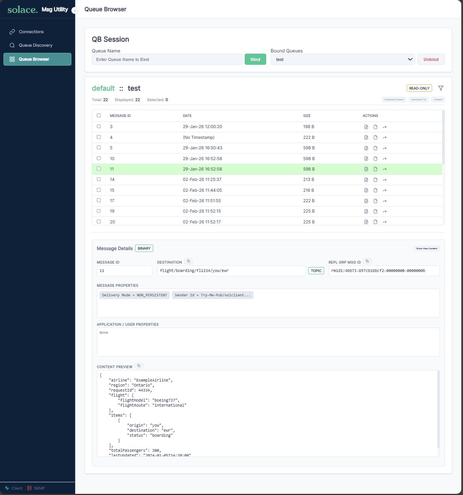

# Solace Message Utility

Solace Message Utility is a browser-based tool for people who work with Solace PubSub+ Event Brokers: developers, testers and support teams who need to look at messages and queues, and the administrators who decide who may do that. Browse queues, inspect messages, forward or delete them, copy them across brokers and search subscriptions, all from one self-contained HTML page. There is nothing to install on your machine.

This page says what the tool does, shows the three ways to run it and points to the document for each audience.



## Contents

- [Three ways to run it](#three-ways-to-run-it)
  - [Try it without a broker](#try-it-without-a-broker)
- [Quick start](#quick-start)
  - [Standalone: the hosted page](#standalone-the-hosted-page)
  - [Standalone: self-host the static files](#standalone-self-host-the-static-files)
  - [Gateway: one container](#gateway-one-container)
  - [Provisioned: sign-in and administration](#provisioned-sign-in-and-administration)
- [Features](#features)
- [Documentation](#documentation)
- [License](#license)

## Three ways to run it

| Mode | What it is | Broker credentials | Start | Try it offline |
| --- | --- | --- | --- | --- |
| **Standalone** | The app as a single HTML file, from GitHub Pages or any web server. Your browser connects to the broker. | Each user types them | Open the page | `demo.html` |
| **Gateway** | The app served by the gateway container, which connects to your brokers for it. Browsers reach and trust only the gateway. | Each user types them | `SMU_VERSION=<release> docker compose -f docker/compose.gateway.yaml up -d` | `demo.html` |
| **Provisioned** | Gateway mode plus sign-in. An administrator stores the broker credentials and grants each user brokers, VPNs and queues. | Stored on the gateway; users sign in | `SMU_VERSION=<release> docker compose -f docker/compose.provisioned.yaml up -d`, after [its setup](#provisioned-sign-in-and-administration) | `provisioned-demo.html` |

Both container modes run the same image: Gateway mode by default, Provisioned mode with `SMU_CONN_MODES=provisioned`. [deployment.md](docs/deployment.md#choosing-a-mode) compares the modes. [provisioned-mode.md](docs/provisioned-mode.md) covers Provisioned mode in full.

### Try it without a broker

Both demos are attached to every Release. They run from disk with nothing else: no broker, no gateway and no network request.

- `demo.html` -- Standalone and Gateway mode: the Direct connection form and every module, against a broker inside the page. Use Broker Host `broker.solace.com` and any non-empty credentials, or **Fill the connection form** in its Demo controls panel. See [demo.md](docs/demo.md#direct-demo-demohtml).
- `provisioned-demo.html` -- Provisioned mode: sign in with a demo account, then browse, copy and administer against a fake gateway. See [demo.md](docs/demo.md#provisioned-demo-provisioned-demohtml).

## Quick start

None of these need a build toolchain. [deployment.md](docs/deployment.md) has the full detail for Standalone and Gateway mode.

### Standalone: the hosted page

Open <https://solacelabs.github.io/solace-msg-utility/> in a browser. Your browser needs network access to the broker, and the broker must allow CORS for SEMP.

### Standalone: self-host the static files

Take `index.html` from the latest [GitHub Release](https://github.com/SolaceLabs/solace-msg-utility/releases) and the two vendor libraries `solclient.js` and `jszip.min.js` from the `dist` branch. Put them in one folder served over HTTP (`npx http-server`, nginx, IIS, ...). Sources and supported layouts are in [deployment.md](docs/deployment.md#self-host-the-static-files).

### Gateway: one container

The image includes the Solace JavaScript API and JSZip, so you need no other files. To try the newest release:

```bash
docker run --rm -p 9443:9443 -v solace-tls:/tls \
  ghcr.io/solacelabs/solace-msg-utility:latest
```

Open <https://localhost:9443/>. The container connects to your brokers for the app, so the browser needs to reach and trust only the container. The image trusts the standard public root CAs, so a broker with a certificate from a public CA works as it is; for a broker whose certificate comes from a private CA, put that CA in `/tls/trust`: see [TLS and trusted CAs](docs/deployment.md#tls-and-trusted-cas). For production, pin a release and never use `latest`: run `SMU_VERSION=<release> docker compose -f docker/compose.gateway.yaml up -d` from a checkout of that release. Compose refuses to start without `SMU_VERSION`. See [deployment.md](docs/deployment.md#gateway-mode).

### Provisioned: sign-in and administration

From a checkout of the release you deploy, write the first administrator's password to `docker/admin-password`, give it and a backup directory to the gateway's UID (65532) alone, and start the gateway:

```bash
cd docker
chmod 400 admin-password && sudo chown 65532 admin-password
mkdir -p backup && chmod 700 backup && sudo chown 65532 backup
SMU_VERSION=<release> docker compose -f compose.provisioned.yaml up -d
```

Then open `https://<host>:9443/`, sign in as `admin`, change the password and add brokers and users at `/solAdmin`. The password rules, settings, recommended values, two-factor sign-in, certificates and backups are in [provisioned-mode.md](docs/provisioned-mode.md#start-it).

## Features

Every screen, field and shortcut is described click by click in the [user guide](docs/user-guide.md).

- **Connections** -- two independent connections, Solace Web Messaging for messages and SEMP REST for management, with Basic or OAuth2 sign-in, saved profiles and live status dots. In Provisioned mode you sign in and pick from the brokers and VPNs you may use, with no credentials to type.
- **Queue Browser** -- bind up to three queues at once and watch messages arrive in a sortable table. Inspect each message, filter by properties and body, forward messages to a topic or queue with per-message status, delete them (read-write queues only) and download them as a ZIP.
- **Queue Copy** -- copy or move messages between queues on one broker or across brokers. A verify step checks count, size and quota first, a run is bounded to the snapshot taken at verify time, and it stops on the first error so partial state stays visible.
- **Queue Subscriptions** -- list every VPN, queue and topic subscription your SEMP user can see, filter each column, and answer "which queues subscribe to topic X?" with Solace topic matching.
- **Administration (Provisioned mode)** -- manage users, brokers, grants, gateway settings, certificates and encrypted backups from `/solAdmin`.
- **Self-signed certificates** -- a helper dialog explains how to trust a broker certificate that the browser blocks.
- **Built-in manual** -- the About page shows the version you run, and its Help tab holds an illustrated chapter for each page of your build.

## Documentation

| Document | For whom | What it covers |
| --- | --- | --- |
| [user-guide.md](docs/user-guide.md) | Users and administrators | Every screen and field, click by click |
| [demo.md](docs/demo.md) | Anyone evaluating the tool | The two offline demos: what they hold, accept and simulate |
| [deployment.md](docs/deployment.md) | Operators | Choosing a mode, hosting, the image and its settings, network requirements, updating |
| [provisioned-mode.md](docs/provisioned-mode.md) | Operators and administrators | Provisioned mode: setup, settings, two-factor, certificates, backups, security model, troubleshooting |
| [developer-guide.md](docs/developer-guide.md) | Developers | Setup, build, project structure, adding a module, code conventions |
| [architecture.md](docs/architecture.md) | Developers | System design, module isolation, events and the gateway internals |
| [testing.md](docs/testing.md) | Developers | How the tests are organized, coverage policy, how to run each suite |
| [contributing.md](docs/contributing.md) | Contributors | Workflow, dev-script tasks and the pull request checklist |
| [git.md](docs/git.md) | Maintainers | Branching, releases, image tags and the tag workflow |

## License

[GNU GPLv3](LICENSE)
