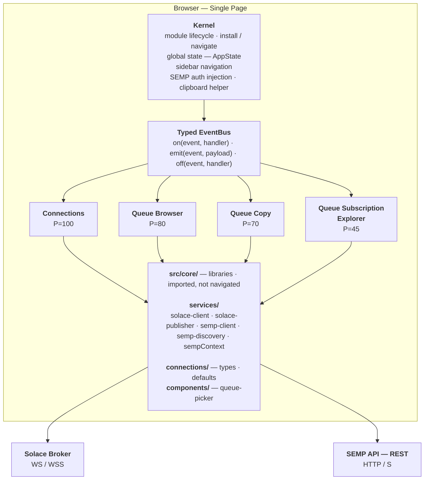
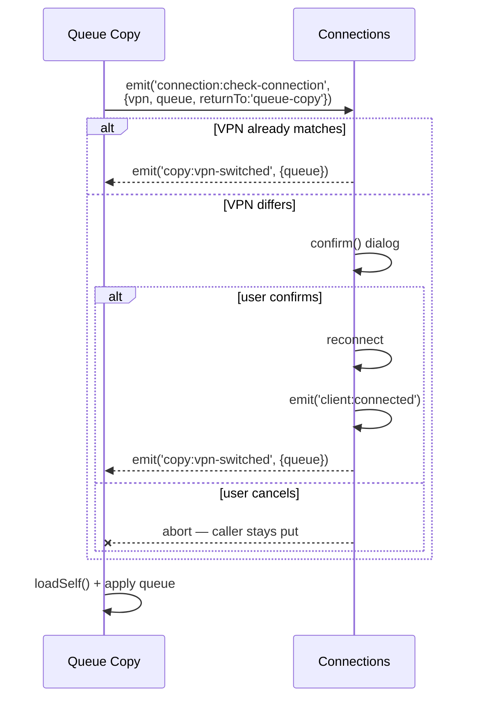
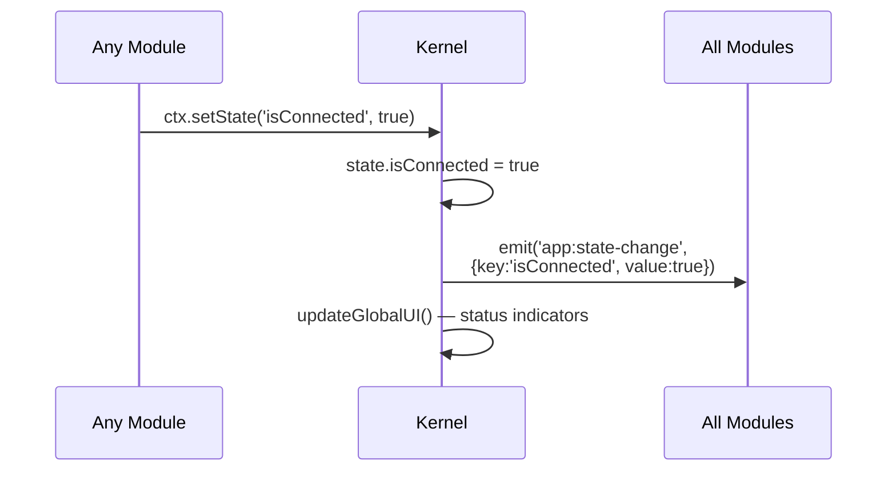
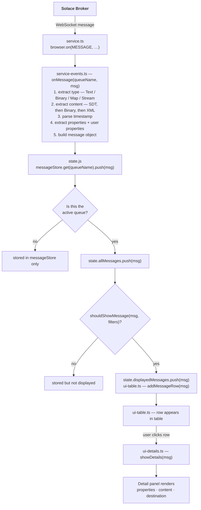
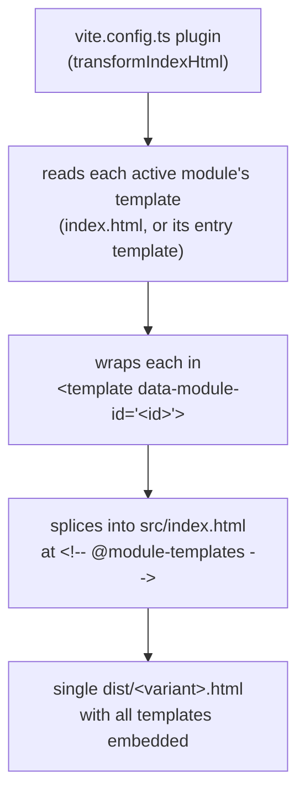

# Architecture

## Contents

- [System Overview](#system-overview)
  - [Publishing pipeline (`solace-publisher`)](#publishing-pipeline-solace-publisher)
  - [Hosted mode (gateway tunnelling)](#hosted-mode-gateway-tunnelling)
  - [Container image](#container-image)
- [Module Isolation](#module-isolation)
  - [Install-phase buffering (`hold` / `release`)](#install-phase-buffering-hold--release)
- [Cross-Module Event Flow](#cross-module-event-flow)
  - [VPN-switch handoff (Queue Copy / Queue Browser -> Connections)](#vpn-switch-handoff-queue-copy--queue-browser---connections)
  - [State Change Propagation](#state-change-propagation)
- [Dependency Injection](#dependency-injection)
- [Logging](#logging)
- [Queue Browser Internal Architecture](#queue-browser-internal-architecture)
  - [Circular Dependency Resolution](#circular-dependency-resolution)
- [Data Flow: Message Lifecycle](#data-flow-message-lifecycle)
- [SEMP v2 Paged Discovery (core library)](#semp-v2-paged-discovery-core-library)
  - [Service contract](#service-contract)
  - [Consumers: the `QueueSource` seam](#consumers-the-queuesource-seam)
  - [Demo mode](#demo-mode)
- [SEMP v1 Pagination (Queue Subscription Explorer)](#semp-v1-pagination-queue-subscription-explorer)
  - [Topic intersection filter](#topic-intersection-filter)
- [Queue Copy: Verify Flow & Broker Bug Workaround](#queue-copy-verify-flow--broker-bug-workaround)
  - [Two-call SEMP v1 workaround](#two-call-semp-v1-workaround)
  - [Access-type capture (gate for Copy and Move)](#access-type-capture-gate-for-copy-and-move)
  - [Run engine: two-phase model](#run-engine-two-phase-model)
- [DOM Template System](#dom-template-system)
  - [Module registration: variant manifests](#module-registration-variant-manifests)
  - [Build flavors vs variants](#build-flavors-vs-variants)
- [Provisioned Connections (RBAC)](#provisioned-connections-rbac)
  - [Connection modes](#connection-modes)
  - [The connections module: two entries, one owner](#the-connections-module-two-entries-one-owner)
  - [Managed profile (core-owned, names only)](#managed-profile-core-owned-names-only)
  - [RBAC state + matchers](#rbac-state--matchers)
  - [Kernel gating](#kernel-gating)
  - [Credential custody](#credential-custody)
  - [Enforcement points](#enforcement-points)
  - [Provisioned secondary connections](#provisioned-secondary-connections)
  - [The admin app (`/solAdmin`)](#the-admin-app-soladmin)
  - [The demo broker (`demo.html`, `provisioned-demo.html`)](#the-demo-broker-demohtml-provisioned-demohtml)
  - [Admin modules + the Go store](#admin-modules--the-go-store)
- [CSS Organization](#css-organization)
  - [Required-Element Invariant](#required-element-invariant)
- [Technology Decisions](#technology-decisions)

---

## System Overview



The broker-side service factories live in `src/core/services/` as **pure libraries** — they take lifecycle hooks (no AppContext, no UI, no global bus). The connections module (priority 100) is the *primary specialist*: `installDirect` in its `module.ts` (shared by both of its entry files) defines `solaceHooks` / `sempHooks` that bridge factory lifecycle events to global AppState + bus events that other modules consume. This pattern lets a future module (queue-copy) own a *secondary* connection by passing different hooks to the same factories — module symmetry, no cross-module imports.

### Publishing pipeline (`solace-publisher`)

`src/core/services/solace-publisher.ts` is the single home for the "clone an SDK message + force PERSISTENT delivery + stamp a `{ Solace_Msg_Utility_Seq_Num, Original_Msg_ID }` correlation key + send + await ACK/REJECT with a 30-s timeout" pipeline. The factory `createSolacePublisher(session, opts?)` returns `{ send(orig, dest, opts?), rejectAllPending(reason), dispose(reason?), isPending(key) }`. `send()` resolves with `{ ok: true } | { ok: false; error }` (never rejects) and also accepts optional `onAck` / `onReject` / `onTimeout` callbacks for fire-many-then-update-on-resolution patterns. ACK/REJECT listeners attach on construction; `dispose()` detaches them and resolves any in-flight publishes with the supplied reason — used by callers to surface user-friendly errors like `'Client disconnected.'` end-to-end without writing per-module sweep code.

Two callers today:

- **queue-browser** owns its publisher inside `service.ts`, lifecycle-managed via `client:connected` / `client:disconnected`. `forwardMessage` returns the publisher's `Promise<SendResult>`; `handleForwardSend` fires all sends concurrently and updates UI status from `.then` / `.catch`. `hasInFlightForward` delegates to `publisher.isPending` so the forward modal still detects UUID collisions across modal sessions.
- **queue-copy** stores `state.destPublisher` and `state.primaryPublisher` (one per Solace session), created in the corresponding hooks/bus subscribers. `service-copy.ts runCopyJob` picks `state.destPublisher ?? state.primaryPublisher` and awaits each `send()` sequentially.

Two publishers can coexist on the same session (e.g. queue-copy's sameVpn case, where the primary session also hosts the secondary publisher) — each maintains its own pending-key map, and the listener pair only resolves entries it owns. The publisher knows nothing about AppContext, bus events, or modules; modules know nothing about ACK correlation, timer management, or the property-copy chain. This is the same module-symmetry split as solace-client / semp-client.

### Hosted mode (gateway tunnelling)

The PWA can run standalone (talking directly to brokers) OR behind the Go gateway in `go-web-proxy/`, which serves the same bundle and also reverse-proxies SEMP HTTP and Solace WebSocket traffic. In the gateway deployment, the broker is internal and unreachable from the browser; every broker URL must be tunnelled through the gateway's path scheme `{pageOrigin}/{scheme}/{port}/{host}{urlPath}`, where `scheme ∈ { http, https, ws, wss }`.

The gateway's settings live in `config.yaml` ([go-web-proxy/configfile.go](../go-web-proxy/configfile.go)): on the first start the file is seeded from the environment and written (an unwritable path is fatal), afterwards it is authoritative and a differing env var is only reported. Two values stay environment-only by design, `CONFIG_FILE` and `STORE_KEY_FILE`, so the file can never redirect the gateway to another secret. The request pipeline is `accessLog(withClient(clientACL(root)))` ([access.go](../go-web-proxy/access.go)): `withClient` resolves the client address once (trusted proxies) for the access list and the sign-in throttle, and the access list runs on every route, inside the access log so a denial is recorded as a 403 like any other response; an empty allow list admits everyone. The file's keys are documented in [deployment.md](deployment.md).

**Live settings.** The keys an administrator can change without a restart (`connModes`, `defaultConn`, `logLevel`, `access.*`, `session.*`, `login.*`, `modules.*`) are not read from `config` after startup. `serve()` copies them into a `*live` ([live.go](../go-web-proxy/live.go)), an `atomic.Pointer` swapped as one value plus the logger's `slog.LevelVar`, and passes it to every reader: `withClient`, `clientACL`, `/hosted`, the bundle gate, the session table and the throttle each load the current value per request. The only writer is the settings endpoint ([settings.go](../go-web-proxy/settings.go)): `PUT /managed/settings` decodes into a copy of the saved file, runs the same `toConfig` and connection-mode checks as startup, refuses `connModes: direct` (it would end Provisioned mode, and the console with it, at the next restart, so that change is the host's), refuses a change to a path key (the `hostOnly` entries of `restartOnlyKeys`: `tls.certFile`, `tls.keyFile`, `tls.trustDir`, `usersFile`, `connectionsFile`, which only a hand edit changes, so the endpoint can never point the gateway at its own secrets), an access list that would deny the requesting client (`would_lock_out`) and a write over a hand edit (a fingerprint of the bytes it last read or wrote no longer matches, `config_changed_on_disk`; a file it cannot read is `config_unreadable`, not a hand edit), writes atomically, then swaps the live value. `restartOnlyKeys` lists the rest; `pendingRestart` compares the saved file with the running config. A new live key goes in `liveSettings` and `apply`; a reader must take it from `*live`, never from `config`.

The connections module probes the gateway-only `/hosted` endpoint at the very start of its `install(app)`. A 200 response carrying JSON `{hosted, connModes, defaultConn}` flips the singleton in `src/core/hosted.ts` **and** resolves the deployment's connection modes (see [Connection modes](#connection-modes)); a gateway older than that contract answers with the plaintext `'true'`, which is still accepted and means *hosted, Direct only*. Any other outcome (404 from a standalone deployment, unrecognised body, network error) leaves hosted mode off and the app Direct-only. The probe is awaited before any service factory is created so a Connect click can't race the flag.

`buildBrokerUrl(scheme, host, port, urlPath, isWebSocket)` in `src/core/hosted.ts` is the single rewrite point. In direct mode it returns the original `${scheme}://${host}:${port}${urlPath}` shape; in hosted mode it returns `${wireScheme}://${pageHost}/${scheme}/${port}/${host}${urlPath}`, with `wireScheme` upgraded to `wss`/`ws` for WebSocket (matching the page's https/http) and `https`/`http` for plain HTTP. Both `solace-client` and `semp-client` route through this builder, so every downstream URL (SEMP v2 fetches, SEMP v1 RPC via `deriveSempV1Url`, the queue-discovery paged fetches, queue-subscription-explorer's RPC POSTs, the queue-picker's caches) inherits the rewrite transparently — they all append paths onto the captured `sempCtx.baseUrl`.

Two related details:

- `deriveSempV1Url` strips path/query/fragment in direct mode (SEMP v1 lives at the broker root `/SEMP`, regardless of any user-supplied urlPath on v2) but preserves the gateway proxy prefix in hosted mode so the v1 POST still routes via the gateway.
- The wss TLS handshake probe in `solace-client.ts` is skipped in hosted mode. The browser only sees the gateway's TLS endpoint (already trusted by the PWA load); probing the internal broker would be wrong. Same reasoning suppresses the "click to trust this URL" help link in connection-error toasts.

`AppState.sempCredentials` carries the user-typed `protocol/host/port/urlPath` alongside the rewritten `baseUrl`, so UI code (queue-copy source/dest readout, modal summary) displays the broker the user reached for — not the gateway-prefixed wire URL.

### Container image

The image ([docker/Dockerfile](../docker/Dockerfile), whose header is the authoritative list) is `FROM scratch`: the gateway binary, the bundles it serves, and two directories baked empty, everything owned by UID `65532`, the user it runs as. Operator docs name only `/tls` and `/data`, the two mounts ([deployment.md -> Mounts](deployment.md#mounts)).

| Path | Holds |
| --- | --- |
| `/gateway` | The version-stamped gateway binary built from `go-web-proxy/`; the entrypoint, listening on `:9443`. |
| `/tls` | `tls.crt` and `tls.key` (generated self-signed on the first start when both are missing, so the directory ships writable) and `trust/`, the broker CAs (`*.crt`, `*.pem`). |
| `/data` | `config.yaml` in every mode; `users.yaml`, `connections.yaml` (both encrypted) and `store.key` in Provisioned mode. Baked empty so a named volume inherits the ownership. |
| `/SolaceMsgUtility` | `appRoot`, a fixed path: `index.html` (the Direct Release bundle), `provisioned.html`, `solAdmin.html`, `solclient.js`, `jszip.min.js`, and the vendor licences under `licenses/solclientjs/` and `licenses/jszip/`. Nothing else from `dist/` is copied in. |

**Which bundle is served.** `pwaHandler` ([proxy.go](../go-web-proxy/proxy.go)) serves `index.html` at `/` in Gateway mode and `provisioned.html` in Provisioned mode (`appIndexFile`), and the same bundle for any path without a file extension that is not a file (history-mode fallback); a missing asset with an extension stays a `404`. `solAdmin.html` is reached only through `/solAdmin`, behind the admin gate, and a request for `solAdmin.html` or `provisioned.html` by name gets `404`.

**Serving your own build.** Mount it over `/SolaceMsgUtility`, with the bundles the mode serves and both vendor scripts beside them; the mount may be read-only. The path is not configurable: the `APP_DIR` variable and `appDir` key of earlier releases are ignored. A `config.yaml` that still has `appDir` loads (`fileConfig.RemovedAppDir` keeps the strict decoder from refusing it), `removedInUse` names it and a set `APP_DIR` for a warning at start, and the gateway's next write of the file drops the key.

---

## Module Isolation

Modules have **zero cross-module imports**. Each module is a self-contained directory with its own service layer, UI management, and state. The only shared code is in `src/core/`.

```text
src/core/                          Shared infrastructure
  types.ts                         Interfaces only — no runtime code
  event-bus.ts                     Pub/sub factory
  kernel.ts                        Orchestrator (module lifecycle, state, navigation, SEMP auth)
  dom.ts                           `required()` helper — fail-fast required-element assertion
  utils.ts                         Pure utilities (escapeHtml, escapeXml, formatBytes, generateUuid, matchString,
                                   matchContains, topicsIntersect, topicFilterMatches, normalizeUrlPath, errMessage,
                                   isValidHost, isValidPort)
  icons.ts                         Shared inline SVG icons (ICONS) + iconButton() for labelled icon-only buttons
  download.ts                      downloadBlob(): save a Blob as a named file (queue-browser's downloads, backup's export)

src/modules/connections/                  Module -- primary connection setup: module.ts (Direct, every Release bundle), module.managed.ts (Direct + Provisioned tabs, provisioned.html)
src/modules/queue-browser/                Module — queue-browser session + message table
src/modules/queue-copy/                   Module — cross-broker queue copy
src/modules/queue-subscription-explorer/  Module — flat (vpn, queue, topic) table (SEMP v1)
src/modules/queue-discovery/              Module — vestigial; no shipping variant activates it
src/modules/admin-login/                  Module — /solAdmin entry point (admin variant only)
src/modules/user-management/              Module — admin-only user + entitlement CRUD (admin variant only)
src/modules/connection-management/        Module — admin-only broker-connection CRUD (admin variant only)

Install order + sidebar order are set in [src/registry.ts](../src/registry.ts) — each registry entry is a `{ module, priority }` tuple, so the entire ordering decision lives in one file.
```

There are no `*-mock` service siblings: the demo build (`vite build --mode demo`) runs these same modules against the in-browser broker -- see [The demo broker](#the-demo-broker-demohtml-provisioned-demohtml) and the **Build Modes** section in [CLAUDE.md](../CLAUDE.md).

All module coordination goes through the EventBus — every module publishes and subscribes through the single shared bus instance, with no direct module-to-module references.

### Install-phase buffering (`hold` / `release`)

Modules install in priority order, so an earlier module that emits during its `install()` could reach later-installing modules that haven't subscribed yet. The kernel wraps the install loop in `eventBus.hold()` / `eventBus.release()` — emits fired while held are queued FIFO and flushed (in order) once every module has finished install. Subscriptions made during install are honoured when the flush runs.

No module emits during install today (the currently live cross-module configs are propagated at user-action time — e.g. Connect — not at install time), so the buffer is a no-op in practice. It's retained as a capability: future initial-state events that need to reach later-priority modules can emit during install and rely on the FIFO flush. No `setTimeout`, no sticky-event semantics — just a single install-phase gate.

These methods are kernel-only. Modules never call `hold()`/`release()`.

---

## Cross-Module Event Flow

### VPN-switch handoff (Queue Copy / Queue Browser -> Connections)

A module that needs the primary connection on a specific VPN emits `connection:check-connection` with `{vpn, queue, returnTo}`. Connections either confirms it's already on that VPN (fires the finish event synchronously and the caller resumes) or prompts the user, reconnects, and fires the finish event once the new session is up. This is the same conditional-reconnect flow queue-copy and queue-browser both use when a picked queue lives in a different VPN than the current primary.

**Navigation contract — single source of truth.** The connections module navigates the user to its own screen **only when there is actual connection work to do**, and only at the moment the work is committed:

| Path | Navigates? |
| --- | --- |
| Auto-connect (not yet connected) | yes — before initiating connect |
| Already on the target VPN | no — nothing to do |
| VPN switch, user confirms | yes — *after* confirm |
| VPN switch, user cancels | no — caller stays put |

The `returnTo` field only selects which finish event fires (`browser:browse-queue` for `'queue-browser'` and the default, `copy:vpn-switched` for `'queue-copy'`) — it does **not** alter navigation. Future modules using this handshake inherit the policy automatically: pick a `returnTo`, add a finish-event branch in [connections/module.ts](../src/modules/connections/module.ts), don't reintroduce per-caller navigation differences. Tests in [tests/modules/connections/module.test.ts](../tests/modules/connections/module.test.ts) lock the four rows above in place.

**Why the picker does not own the confirm.** The reusable `pickQueue()` core component resolves a `{vpn, queue}` tuple and nothing more. Whether that VPN matches the consumer's "current" VPN (different concept across consumers — primary for queue-browser, destination form for queue-copy's dest picker) and whether to disrupt the primary session are app-layer decisions. Keeping them in the consumer + connections module lets the picker stay generic across all current and future callers.



### State Change Propagation



---

## Dependency Injection

The Kernel builds an `AppContext` for each module, injecting all shared services:

```text
                    Kernel
                      |
          +-----------+-----------+
          |           |           |
    AppContext A  AppContext B  AppContext C
    {                {                {
     container: A    container: B    container: C
     appState: *     appState: *     appState: *     <-- same reference
     eventBus: *     eventBus: *     eventBus: *     <-- same instance
     setState: fn    setState: fn    setState: fn    <-- bound to Kernel
     loadSelf: fn    loadSelf: fn    loadSelf: fn    <-- navigateTo(A/B/C)
     sempFetch: fn   sempFetch: fn   sempFetch: fn   <-- same function
     ...             ...             ...
    }                }                }
```

Each module gets its own `container` (isolated DOM subtree) and `loadSelf` (bound to its ID), but shares the same `appState`, `eventBus`, and helper functions.

---

## Logging

Every runtime log goes through the singleton `logger` in [src/core/logger.ts](../src/core/logger.ts) — a drop-in replacement for `console.*` with a level filter:

```ts
import { logger } from '../../core/logger';
logger.debug('[Module] fine-grained trace');
logger.info ('[Module] lifecycle event');
logger.warn ('[Module] recoverable mismatch');
logger.error('[Module] failure', err);
```

Levels (numeric severity, defined in [src/core/constants.ts](../src/core/constants.ts)): `DEBUG=0`, `INFO=1`, `WARN=2`, `ERROR=3`, `SILENT=4`. A call fires when the current level is `<=` the call's level; `SILENT` mutes everything.

The current level is module-scoped state, set once at boot in `Kernel.start()` from the `?logLevel=<NAME>` URL parameter (case-insensitive). Invalid values fall back to `DEFAULT_LOG_LEVEL` (`INFO`). The logger is **not** routed through `AppContext` — it's set-once boot configuration, not application state, and forcing every service factory to take a `logger` argument purely for delegation would be high churn for no reuse benefit.

Each `logger.*` method delegates to the matching `console.*` channel so DevTools severity filtering keeps working and existing test instrumentation (`vi.spyOn(console, 'warn')`) is unchanged.

Inside [src/core/services/solace-client.ts](../src/core/services/solace-client.ts), `connect()` registers a generic `logger.debug` listener for every value of `solace.SessionEventCode` (in addition to the typed handlers that drive the lifecycle hooks). This means the full Solace SDK event stream is observable with `?logLevel=DEBUG` without per-event wiring, and any new codes the SDK adds are picked up automatically.

The 10 raw `console.*` calls in [src/index.html](../src/index.html) (the inline `<script>` that loads `solclient.js` and `JSZip`) are intentionally not routed through the logger — they fire before any module imports complete.

---

## Queue Browser Internal Architecture

The largest module is decomposed into single-responsibility files:

```text
queue-browser/
  module.ts          Orchestrator — wires DOM events to handlers
       |
       +--- service.ts           Broker operations + publisher lifecycle
       |      createBrowser()       Create queue browser
       |      forwardMessage()      Delegate to core/services/solace-publisher
       |      hasInFlightForward()  Delegate to publisher.isPending
       |      deleteMessages()      Remove from queue + UI
       |
       +--- service-events.ts    Broker event callbacks
       |      onMessage()           Parse incoming messages
       |      onBrowserUp()         Queue connected
       |      onConnectFailed()     Connection error
       |      (ACK/REJECT handlers moved into core/services/solace-publisher)
       |
       +--- state.js             Local state (not shared via EventBus)
       |      messageStore          Map<queueName, Message[]>
       |      browserInstances      Map<queueName, QueueBrowser>
       |      shouldShowMessage()   Filter evaluation engine
       |
       +--- ui-core.js           DOM management
       |      initElements()        Cache all DOM references
       |      updateVisibility()    Show/hide based on connection state
       |      updateCounts()        Refresh Total/Displayed/Selected
       |
       +--- ui-events.ts         User action handlers
       |      handleBindClick()     Bind queue
       |      handleBulkForward()   Forward selected messages
       |      handleBulkDelete()    Delete selected messages
       |      applyFilters()        Apply filter criteria
       |
       +--- ui-table.ts          Table rendering
       |      renderList()          Full table re-render
       |      addMessageRow()       Append single row (real-time)
       |      downloadMessagesZip() ZIP export
       |
       +--- ui-details.ts        Detail panel
       |      showDetails()         Render message details
       |      addPropertyFilterRow() Dynamic filter rows
       |
       +--- ui-forward.js        Forward modal
       |      openForwardModal()    Prepare modal with messages
       |      updateForwardStatus() Update ACK/REJECT status
       |
       +--- constants.js         Module-scoped SVG icon strings (downloadContent, forward, delete, copy …)
```

Queue-browser's production `service.ts` runs unmodified in both real and demo builds. In the demo, its SDK calls reach the `window.solace` emulation installed by the demo broker, and publish-with-ACK (delegated to the core `solace-publisher`) round-trips through the broker's acknowledgement events -- see [The demo broker](#the-demo-broker-demohtml-provisioned-demohtml).

### Circular Dependency Resolution

`service-events.ts` needs `disconnectBrowser` from `service.ts`, but `service.ts` passes `serviceEvents` callbacks to the Solace SDK. This circular dependency is broken by the `wire()` pattern:

```text
module.ts (install):
  1. const serviceEvents = createServiceEvents();     // No deps yet
  2. const service = createService(app, serviceEvents); // Receives serviceEvents
  3. serviceEvents.wire({ disconnectBrowser: service.disconnectBrowser }); // Late binding
```

`onConnectFailed` throws `wire() not called before onConnectFailed` if step 3 was ever skipped — surfaces the missing-wiring regression at first failure instead of silently no-oping.

---

## Data Flow: Message Lifecycle



---

## SEMP v2 Paged Discovery (core library)

SEMPv2 monitor endpoints page their results — the `meta.paging.nextPageUri` field on a response carries an absolute URL for the next page. Brokers in production frequently host hundreds of VPNs/queues, so the discovery service streams pages instead of accumulating them.

### Service contract

The paged-fetch generator lives in **core** at `src/core/services/semp-discovery.ts` and is parameterized by a `SempContext` (a `{ fetch, baseUrl }` pair scoped to a specific broker). This decouples the pagination logic from any particular connection so a module can drive the same generator against a *primary* OR *secondary* broker by passing its own SempContext.

```ts
// src/core/services/semp-discovery.ts
export function createSempDiscovery(sempCtx: SempContext): {
    fetchVpns(maxCount?: number): AsyncGenerator<FetchPage>;
    fetchQueues(vpn: string, maxCount?: number): AsyncGenerator<FetchPage>;
};

type FetchPage = { ok: true; data: string[] } | { ok: false; error: string };
```

A primary `SempContext` is built via `unfilteredPrimarySempContext(ctx)` from `src/core/services/sempContext.ts` (named for what it does NOT do — see [Enforcement points](#enforcement-points)); secondary SempContexts (queue-copy's destination broker) are built directly from the secondary `createServiceSemp` factory's `onConnected` hook.

A shared `fetchPaged()` helper drives the pagination loop:

```text
while (url) {
    if (pageNum > 0) await sleep(PAGE_DELAY_MS);   // 370ms throttle between pages
    sempCtx.fetch(url) → yield { ok: true, data: [...] }
    url = json.meta?.paging?.nextPageUri || null
}
```

The first error terminates the stream — the generator yields `{ok: false, error}` and returns. Any pages already yielded remain valid for the caller. The throttle protects the broker from a burst of back-to-back requests when paging through hundreds of items.

### Consumers: the `QueueSource` seam

Discovery is a capability **of a connection**, owned by whoever owns that connection — never by the reusable consumer. Components receive a `QueueSource` (the discovery analog of `SempContext`) and call `listVpns()` / `listQueues(vpn)`; they never run their own SEMP discovery:

```ts
// src/core/services/queue-source.ts
export interface QueueSource {
    key: string;                                  // cache identity
    listVpns(): AsyncGenerator<FetchPage>;
    listQueues(vpn: string): AsyncGenerator<FetchPage>;
}
export type Scope  = 'browse' | 'operate';
export type Access = { session: ManagedSession; broker: string; scope: Scope } | 'unmanaged';

export function sempQueueSource(sempCtx: SempContext, access: Access): QueueSource;    // live SEMP, filtered by access
export function queueSourceFrom(ctx: AppContext, scope: Scope): QueueSource | null;   // primary
```

`queueSourceFrom(ctx, scope)` is the single place that branches managed-vs-direct. `scope` says what the list is FOR: `browse` filters by `isQueueVisible`, `operate` by `canOperate` — so a destination picker (copying into a queue is a write) cannot offer a queue the user may only read.

- **VPNs** — managed yields the **provisioned set** (`appState.managed.vpns`, published by the connections module from `/managed/me`) with no SEMP call; standard does live SEMP discovery. This is why the managed queue-picker lists exactly the VPNs the Connections dropdown shows, instead of every VPN a broad entitlement glob (`msgVpns: '*'`) would admit.
- **Queues** — always live SEMP (no provisioned queue inventory exists anywhere; RBAC specifies queue *globs*, applied by `filterSempFetch`). The asymmetry is in the *data*, not the handling — both are `QueueSource` methods.
- **`key`** — managed folds in the provisioned set + entitlement rows, so a permission/provisioning change (e.g. via Refresh) flips it and the picker's cache (keyed by `key`, not `baseUrl`) misses → re-reads. Standard uses the `baseUrl`.

The reusable [`pickQueue(source, opts?)`](../src/core/components/queue-picker/index.ts) component consumes a `QueueSource` with `for await`, accumulating + sorting + re-rendering after every yielded page:

```ts
for await (const page of source.listVpns()) {
    if (page.ok) {
        currentVpnList = [...currentVpnList, ...page.data].sort();
        renderOptions(vpnList, currentVpnList);   // incremental render
    } else {
        vpnInput.placeholder = page.error;
        return;
    }
}
```

The user sees results populate progressively rather than waiting for every page. queue-browser builds its source with `queueSourceFrom(ctx)`; queue-copy uses `queueSourceFrom(ctx)` for the source / same-broker destination and `sempQueueSource(state.destSempCtx)` for a different-broker destination. The picker behaves identically in every variant — the connection's source decides where the names come from, and the picker never calls SEMP itself.

### Demo mode

There is no discovery mock: the real `semp-discovery` runs in the demo against the demo broker's SEMP v2 interceptor, so the same generator and consumer code paths are exercised -- see [The demo broker](#the-demo-broker-demohtml-provisioned-demohtml).

---

## SEMP v1 Pagination (Queue Subscription Explorer)

Subscription listing uses SEMP **v1** — the `<rpc><show><queue><subscriptions/>` endpoint — not the v2 monitor REST API. The two pagination protocols differ:

| | SEMP v2 (core paged discovery) | SEMP v1 (queue-subscription-explorer) |
| --- | --- | --- |
| Transport | `GET /SEMP/v2/...?count=100` | `POST /SEMP` with raw `<rpc>` XML body |
| Continuation | `meta.paging.nextPageUri` (full URL) | `<more-cookie>` block with the next-page `<rpc>` body |
| Page-size knob | `count` query param | `<num-elements>` element |
| Auth | `Authorization` header (same as v2) | `Authorization` header (same as v2) |

Callers pass the literal path `'/SEMP'` to `sempCtx.fetch`; the kernel's `sempFetch` assembles the wire URL from `appState.sempCredentials` (via `normalizeUrlPath` + `buildBrokerUrl`) on every call, so the v1 RPC inherits hosted-mode routing exactly like a v2 request.

The subscription service (`src/modules/queue-subscription-explorer/service.ts`) follows the same async-generator shape as `createSempDiscovery` — same `{ ok, data | error }` envelope, same `PAGE_DELAY_MS = 370ms` throttle between pages — so the consumer code in `module.ts` looks structurally identical:

```ts
let body: string | null = INITIAL_BODY;       // <rpc>…<num-elements>100</num-elements>…</rpc>
while (body) {
    if (pageNum > 0) await sleep(PAGE_DELAY_MS);
    res = await sempCtx.fetch(url, { method: 'POST', headers, body });
    text = await res.text();
    parsed = parseSubscriptionsResponse(text);   // SubscriptionRow[] + nextPageBody
    yield { ok: true, data: parsed.page.rows };
    body = parsed.page.nextPageBody;             // null when broker has no more pages
}
```

The XML→`SubscriptionRow[]` parser is split into its own `parse.ts` module so the pure logic (queue/topic extraction, more-cookie inner-`<rpc>` serialization via `XMLSerializer`) is unit-testable without mocking `fetch`. Queues with zero topic subscriptions are intentionally omitted from the dataset — the user opted to drop them rather than render blank-subscription rows.

### Topic intersection filter

The Subscription column filter uses **`topicFilterMatches(filter, topic)`** — an intentionally *asymmetric* wrapper (the user's pattern is matched loosely; the broker-stored topic follows Solace's stricter wildcard rule), which normalizes onto the symmetric intersection primitive: both the user-typed pattern and the stored subscription may carry `*` (single-level) or `>` (multi-level trailing) wildcards, and the filter matches when the topic-sets overlap. The pure helper lives in core at `src/core/utils.ts` as `topicsIntersect(a, b)` so both sides are split on `/` and matched level-by-level — this is symmetric in `a` and `b` by design.

VPN and Queue column filters use a different rule (per user spec): plain substring match by default, escalating to anchored wildcard via `matchString()` when the input contains `*`. The shared `matchString` helper lives in `src/core/utils.ts`.

---

## Queue Copy: Verify Flow & Broker Bug Workaround

The queue-copy module's verify phase snapshots the source queue (count, oldest-msg-id, newest-msg-id, access-type) before the run phase begins. The snapshot is **immutable for the duration of the run**: the engine copies oldest → newest in one pass and stops. New arrivals after verify are explicitly out of scope. The newest-msg-id is the **hard stop boundary** for the copy engine; the access-type gates the modal's Move button when the source queue is read-only.

### Two-call SEMP v1 workaround

The broker SEMP v1 `show queue … detail` RPC has a bug (`soltr/10_25_0VMR`): `<info>/<newest-msg-id>` always returns `0`. The same bug surfaces in SEMP v2 as `highestMsgId`. To recover the real value, [`verifyViaSempV1`](../src/modules/queue-copy/service-verify.ts) issues a **second** SEMP v1 POST per verify call:

1. **Detail call** — `<rpc><show><queue><name>…</name><vpn-name>…</vpn-name><detail/></queue></show></rpc>` → populates count, size, quota, max-msg-size, oldest-msg-id from `<info>/*`. The `<newest-msg-id>` field is intentionally ignored (parse line commented out for traceability).
2. **Supplementary call** — `<rpc><show><queue><name>…</name><vpn-name>…</vpn-name><messages/><newest/><count/><num-elements>1</num-elements></queue></show></rpc>` → returns one spooled-message record; `result.newestMsgId` is taken from `spooled-messages/spooled-message/message-id`.

The supplementary call is best-effort: on non-2xx, parse error, fail execute-result, or non-numeric ID, `newestMsgId` stays `null` without failing verification. An empty queue legitimately yields `null`. The signal is checked between the two calls so Cancel-during-verify still aborts promptly.

The QueueBrowser-accumulate fallback (no-SEMP path) is unaffected — it tracks max(seenIds) directly from the browsed messages.

### Access-type capture (gate for Copy and Move)

Both verify paths populate `result.accessType: 'no-access' | 'read-only' | 'read-write' | null`:

- **SEMP path:** the existing detail RPC's `<info>/<others-permission>` value is parsed in `parseSempV1Response` via [`normalizeAccessType`](../src/modules/queue-copy/service-verify.ts). Format examples: `Read-Only (1000)`, `No-Access (1001)`, `Consume (1100)`, `Modify-Topic (1110)`, `Delete (1111)`. Match by prefix (the trailing `(NNNN)` is broker-version-dependent and ignored). Mapping: `No-Access*` → `'no-access'`; `Read-Only*` → `'read-only'`; `Consume*` / `Modify-Topic*` / `Delete*` → `'read-write'`. The SEMP RPC also returns `<info>/<owner>`, captured into `result.owner`.
- **QueueBrowser fallback:** the temp browser's `_messageConsumer._permissions` (same SDK property queue-browser reads) is captured on UP and normalized. SDK returns `'READ_ONLY'` or `'READ_WRITE'`. The SDK has already evaluated the user's effective access from the client's perspective — owner status is baked in — so `result.owner` is left null and the gate trusts `accessType` directly.

**Modal owner override (SEMP path only).** SEMP queue metadata reports `<owner>` and `<others-permission>` independently — the broker's actual access-control rule "owners have full access regardless of others-permission" is the application's responsibility to apply. After `verifySource` returns, `runVerify` in [`ui-modal.ts`](../src/modules/queue-copy/ui-modal.ts) performs a **case-sensitive strict equals** between `result.owner` and `clientUser` (from `ctx.appState.solaceConnection?.user`, defaulting to `''`). On match: lift `result.accessType` to `'read-write'`. On mismatch: fall through to the others-permission gate downstream. The only guard is `result.owner !== null` — null means SEMP didn't surface owner (element missing) or the path was QB-fallback (where owner is not extracted because the SDK's `_permissions` already factored it in). Empty owner is a legitimate value (server-created queue) and is compared with strict equals like any other string.

**Gate matrix.** `evaluateStartGate`:

| `accessType` | `mode === 'copy'` | `mode === 'move'` |
| --- | --- | --- |
| `'no-access'` | blocked (no-access banner) | blocked (no-access banner) |
| `'read-only'` | enabled | blocked (read-only banner) |
| `'read-write'` | enabled | enabled |
| `null` | enabled (permissive — let broker enforce) | enabled |

Move requires consume-or-higher because it deletes from the source after publishing to the destination. The engine itself contains no permission check; gating is entirely a verify-phase + modal concern.

### Run engine: two-phase model

The copy engine separates **stop detection** (Phase 1) from **outcome evaluation** (Phase 2). MESSAGE handlers, the idle timer, browser-event handlers, and the cancel-check together set a single first-wins `stopReason` and call `browser.stop()`; in-flight publishes settle naturally (cancel rejects them via `publisher.rejectAllPending`). Once `inFlight` drains to zero, `evaluateAndFinish` consumes the `stopReason` plus `cancelRequested` and produces a `status` of `'completed' | 'cancelled' | 'error'`, calling `onComplete` exactly once.

Stop reasons: `cancel`, `source-drift` (first msg id ≠ recorded oldest), `max-consumed` (msg id > recorded newest AND we never saw the recorded newest — see below), `reached-max` (processed the recorded newest), `idle` ([`IDLE_TIMEOUT_MS`](../src/modules/queue-copy/constants.ts) = 30 s with no MESSAGE), `publish-error`, `browser-error`. `reached-max` and `idle` produce `completed` only when `copied === total` — otherwise `error` with a count-mismatch message. Cancel always upgrades the final classification.

All five tunable knobs (`IDLE_TIMEOUT_MS`, `PUBLISH_CONCURRENCY_HIGH=20`, `PUBLISH_CONCURRENCY_LOW=10`, `BIND_PROBE_TIMEOUT_MS`, `ACCUMULATE_IDLE_MS`) live in [`queue-copy/constants.ts`](../src/modules/queue-copy/constants.ts) — single source of truth, motivated by an earlier 30s/60s drift between `service-copy.ts` and the since-deleted `service-copy-mock.ts`. `service-copy.ts` / `service-verify.ts` re-export them via barrel lines for existing test imports.

**`msgId > maxMsgId` is disambiguated by a `seenMaxMsgId` flag, not blindly fatal.** Same-broker copy/move creates a feedback loop: our own published clones land back on the source queue and may be re-delivered as MESSAGE events while the originals' ACKs are still in flight. To distinguish "benign clone" from "the recorded max was consumed externally", the engine sets `seenMaxMsgId = true` synchronously (before the publish await) when a MESSAGE matches the recorded max. The pre-process gate then branches:

- `msgId > maxMsgId` AND `seenMaxMsgId === true` → silent drop. The maxMsgId message is somewhere in our in-flight set, and the post-process gate will end the run when its ACK lands.
- `msgId > maxMsgId` AND `seenMaxMsgId === false` → `triggerStop('max-consumed')`. Solace delivers QB messages in spool-ID order, so a strictly-greater id without ever having seen the recorded max means the max is gone from the queue.

**Phase 1 calls `browser.disconnect()`, not `browser.stop()`.** Disconnect is permanent — no further MESSAGE events can be delivered, even speculatively, while Phase 2 waits for in-flight publishes to settle. This is the cut that prevents same-queue clones from racing the ACK drain.

**Backpressure: source browser pauses at `PUBLISH_CONCURRENCY_HIGH`, resumes at `PUBLISH_CONCURRENCY_LOW`.** The Solace SDK enforces a per-session publish window (default ~50 unACK'd messages); exceeding it makes the next `session.send` return "Guaranteed Message Window Closed". To stay safely under the broker limit even with messages already buffered in the SDK transport window, the engine calls `browser.stop()` when in-flight reaches HIGH and `browser.start()` when it drops to LOW. Hysteresis between the two prevents flapping. Pause is reversible (the SDK's transport buffer holds undelivered messages and re-flushes them on `start()`); separate from the permanent `disconnect()` used by `triggerStop`.

**The idle timer is suspended for the duration of a pause.** Idle's semantics is "no MESSAGE arrived in `IDLE_TIMEOUT_MS`" — but during pause no MESSAGE *can* arrive, because we asked the broker to stop sending them. Leaving the timer armed would erroneously fire `'idle'` whenever the pause exceeds the timeout while in-flight publishes are still settling. So when pausing: `clearTimeout(idleTimer); idleTimer = null`. When resuming: `resetIdleTimer()`. The `finally` block's idle-reset is gated on `!browserPaused` so ACKs landing during pause don't re-arm the suspended timer.

A late cancel detected during pause triggers stop on the next ACK landing — no need to wait for the idle timer.

**In-flight publishes that ACK after a stop still count toward `copied`.** When a stop fires (e.g. `max-consumed` because a brand-new msg arrived after the recorded max was consumed externally), publishes that were already in flight to the destination continue to settle. Their successful ACKs increment `copied` — the messages truly made it, so the user-facing count must reflect that. Phase 2's `copied` vs `total` comparison then produces the right outcome (`error` with "Sent N of M expected" rather than the misleading "Sent 0 of M"). For move mode, the per-message `removeMessageFromQueue` is skipped when the source browser is already disconnected, so the source-queue copy of a successful publish remains and will be re-delivered to the next consumer (best-effort: we'd rather leave a duplicate than lose a message). Only failed in-flight publishes (e.g. `publisher.rejectAllPending` resolutions on cancel) are skipped — and only the FIRST publish failure escalates to `publish-error` (subsequent failures land with `stopReason` already set and are no-ops).

In move mode, `browser.removeMessageFromQueue(msg)` is called per message immediately after that message's publish ACK lands — never batched.

---

## DOM Template System

Each module owns its own `index.html` next to its code:

```text
src/modules/<id>/index.html   ← canonical per-module HTML
src/modules/<id>/module.ts
src/modules/<id>/...
```

The repo-root `index.html` is a generic PWA shell — sidebar, header, `#module-container`, status bar — and contains a single marker comment where module templates get injected at build time:

```html
<!-- index.html (repo root) — shell only -->
<div id="module-container"></div>
...
<!-- @module-templates -->
```

The `inject-module-templates` Vite plugin in `vite.config.ts` reads each active module's template at build time, wraps each in `<template data-module-id="<id>">...</template>`, and replaces the `@module-templates` marker with the concatenated blocks. Only the active variant's modules are injected, so the output single-file bundle has exactly those templates inline, ready for the Kernel to find at startup. A module's template is its `index.html`, unless the variant maps it to an entry (`MODULE_ENTRIES`, below): then `index.<entry>.html` is used, with the base `index.html` spliced in at its `<!-- @module-base -->` marker. Composition lives in `readModuleTemplate` ([scripts/module-registry-plugin.mjs](../scripts/module-registry-plugin.mjs)), which the tests' `loadModuleDOM(id, entry?)` also calls, so a test DOM is exactly the shipped one.



At startup, the Kernel:

1. Finds `<template data-module-id="X">` for each module
2. Creates a wrapper `<div id="module-view-X" class="module-view hidden">`
3. Clones the template content into the wrapper
4. Passes the wrapper as `container` in AppContext
5. Calls `module.install(ctx)`

Navigation toggles the `.hidden` class on module wrappers — no routing, no page reloads.

**Editing rule:** Module HTML changes go in `src/modules/<id>/index.html` only. Don't edit the shell `src/index.html` for module markup — those edits won't survive the next build (the marker gets re-expanded). The shell itself (sidebar layout, header, status bar) stays in `src/index.html`.

### Module registration: variant manifests

Active modules are listed in **variant manifest** files under [src/variants/](../src/variants/). Each manifest is a small file exporting `ACTIVE_MODULES: Record<string, number>` — id → priority. To disable a module in a variant, comment one line. To enable, uncomment. To create a new module, drop `src/modules/<id>/{module.ts, index.html}` and add a line to the variant. No second list to maintain. A manifest may also export `MODULE_ENTRIES: Record<string, string>` (id → entry name) to install a different entry file for a module: `{ connections: 'managed' }` installs `src/modules/connections/module.managed.ts` with `index.managed.html`. The module keeps its id and sidebar entry; only the file changes. An override for an id the manifest does not list fails the build.

```ts
// src/variants/standard.ts — every module the default build ships
export const ACTIVE_MODULES: Record<string, number> = {
    'connections':                 100,
    'queue-browser':                80,
    'queue-copy':                   70,
    'queue-subscription-explorer':  45,
};

// src/variants/min.ts — minimal: connections + queue-browser only
export const ACTIVE_MODULES: Record<string, number> = {
    'connections':                 100,
    'queue-browser':                80,
};

// src/variants/managed.ts -- the bundle served in Provisioned mode (dist/provisioned.html):
// standard's modules, with connections on its managed entry
export const ACTIVE_MODULES = { 'connections': 100, 'queue-browser': 80, 'queue-copy': 70, 'queue-subscription-explorer': 45 };
export const MODULE_ENTRIES = { 'connections': 'managed' };

// src/variants/admin.ts — the standalone /solAdmin app (no messaging modules)
export const ACTIVE_MODULES: Record<string, number> = {
    'admin-login':                 100,
    'user-management':              20,    // admin-only (gated by isModuleVisible)
    'connection-management':        15,    // admin-only
    'gateway-settings':             10,    // admin-only: config.yaml
    'backup':                        5,    // admin-only: export, import, scheduled backups
};
```

[src/variants/_active.ts](../src/variants/_active.ts) is a one-line re-export from one variant (default `./standard`). The registry imports `ACTIVE_MODULES` from `_active`, so the registry never changes when variants do. To ship a different variant, build with `node scripts/vite-build.mjs --variant=<name> --out-filename=<name>` -- the wrapper exists because Vite's CLI parser rejects unknown options, and passes both flags to `vite.config.ts` as private env vars. The variant drives `vite.config.ts`'s variant-redirect resolver (which rewrites `_active` to the chosen variant file), the module registry and the template injection. Do not edit the re-export instead: with no `--variant`, the registry plugin falls back to `standard` regardless of what `_active` points at.

A module directory may exist on disk but not appear in any variant (e.g. [`src/modules/queue-discovery/`](../src/modules/queue-discovery/)). Neither its `<template>` block nor its code is emitted: the `inject-module-templates` plugin and the **module registry** both work from the active variant's manifest only (see below), so the kernel never installs it. This is the intentional "carry the code, ship the bundle without it" shape — stronger than tree-shaking, because the unlisted module's `module.ts` is never imported.

**Manifest-driven registry (manifest is authoritative for bundling, not just activation).** [src/registry.ts](../src/registry.ts) reads `ACTIVE_MODULES` from `_active` for the id->priority map and resolves each id to its `PwaModule` via `moduleFiles` from the **`virtual:module-registry`** module. That virtual module is generated per build by the `moduleRegistryPlugin` ([scripts/module-registry-plugin.mjs](../scripts/module-registry-plugin.mjs)) -- it reads the active `src/variants/<name>.ts`, then emits literal `import * as` statements for **exactly** the listed ids (each id's `module.ts`, or `module.<entry>.ts` under `MODULE_ENTRIES`), keyed by module id. So a module absent from the active variant is never imported and never reaches the bundle, and neither is the entry file a variant does not select. For the one split that matters today, the build proves it on the output: `npm run check:bundles` ([scripts/check-bundles.mjs](../scripts/check-bundles.mjs), run by the `build` task) fails if any Release bundle carries a managed-UI marker, or if `provisioned.html` lacks one. If a manifest lists an id with no matching entry file, the plugin fails the build; if an entry file's exported `.id` doesn't match its directory, the registry throws a clear error -- boot fails fast. (vitest registers the same plugin so tests resolve `virtual:module-registry`, defaulting to the `standard` variant.)

The `inject-module-templates` Vite plugin takes the active variant's module ids and entries (from the same manifest as the registry) and injects each one's template as a `<template data-module-id="<id>">...</template>` block, so a non-active module's markup never reaches the shipped HTML. A module in the active variant with no template on disk is skipped by the plugin and surfaces a kernel console error at startup.

**To add a new module**: create `src/modules/<id>/` with `module.ts` and `index.html`, then add a line to whichever variant should ship it. The build plugin and the registry pick it up automatically.

**To ship a build variant**: drop a new `src/variants/<name>.ts` listing the desired subset, then `node scripts/vite-build.mjs --variant=<name> --out-filename=<name>.html` (and add it to the `build` npm script if every release should carry it; a bundle the Release uploads must also join `RELEASE_BUNDLES` in `scripts/check-bundles.mjs` -- through `DIRECT_BUNDLES`, which must carry no Provisioned UI, unless it is the Provisioned demo -- and the `release` step of `tag.yml`, which a test keeps equal). The dev server takes a variant the same way: `__VITE_VARIANT=managed npm run dev` serves the managed bundle.

### Build flavors vs variants

A **variant** decides *which modules* ship (the `ACTIVE_MODULES` manifest). A **flavor** decides *how a module behaves* at build time, via a build-time feature flag — orthogonal to the variant. The two compose: any variant can be built in any flavor.

The first flavor is the queue-browser **no-payload** build. [src/modules/queue-browser/features.ts](../src/modules/queue-browser/features.ts) exports `showPayload()`, which reads `import.meta.env.VITE_SHOW_PAYLOAD` (default `'true'`). The flag is module-local -- only queue-browser consumes it, and "payload" is a queue-browser concept (cross-module RBAC gating is a separate mechanism -- see [Provisioned Connections](#provisioned-connections-rbac)). When `VITE_SHOW_PAYLOAD='false'`:

- **The body is never decoded onto state.** `service-events.onMessage` skips the SDT/binary/XML decode and never sets `content` on the stored message object, so the payload is completely inaccessible through app state. The raw SDK message (`_originalMsg`) is retained only because Forward/Delete need it.
- **Payload DOM is removed at install.** Every payload-bearing element in [index.html](../src/modules/queue-browser/index.html) carries a `data-payload` attribute (the single source of truth for "what is payload"); `module.ts` removes `[data-payload]` nodes up-front, and the `required()` assertion list is conditional so the removed elements aren't asserted. Removed: Content Preview, Copy Content, Show Raw + Raw modal, Download Content, Download Full, and the Body-Content filter. **Kept**: Forward, Delete, all metadata, and every other filter.
- **The build plumbs the flag** through `scripts/vite-build.mjs` (`--show-payload=false` → `__VITE_SHOW_PAYLOAD`) into a `vite.config.ts` `define` of `import.meta.env.VITE_SHOW_PAYLOAD`. Because `showPayload()` then folds to a constant, Rollup dead-code-eliminates the payload branches from `dist/no-payload.html` (the inert `data-payload` markup stays in the injected `<template>`, but the live nodes are removed at install and the decode/wiring JS is gone). Emitted by `npm run build:no-payload`.

---

## Provisioned Connections (RBAC)

**Provisioned** is a connection *mode* that only one product bundle carries. Every Direct Release bundle installs the Direct-only connections entry; the login-gated (**Provisioned**) path ships in `dist/provisioned.html` (the `managed` variant -- internal names keep "managed": the variant, [module.managed.ts](../src/modules/connections/module.managed.ts), the `/managed/*` API, `managedProfile`), which the gateway serves at `/` in Provisioned mode, and in the offline `provisioned-demo.html` (against a fake gateway, see The demo broker). Within that bundle, which of the two modes the app offers is resolved at runtime from the gateway. Provisioned mode abstracts broker credentials away from the user: they sign in with an app account, and the deployment holds the broker credentials and grants each account a scoped set of brokers, VPNs and queues. It runs only behind the [go-web-proxy](../go-web-proxy), with `connModes` `provisioned` or `both` (and `hosted` true, the default). The user-facing design, locked decisions, and **threat model** live in [rbac-variant-plan.md](rbac-variant-plan.md); operations in [deployment.md](deployment.md). This section is the *how*.

On the gateway side there is **one binary and one image** for every container mode. `main.go` reaches the store and the `/managed/*` handler through `newManagedRouting`, which builds them only when the `connModes` at startup offers Provisioned sign-in (`config.provisioned()`); in Gateway mode it returns nil and `/managed/*`, `/login` and `/solAdmin` are 404s. The image ships both app bundles, and `appIndexFile` picks the one served at `/`: `index.html` (Direct only) in Gateway mode, `provisioned.html` in Provisioned mode; neither file, nor `solAdmin.html`, is served by its own name.

Enforcement is **proxy connection-gating + client guardrails**: the proxy returns only the connections a user is entitled to (plus per-queue permission globs); the client filters discovery and guardrails the UI. The broker relay itself stays ungated, so the client guardrails are UX, not a security boundary.

### Connection modes

[src/core/connections/conn-modes.ts](../src/core/connections/conn-modes.ts) holds a single enum, `connModes: 'direct' | 'provisioned' | 'both'`, plus `defaultConn` (which tab opens first when both are offered). `resolveConnTabs(cfg)` turns it into the ordered tab list -- never empty, so a "no connection UI at all" state is structurally impossible.

The config reaches the app through the gateway probe only:

- **No `/hosted`** (static file, any web server, `dist/index.html` opened from disk) => `DEFAULT_CONN_CONFIG` => **Direct only**. Provisioned can never appear without a gateway, because without one there is nothing to authenticate against.
- **Hosted** ⇒ the gateway reads `connModes` / `defaultConn` from its `config.yaml` (seeded from `CONN_MODES` / `DEFAULT_CONN` on the first start) and returns them in the `/hosted` JSON (`{hosted, connModes, defaultConn}`); [core/hosted.ts](../src/core/hosted.ts)'s `probeDeployment` applies it over the default. A gateway older than this contract answers with the plaintext `true`, which is still accepted and means *hosted, Direct only*. `coerceConnConfig` never throws — a malformed response degrades to Direct only.
- The gateway **refuses to start** when `connModes` offers Provisioned sign-in with `hosted: false` (`validateConnModes`, run on the loaded file and before the file is first written), so a half-configured deployment fails at boot rather than showing a tab that cannot work.

The resolved config is published once to `AppState.connConfig` by the connections module, so no other module probes the gateway again. `resolveDestCredModes(cfg)` derives what a **secondary** connection may offer from the very same enum (`direct` => manual only, `provisioned` => provisioned only, `both` => both) -- one source of truth, so the primary's tabs and the secondary's credential sources cannot drift apart.

### The connections module: two entries, one owner

[src/modules/connections/](../src/modules/connections/) owns the primary connection in both modes, through two entry files with the same id and sidebar entry:

- [module.ts](../src/modules/connections/module.ts) is the Release entry. It exports `installDirect(app, { onBeforeConnect? })` -- the Direct form (`ui.js` / `config.js`), its factory pair bridged to global state, and the Direct VPN-switch dance -- and installs it alone. It publishes a Direct-only `connConfig` whatever `/hosted` advertises (warning when the gateway offers Provisioned sign-in), so no module offers a provisioned mode this bundle cannot back.
- [module.managed.ts](../src/modules/connections/module.managed.ts) is the managed entry. It renders the Direct / Provisioned tab bar, calls the same `installDirect`, then builds [managed-panel.ts](../src/modules/connections/managed-panel.ts) (which uses the `/managed/*` client in [core/services/managed-service.ts](../src/core/services/managed-service.ts)). Its template `index.managed.html` wraps the shared Direct markup in the Direct tab panel.

Both modes drive the *same* pure core factories and produce the same AppState writes and bus emits — the module is still the one place that bridges factory hooks to global state (Anchor #4).

Three consequences of running both modes in the managed entry are load-bearing:

- **Mode interlock.** Only one mode may be live. Connecting on Provisioned tears down a Direct session (`direct.disconnect()`); connecting on Direct clears `appState.managed` (the entry's `onBeforeConnect`). Without this, RBAC -- which keys entirely off that field -- would keep filtering a session it knows nothing about. Switching *tabs* is non-destructive; teardown happens at connect time.
- **Single cross-module router.** In the managed entry, `connection:check-connection` and `connection:edit-requested` route to the Provisioned panel when `appState.managed` is set, else run the Direct form's VPN-switch dance. The Release entry routes both to the Direct form and registers no `rbac:sign-out-requested` listener, since no Provisioned session can exist there. Callers stay mode-agnostic. `rbac:sign-out-requested` is routed the same way, to the Provisioned panel's logout (the Direct-connect interlock's teardown), and is a no-op without a Provisioned session.
- **The Provisioned tab is offered only when the deployment offers it** -- tab visibility *is* the availability signal, which is why the old "Deployment Gateway Required" gate card was removed.

**The gateway owns the session.** Users sign in on the gateway's own page (`/login`, a form with no script); the gateway checks the password against a slow per-user hash, throttles guessing, and sets an `HttpOnly` `SameSite=Lax` session cookie (go-web-proxy: `pages.go`, `session.go`, `throttle.go`, `password.go`). The bundle never sees a password or a credential for the gateway. At install the Provisioned panel calls `GET /managed/me` (`restore()`): a live session's profile goes to the managed profile (below), `appState.managed` is published and the Provisioned tab opens; `401` leaves the signed-out view, whose **Sign in** button is a plain link to `/login`; `403 password_change_required` points it at `/login/password`. Because the cookie survives a page reload, so does the session. **Refresh** re-reads `/managed/me`; a `401` there means the gateway ended the session (idle or absolute limit, or an admin changed the account) and the panel drops its local state to match. **Sign out** calls `POST /managed/logout` and clears local state. All `/managed/*` calls go through [managed-api.ts](../src/core/services/managed-api.ts) (`managedRequest`, which never rejects, and `managedErrorMessage`, which maps the gateway's JSON error codes to text). A Provisioned session reaches brokers only through the gateway: SEMP through its relay and SMF through its socket gate, both behind the session (see Credential custody below); under `CONN_MODES=managed` the Direct relay answers `404`.

### Managed profile (core-owned, names only)

`/managed/me` names the user's brokers and Message VPNs and nothing else: no address, port, username or password. [src/core/services/managed-profile.ts](../src/core/services/managed-profile.ts) holds that profile; the kernel creates one per app and passes it on every `AppContext` as `managedProfile`, so it is injected, never global (Anchor #2). The managed entry attaches the gateway calls (`attachDialer`, from `createManagedService`), which keeps the `/managed/*` endpoint paths out of every bundle without the Provisioned UI (`check:bundles`).

```ts
interface ManagedProfileStore {
  setProfile(p: ManagedProfile): void;
  clear(): void;
  attachDialer(d: ManagedDialer): void;      // { dial(broker, vpn), relayBase(broker) }
  isActive(): boolean;
  brokers(): string[];                       // names only
  vpnsFor(broker: string): string[];
  dial(t: SolaceTarget, cb: { connect(c: SolaceDial): void | Promise<void> }): Promise<void>;
  dial(t: SempTarget,   cb: { connect(c: SempDial):   void | Promise<void> }): Promise<void>;
}
```

The **dial interface** is what makes this shareable. A caller names a *target* (`{broker, vpn, kind:'solace'}` or `{broker, kind:'semp'}`) and supplies a callback; the profile checks the target against the provisioned set and invokes the callback with a ready config:

- **SEMP** needs no credential in the browser at all: the callback gets `{cfg, broker}` whose `cfg.relayBase` is `/managed/relay/{broker}`. `semp-client.ts` and the kernel's `sempFetch` then send every request there with no `Authorization` header (`credentials: 'same-origin'`), and the gateway adds the broker's stored SEMP account.
- **Solace (SMF)** must log in from the SDK, so the profile calls `POST /managed/dial` and hands the callback `{cfg, broker, pass, clientName}`: `cfg.smfPath` is the gateway's socket path, which `solace-client.ts` opens as `wss://{page host}{smfPath}` (`gatewayWsUrl`), and `pass` is the VPN's client password. The callback passes it straight to the SDK; nothing keeps it, so `AppState.solaceConnection.pass` is `''` and a reconnect (a VPN switch) dials again.

An inactive session or an unprovisioned target is refused before any gateway call (`Broker "x" is not provisioned for this account.`); a refused dial rejects with the gateway's code as text, and `isSessionEnded(e)` tells the caller when that code means the gateway session ended, so the session owner signs out. A dial answered after a sign-out never reaches the callback, and a socket path outside `/managed/smf/` is refused. `dial` is **overloaded on target kind**, so a Solace target requires a `vpn` and a SEMP target cannot supply one. Because the profile composes the connection identity, the `clientName` always matches the `clientNameId` inside the config it hands over.

### RBAC state + matchers

One optional field is added to `AppState` ([src/core/types.ts](../src/core/types.ts)): `managed?: ManagedSession | null`. `null`/absent ⇒ allow-all (every Direct session), so the helpers below are safe to call unconditionally.

```ts
interface ManagedSession {
  admin: boolean;      // gates the admin-only modules
  username: string;    // to recognise a change to the session's own account; not a credential
  broker: string;      // connected broker NAME — the `broker` arg to matchers
  vpns: string[];      // PROVISIONED VPN names for that broker (names only)
  operate: QGlob[];    // queues the user may browse + delete on (operate ⊇ read-only)
  readOnly: QGlob[];   // queues the user may only browse
}
```

**Matcher inputs only.** The provisioned names live in the profile above, and no broker credential exists in the browser for a Provisioned session (`AppState.sempCredentials` carries the relay base with blank `user`/`pass`); the gateway session is an `HttpOnly` cookie script cannot read. Nothing that could dial a broker or call the gateway ever enters `AppState`.

[src/core/rbac.ts](../src/core/rbac.ts) holds **stateless, case-sensitive** matchers — `matchGlob(pattern, value)` (multi / leading / middle / trailing `*`), `isModuleVisible(s, id)`, `isVpnVisible(s, broker, vpn)`, `isQueueVisible(s, broker, vpn, queue)` (union of operate + read-only), and `canOperate(s, broker, vpn, queue)` (operate only). `explainAccess(rows, broker, vpn, queue)` reports which of those a set of rows grants (`operate` / `read-only` / `vpn-only` / `none`) and the row that grants it, built on the same row predicates so it cannot disagree with them; the admin app's User Management **Permission test** card (`src/modules/user-management/access-test.ts`) renders it. List search in the admin editors uses `matchContains` from `utils.ts` instead (contains, case-insensitive, `*` = any run) -- a screen filter that grants nothing. The same glob/entitlement logic is mirrored in the proxy's `rbac.go`, pinned by a shared TS↔Go conformance vector.

Module visibility is a **requirement map**, `MODULE_REQUIREMENTS: Record<string, 'admin' | 'unfiltered-semp'>`:

| Requirement | Modules | Rule |
| --- | --- | --- |
| `admin` | `user-management`, `connection-management`, `gateway-settings`, `backup` | visible only when `session.admin` |
| `unfiltered-semp` | `queue-discovery` | visible when there is **no** Provisioned session; hidden in **every** Provisioned session, admin included |

`unfiltered-semp` exists for a module that reads over **SEMP v1 RPC**, which the discovery filter deliberately never rewrites (below), with nothing else filtering its rows -- its listing would be entirely unfiltered under RBAC, so it is hidden. `queue-subscription-explorer` also reads over v1 RPC (one broker-wide `<show><queue>...<subscriptions/>` paged by `<more-cookie>`), but in a Provisioned session its service passes each page through `visibleQueueRows(managed, rows)` ([managed-semp-filter.ts](../src/core/managed-semp-filter.ts)): a row stays when its VPN is one of the provisioned VPNs (`isListedVpn`, the rule the VPN-list filter uses) and its queue passes `isQueueVisible`. So it is under module control like Queue Browser and Queue Copy. The broker's whole subscription list still reaches the browser; like the queue lists, this is an app-side guardrail, not a gateway boundary.

A module absent from the map is under **module control**: in a Provisioned session it is visible only if it is in `session.modules`, except the sign-in surfaces (`connections`, `admin-login`), which are always visible. `session.modules` comes from `/managed/me`: the user's own `modules` list in `users.yaml`, or `config.yaml`'s `modules.userDefault`, always cut down to `modules.offered`. The gateway grants only ids in `moduleCatalog()` ([configfile.go](../go-web-proxy/configfile.go)) -- `queue-browser`, `queue-copy`, `queue-subscription-explorer` -- which leaves the `unfiltered-semp` modules out, so they stay hidden twice over. A fresh `config.yaml` offers the whole catalog; one written before a module joined the catalog keeps its own `modules.offered` until an administrator adds it. [tests/variants.test.ts](../tests/variants.test.ts) checks that the catalog equals the managed variant's module-controlled modules: a module added to the `managed` variant must be added to `moduleCatalog()` too, or no signed-in user can ever see it.

### Kernel gating

`renderSidebar()` filters entries through `isModuleVisible(state.managed, id)` and re-applies `.active` after rebuilding; first-module activation skips hidden modules. The kernel subscribes once to the `rbac:changed` bus event -> re-renders and, if the active module is now hidden, navigates to the highest-priority visible module. All of this no-ops when `managed` is null. Three modules emit `rbac:changed`: the connections module's Provisioned panel (session restore / sign-out / refresh, and the Direct-connect interlock), `user-management` (when an admin edits their own entitlements), and `admin-login` (the `/solAdmin` session restore and sign-out). A change that ends the session at the gateway is not patched in place: when an admin sets their own password, changes their own administrator flag or deletes their own account, or any admin call gets `401`, `user-management` / `connection-management` emit `rbac:sign-out-requested` and the module owning the session runs its ordinary sign-out, which emits `rbac:changed` as usual.

### Credential custody

Broker credentials live in the gateway only, and the browser never holds one longer than an SDK login:

- **At rest.** `users.yaml` and `connections.yaml` are sealed whole with AES-256-GCM ([storecrypt.go](../go-web-proxy/storecrypt.go)): a 6-byte header, `SMUS`, a format version and a role byte (users or connections), is the associated data, so a file cannot be swapped for the other store or replayed under another version, and every write takes a fresh random nonce. The 32-byte key is the file `STORE_KEY_FILE` names (64 hex characters, environment-only; [keyfile.go](../go-web-proxy/keyfile.go)), generated only on a fresh volume; a store the gateway cannot open stops the start. Inside the sealed connections file the broker passwords are plaintext, so the admin app sends them as typed, over TLS.
- **SEMP.** The read-only relay ([relay.go](../go-web-proxy/relay.go), below) adds the broker's stored SEMP account to each request; the browser never sees it.
- **SMF.** `POST /managed/dial` ([dial.go](../go-web-proxy/dial.go)) returns one VPN's client username and password to an entitled user, and the SMF gate ([smf.go](../go-web-proxy/smf.go)) carries the SDK's WebSocket to the broker; open sockets close on revocation ([sockets.go](../go-web-proxy/sockets.go)). The dialled password is the one broker credential the browser ever receives.
- **Direct relay.** Under `CONN_MODES=provisioned` the open Direct relay (`/{scheme}/{port}/{host}/...`) answers `404`, read live, so a Provisioned-only deployment offers no path to a broker that skips the session; under `both` it stays for the Direct tab.

See [rbac-variant-plan.md](rbac-variant-plan.md) for the threat model: what this protects and what it does not.

### Enforcement points

Five seams do the work. Everything else in the app calls the ordinary APIs and inherits the filtering.

**1. Discovery — the `QueueSource` seam.** The queue-picker never touches SEMP; it consumes a `QueueSource` (see the *QueueSource seam* section above). `sempQueueSource(sempCtx, access)` takes a typed **`Access`**:

```ts
type Scope  = 'browse' | 'operate';
type Access = { session: ManagedSession; broker: string; scope: Scope } | 'unmanaged';
```

`'unmanaged'` is not an absence of information -- it is an explicit, greppable declaration that this list is deliberately unfiltered, so the audited bypasses can be enumerated. `queueSourceFrom(ctx, scope)` builds the primary's source and is the **one** managed-vs-direct branch point: in a Provisioned session VPNs come from the provisioned set (`appState.managed.vpns`, no SEMP call at all) and queues come from live SEMP filtered by `scope`. `browse` filters by `isQueueVisible`, `operate` by `canOperate` -- so a *destination* picker (copying into a queue is a write) cannot offer a queue the user may only read.

The source's `key` — the picker's cache identity — folds in scope, broker and an entitlement fingerprint, so a cached list can never be served across a change of identity, scope or permissions.

**2. Fetch-layer backstop.** `unfilteredPrimarySempContext(ctx)` ([src/core/services/sempContext.ts](../src/core/services/sempContext.ts)) wraps `ctx.sempFetch` with `filterSempFetch` ([src/core/managed-semp-filter.ts](../src/core/managed-semp-filter.ts)) whenever `appState.managed` is set: it bounds the `…/monitor/msgVpns` list to the provisioned set (falling back to the `isVpnVisible` glob before a set is published), drops non-entitled queues from `…/msgVpns/{vpn}/queues`, and preserves `meta` so pagination still works.

The name is a warning, not a description: **only those two SEMP v2 monitor list shapes are rewritten.** Single-object GETs, non-200s, non-JSON, and **every SEMP v1 RPC (`POST /SEMP`)** pass through untouched; the one v1 lister, `queue-subscription-explorer`, filters its parsed rows itself with `visibleQueueRows`. Treat a context obtained this way as unfiltered unless the call is one of those two shapes. Its docstring lists the sanctioned consumers; a new one needs design sign-off.

**3. Bind + read-only gating.** On connect, the connections module's managed panel monkey-patches the SDK session's `createQueueBrowser`: binding a non-entitled queue **throws** (queue-browser's existing `createBrowser` try/catch surfaces it via `showBindError`), and on the browser's `UP` event the perceived `_messageConsumer._permissions` is overwritten per `canOperate`, so queue-browser's existing badge + Delete-hide logic gates by entitlement with no change to that module. Read-only blocks **Delete** only; Forward stays allowed (broker-consistent). This couples to SDK internals and is validated only by a real-broker E2E.

**4. Module requirements and module control.** `isModuleVisible` + `MODULE_REQUIREMENTS` (above) keep whole modules out of a Provisioned session when they cannot be filtered, and module control hides every other module the user was not granted. Queue Subscriptions is granted like any module and filters its own rows (`visibleQueueRows`, above).

**5. The queue-copy gate pipeline.** Queue Copy reaches the broker over paths the seams above do not cover — verify is SEMP v1 RPC, and publishing is not a read at all — so it carries its own gates, in order:

| Stage | Where | Refuses |
| --- | --- | --- |
| Source gate | `runVerify`, **before** the probe is spawned | a source queue failing `isQueueVisible` -- otherwise a signed-in user could type any queue name and read back its depth, size and message IDs over v1 RPC |
| Verify | `service-verify` | (unchanged; broker truth) |
| Start gate | `evaluateStartGate` | intersects the broker's verdict with RBAC: `effectiveSourceAccess` downgrades read-write → read-only when `canOperate` is false, and → no-access when `isQueueVisible` is false, so **move** on a browse-only queue is blocked |
| Destination gate | `destinationRefusal`, last check before any publish | a **topic** on a provisioned publish path (entitlements are per queue; a topic fans out to every queue subscribed to it, so it cannot be checked), and a destination queue failing `canOperate` |
| Run | engine | — |

`destinationRefusal` resolves *where the publish will actually land* -- the primary's broker/VPN when the destination reuses it, or `destForm.provisioned` when a secondary was dialled with provisioned credentials -- and checks that. A **typed-credential** destination is ungated, which is the documented bypass; it is reachable only where the deployment offers Direct alongside Provisioned (`CONN_MODES=both`).

### Provisioned secondary connections

Queue Copy's destination is a *secondary* connection: its hooks write only module-local state, never AppState and never the bus (Anchor #4). It can now be opened two ways, and which are offered comes from `resolveDestCredModes` (above):

- **Manual** — the user types host + credentials, exactly as before.
- **Provisioned** -- the user picks a broker and VPN from `managedProfile.brokers()` / `vpnsFor(broker)`; there are no password fields. `module.ts` calls `managedProfile.dial(target, { connect })` and opens its own factory pair inside the callback: SEMP through the gateway's relay, SMF with the dialled credential, which goes straight to the SDK. A relay `401` or a dial refused because the session ended asks the session owner to sign out (`rbac:sign-out-requested`); the connection's lifecycle stays entirely in the module.

This is the payoff of the dial interface: a second module opens a provisioned connection **without importing the connections module** (Anchor #1) and **without credential-bearing state** (Anchor #2).

When entitlements change under a live run (`rbac:changed`), the module halts the run through the engine's ordinary halt path — the same one Cancel uses, deliberately reported as `cancelled` because the treatment is mechanically identical and `rbac:changed` only ever fires downstream of a user action. Teardown applies to the **destination only**: the source rides the app-wide primary connection, which the connections module owns, so revoking one queue must never disconnect it.

### The admin app (`/solAdmin`)

The entitlement editors and the settings page do not ship in the everyday bundles. They live in their own variant ([src/variants/admin.ts](../src/variants/admin.ts) -> `dist/solAdmin.html`) served by the gateway at **`/solAdmin`**, and only when it is running **hosted AND managed** -- there is no point offering an editor for a store the deployment does not have. The route is a dedicated handler rather than a file in the SPA tree for two reasons: the SPA's history-mode fallback would otherwise answer `/solAdmin` with the ordinary `index.html`, and a disabled deployment must 404 exactly like a wrong URL. The image keeps `solAdmin.html` (and `provisioned.html`) in the app directory, so the PWA handler answers `404` for either plain file: only the gated route serves the console, and only `/` the Provisioned bundle.

[admin-login](../src/modules/admin-login/module.ts) is its entry point. The gateway serves `/solAdmin` only to an administrator's session (no session: redirect to `/login?next=/solAdmin`; a non-admin: `403`), so admin-login signs no one in: it restores the session like the Provisioned tab (`GET /managed/me` -> publish `appState.managed` -> emit `rbac:changed`) **minus the broker** -- it opens no Solace or SEMP connection, so `isConnected` / `isSempConnected` stay false for the app's whole lifetime -- and shows who is signed in with Change password (a link to `/login/password?next=/solAdmin`) and Sign out. A non-admin profile (a race with a demotion) is refused before anything is published. It adopts nothing into `managedProfile`: the admin app opens no provisioned connection.

[gateway-settings](../src/modules/gateway-settings/module.ts) edits `config.yaml` through `GET`/`PUT /managed/settings` (see Live settings above). Its form is table-driven (`FIELDS`: a key and how its input holds the value) and sends the whole file; the gateway's `restartOnly` list drives the "restart" tags, `pendingRestart` the banner, and `changedOnDisk` disables Save.

[backup](../src/modules/backup/module.ts) is Backup & Restore, over the gateway's `/managed/backup*` routes ([backup_api.go](../go-web-proxy/backup_api.go); the format and the scheduler are in [backup.go](../go-web-proxy/backup.go)):

| Route | Does |
| --- | --- |
| `GET /managed/backup` | The schedule and its next run, the last run, `dirProblem` (why `/backup` cannot be written, or `""`), and the saved files, newest first. |
| `PUT /managed/backup/schedule` | Save `{kind, minute, hour, weekday, day, keep, passphrase}`; `passphrase: ""` keeps the current key. |
| `DELETE /managed/backup/schedule` | Remove it; the files stay. |
| `POST /managed/backup/run` | Back up now with the schedule's key; `409 backup_unavailable` with the reason when the file cannot be written. |
| `POST /managed/backup/export` | `{passphrase}` -> `{filename, content}`; the page saves it through `downloadBlob` ([src/core/download.ts](../src/core/download.ts)). |
| `POST /managed/backup/preview` | `{file \| backup, passphrase}` -> per-section added/changed/removed names, the changed settings keys, and whether each users mode would end the caller's session. |
| `POST /managed/backup/import` | The same plus `users`, `connections` (`replace` / `merge` / `skip`) and `settings` (`replace` / `skip`) -> `{restartRequired, signedOut}`. |

- **Format.** A JSON envelope, `{"format":"smu-backup","version":1,"kdf":{"name":"pbkdf2-sha256","iter":N,"salt":...},"data":...}`. `data` is the stores' own sealing (`sealer.seal` in [storecrypt.go](../go-web-proxy/storecrypt.go): AES-256-GCM, random nonce, the authenticated `SMUS` header) with role `backup` (4), under a key PBKDF2 derives from the passphrase at the password hasher's cost and in its slots, never the store key. So a file opens on any deployment, and a store file can never pass for a backup or the reverse. The kdf parameters need no separate authentication: changing them derives another key and the file no longer opens. The sealed text is JSON under the store files' YAML names (`msg-utility-users` with password hashes, `msg-utility-connections` with credentials, `settings` without the host-only paths), which the gateway decodes with the stores' strict YAML rules (JSON is YAML) and the demo's fake gateway reads without a YAML parser.
- **Import.** Stateless: preview and import each resend the file or a saved file's name (which must match `smu-backup-<UTC>.json`, so no path reaches the directory) and the passphrase. Everything is validated before anything is written: `validateUsers` / `validateConns` on the resulting lists (`409 last_admin` when no administrator would remain) and the settings through `checkSettings`, the check `PUT /managed/settings` runs (host-only paths keep this deployment's values). Then users, connections and `config.yaml` are written, each atomically (no transaction spans the three files). `replaceUsers` returns the users whose sessions end (removed, or a new hash or admin flag: `sessionEnders`, the rule `upsertUser` applies), and the store's `onChange` re-checks the open SMF sockets as for any edit. Preview compares records as the store file holds them (`sameRecord`), so an export of an unchanged gateway previews as no change.
- **Schedule.** One schedule: hourly, daily, weekly or monthly in UTC (`nextRun`; a monthly day past the month's end runs on its last day). It is kept in `/data/backup.yaml` beside the users file, sealed with the store key (role `backup schedule`, 3), holding the passphrase-derived key and its salt, never the passphrase; a missing store key beside it refuses to start, as beside a store. The image has no cron: `serve()` runs `backupService.loop`, the gateway's one periodic goroutine, on a context it cancels at shutdown (and waits for a backup in progress). The loop sleeps at most an hour at a time and keeps the due time across wake-ups, so a suspended host or a changed clock delays a run rather than skipping it; a schedule change wakes it. Each run writes `smu-backup-<UTC>.json` (0600, never over an existing file) into `backupRoot` (`/backup`, fixed like `appRoot`; `config.backupDir` exists only for tests), then deletes the oldest beyond `keep`, touching only names the gateway writes. The last run is kept in memory for the page and logged.

**Account control (provisioned.html).** The connections module's Provisioned panel mounts its account control ([account.ts](../src/modules/connections/account.ts): the user, Change password as a plain link to `/login/password`, Sign out) in the sidebar footer above the status lights through `AppContext.mountSidebarAccount`, an empty shell slot (`#sidebar-account`) the kernel fills on request. So the actions stay on every page and through a broker connection, while the markup still comes only from the managed entry: Release bundles, which install the Direct `module.ts`, never carry it.

**Session lifecycle.** `admin-login` is the only writer of the session in this app. Its Sign out button and `rbac:sign-out-requested` (from `user-management` after a change to the admin's own account, or from either admin module on a `401`) run the same sign-out: `POST /managed/logout`, clear `AppState.managed`, emit `rbac:changed`, show the signed-out view and `loadSelf()`. The kernel does not navigate by itself here: with `managed` null every module is visible. `admin-login` answers the request only while it holds the session (a closure flag, not `appState.managed`), because in the kitchen-sink build the Connections Provisioned tab may own the session instead and answers through the connections router.

### The demo broker (`demo.html`, `provisioned-demo.html`)

The demo build does not stub the app's services. It stands up an **in-browser broker** at the transport boundary
and lets the real code run against it.

`src/main.ts` calls `boot()` from [src/core/boot.ts](../src/core/boot.ts), a no-op seam. In demo mode the single
entry `demoRedirects(variant)` returns resolves that import to [src/mock-broker/boot.ts](../src/mock-broker/boot.ts)
instead (the `managed-demo` variant gets [boot.managed.ts](../src/mock-broker/boot.managed.ts), so neither boot's
code reaches the other's bundle; what both do to the shell is in [shell.ts](../src/mock-broker/shell.ts)), which
installs three things before any module installs:

1. **`window.solace`** — a full SDK emulation (factory, constructors, enums, session, queue browser, message).
2. **A `window.fetch` interceptor** answering `/hosted` (hosted, Direct only), the SEMP v2 monitor endpoints and
   SEMP v1 RPCs, for the demo host `broker.solace.com` only (`sempHost` reads it from the hosted URL, `file://`
   pages included), as the SDK emulator connects only to it. What it does not answer, SEMP for any other host
   included, goes to the `passthrough` its boot passes to `installMockServer`: both demos pass `refuseNetwork`
   ([network.ts](../src/mock-broker/network.ts)), so the server module never references the original `fetch` and
   neither demo works with a real broker. A `routes` option answers ahead of the broker. demo.html is a Release
   bundle, so it has no Provisioned tab and no `/managed/*` surface.
3. **The demo control panel**, which drives queue state, connection faults, and latency/volume. It opens on the tab's
   first load (a sessionStorage flag per demo), says at its top that nothing leaves the page, and in demo.html
   offers **Fill the connection form**, which types the demo host, a chosen VPN and demo credentials into the Direct
   form with the events typing raises.

Both boots also call `blockNetworkApis`, which makes `WebSocket`, `EventSource`, `XMLHttpRequest.open` and
`sendBeacon` throw: the app uses none of them, and the SDK emulator replaces the one WebSocket user.

Because both seams present the real contract, `solace-client`, `semp-client`, `solace-publisher`,
`semp-discovery`, queue-copy's verify and copy engines and the subscription parser all run **unmodified** in the
demo. That is the point of the design: the demo exercises shipping code paths, so it cannot drift from them. It
replaced seven hand-written `*-mock` files, two of which had already drifted into disagreeing with each other
about which queues exist.

**Isolation** is structural, not tree-shaking: `serviceDemoRedirect` is only registered when `mode === 'demo'`
([vite.config.ts](../vite.config.ts)), so a production build has no import edge into `src/mock-broker/` and Rollup
never parses it. The control-panel UI lives inside that tree for the same reason.

**Statefulness is the feature.** The broker holds queues and messages, so actions compose: deleting drops the
depth, a copy run really moves messages, and a topic publish fans out to subscribed queues. The SEMP layer reports
depth and spool usage by reading the same store, so verify's numbers always agree with what browsing shows.
`fixtures.BROKERS` maps each broker to its VPNs: demo.html has only `direct`, and `setBrokers` adds the managed
demo's. A VPN name is unique across the demo, so queues stay keyed `vpn/queue`; the SEMP handlers, the by-name
lookups and a publish take a broker (default `direct`) and see only its queues.

**The fake gateway** ([src/mock-broker/gateway/](../src/mock-broker/gateway)) is what the Provisioned demo adds: `/hosted`
and `/managed/*` answered in the browser over fake users, connections and settings, behind the gateway's gates in
their order, with the relay answered by the demo broker. It is held to the gateway's contract: the cases in
[go-web-proxy/testdata/contract/](../go-web-proxy/testdata/contract) are proved against the real gateway by
`contract_test.go` and against the fake by `tests/mock-broker/gateway/contract.test.ts`, so a change to one that the
other does not follow fails a test. Entitlement is `matchGlob` from `rbac.ts`, and every answer is typed with the
app's own interfaces. Each file states what it does not simulate (cross-site checks, body caps, throttles, the
enforcement of a saved access list).
Backup & Restore ([backup.ts](../src/mock-broker/gateway/backup.ts)) seals and opens the gateway's backup format with
WebCrypto, and both sides open the same file, `testdata/contract/backup.json`; its backup directory is in memory, its
schedule runs only through Back up now, and since the fake keeps passwords in plain text, so do its backups (a real
gateway refuses those users).
SMF sockets are the SDK emulator's sessions: one opened on a `/managed/smf/{broker}/{vpn}` URL goes through the
socket gate the Provisioned demo's boot sets (`setSocketGate`), which checks the page's session, the entitlement and the
dialled login, and closes it on the same revocations as `sockets.go`.
The gateway's own pages, `/login` and `/login/password`, are layers over the app with the same copy and flow
(`gateway/pages.ts`); a capture-phase listener catches the app's sign-in links. A sign-in reloads the page, as the
gateway's redirect does, so [boot.managed.ts](../src/mock-broker/boot.managed.ts) carries the gateway, the cookie,
the queues and the scenario across in sessionStorage (a new tab starts from the seed in `gateway/seed.ts`). Like
demo.html, it cannot reach a network (`network.ts`, above).

**What ships, and what keeps it honest.** `provisioned-demo.html` (variant
[managed-demo.ts](../src/variants/managed-demo.ts)) is the managed variant's messaging modules plus the admin pages
(the three editors and Backup & Restore), which an administrator finds in the sidebar instead of at `/solAdmin`. It has no `admin-login`, because the
Provisioned panel owns the session. It is a Release asset, so [check-bundles.mjs](../scripts/check-bundles.mjs) proves on
every build that it carries the managed and the demo markers and nothing that reaches past the page: no captured
`fetch`, no other network API, no form action, no URL to a real host. demo.html is held to the same no-network
rules and must carry the network refusal, but neither the managed markers nor the fake gateway's; the four
production Direct bundles carry no demo marker at all. `tests/build/no-network-apis.test.ts` keeps
the app's source on `fetch`, which the interceptor answers. Past the contract:
- `tests/mock-broker/gateway/routes.test.ts` calls every gateway route through the service that ships, and fails on a
  `/managed/<name>` in `src/` with no row;
- `error-codes.test.ts` places every error code in `managed-api.ts` (`MANAGED_ERROR_CODES`): a contract golden, a
  panel fault, made by the app itself, or not simulated;
- `tests/mock-broker/demo-flow.test.ts` runs whole sessions through the real Kernel and the variant's modules.

Fidelity details that are load-bearing rather than decorative, each covered by a test in `tests/mock-broker/`:
the session's `createQueueBrowser` is a **reassignable own property** and the event emitter is **synchronous and
FIFO**, as in the real SDK (the managed panel in `provisioned.html` patches the method and needs its `UP` handler to run
before queue-browser's, and the Provisioned demo runs that patch against the emulation); publish acks round-trip through
`ACKNOWLEDGED_MESSAGE` with the correlation key nested exactly where the publisher looks; the queue browser
delivers in **spool-ID order** and its `stop()`/`start()` genuinely suspend delivery (the copy engine's drift
detection and backpressure depend on both). The SEMP v1 detail response even reproduces the broker bug the product
works around — `newest-msg-id` of `0` — so the two-call workaround is exercised rather than bypassed.

### Admin modules + the Go store

`user-management` and `connection-management` (shipped only in the `admin` variant) are admin-only CRUD over the gateway store (`GET /managed/users`, `PUT`/`DELETE /managed/users/{name}`, and the same for `/managed/connections/{broker}`) on the session cookie, through `managedRequest`; every gateway error code is shown as text, and `reportManagedFailure` turns a `401` into a sign-out request. Each renders a full-view **gate** card (the shared "... Required" pattern) whenever `!appState.managed?.admin` -- not logged in, or logged in as a non-admin -- and only shows its list/form for an admin session; the gate re-evaluates on every `rbac:changed` (login / logout / self-demote), so it appears and clears reactively. A change that ended the admin's own session (own password, own administrator flag, own account deleted) instead asks the session owner to sign out (`rbac:sign-out-requested`), so the list is never reloaded on a session the gateway has ended. They import only from `src/core/*` and their own `service.ts` (no cross-module imports). Both share two reusable core components: [row-list](../src/core/components/row-list/) (`createRowList`) for the dynamic entitlement / VPN row editors, and [module-gate](../src/core/components/module-gate/) (`createGate`) for the admin "... Required" gate card. `createGate` is the shared implementation of the full-view gate pattern used across the app -- `queue-browser` / `queue-copy` (primary-connection-required) and `queue-subscription-explorer` (SEMP-connection-required) all create their gate via `createGate` rather than hand-rolled markup (the connections module needs none: the Provisioned tab is simply not offered when the deployment does not advertise it); each module owns the mutual exclusion between the gate and its own views (e.g. queue-browser injects the gate into its `ui` layer via `ui.setGate`, since its `updateVisibility` also drives header fields). `connection-management` sends broker passwords as typed, over TLS, and the gateway keeps them in its encrypted connections file (a blank one on edit keeps the stored one); `user-management` sends the password as typed, over TLS, and the gateway hashes it. The gateway ([go-web-proxy/](../go-web-proxy): `store.go`, `managed.go`, `rbac.go`) keeps the two YAML files encrypted whole with the store key ([keyfile.go](../go-web-proxy/keyfile.go), [storecrypt.go](../go-web-proxy/storecrypt.go): generated only on a fresh volume, and a store it cannot open stops the start), loads them strictly (unknown keys, duplicates and malformed entries stop the start) under an `RWMutex`, persists mutations atomically (temp + fsync + rename, then in-memory swap), and bootstraps an admin who must change the password at first sign-in, plus the store key, on first run. The SEMP relay ([relay.go](../go-web-proxy/relay.go)) serves `/managed/relay/{broker}/SEMP...` behind the same gate: it parses the escaped path itself (the router would clean it first), refuses a decoded segment that is empty, `.`, `..`, or holds a backslash, `%`, `;` or a control character, and a query it cannot parse, admits `GET`/`HEAD` under `/SEMP/v2/` and a `POST /SEMP` whose body is one `<rpc>` with one `<show>` (`403 read_only` otherwise), checks the broker against the same entitlement `/managed/me` uses (`entitledVPNs` in `store.go`; an unknown broker and one the user may not use are the same `404`), and sends each request as one round trip on the transport the Direct relay uses (`newUpstreamTransport`), not through a reverse proxy, so no redirect is followed, no interim response or extra header is forwarded, and the allow-lists for the headers in both directions are complete; the stored SEMP account is the only `Authorization`, and a v1 body goes out as `application/xml` whatever type the client named. A broker `401`/`407` or redirect becomes `502 upstream_auth`/`upstream_unavailable`, so a wrong stored credential never looks like an ended session; at most 16 requests per user are in flight. `POST /managed/dial` ([dial.go](../go-web-proxy/dial.go)) is the one route that hands a broker credential to the browser: an entitled user, read-only users included, gets `{smfPath, vpn, user, pass}` for one Message VPN (an unknown VPN and one the user may not use are the same `404`); the password is held in a type that prints and logs masked, and nothing is issued as a ticket, so the SDK's own reconnects keep working. The SMF gate ([smf.go](../go-web-proxy/smf.go)) serves `GET /managed/smf/{broker}/{vpn}[/tail]` behind the same gate: it requires an `Origin` naming the gateway itself over `https` (a WebSocket is not subject to CORS, and a `GET` passes the cross-origin write check), a WebSocket upgrade and the entitlement, then opens the broker's SMF port over TLS with one round trip on the same transport and joins the two connections; only the `Sec-WebSocket-*` headers pass in either direction, so the browser's cookie and `Origin` never reach the broker. Dials and upgrades share a window of 20 per minute per user. The gateway sets no timer on an open socket (the SMF API's keep-alive owns its lifetime); [sockets.go](../go-web-proxy/sockets.go) registers each one and closes it on revocation: a sign-out or a replaced session (`sessions.onDrop`), a password change, changed administrator flag or deleted user (`sessions.onDropUser`, which fires even when the session had already expired), and any user or connection edit after which the user may no longer reach the VPN (`store.onChange`, which re-checks every socket). A socket is registered before its final session and entitlement check, so a revocation that lands during the upgrade is never missed. Server-side invariants: every `/managed/*` request without a session gets the **same 401** whatever the path; a non-admin gets `403 forbidden`; bodies are capped at 64 KiB and unknown JSON fields are rejected; a state change from another site is refused (`cross_origin`); **list responses strip stored secrets and password hashes**; a blank password on edit keeps the stored one while creating a user with a blank password is rejected (`422`); deleting or demoting the **last admin** is refused (`409 last_admin`); and a new password, a changed administrator flag or a deletion ends that user's sessions.

---

## CSS Organization

Styles are split by responsibility — design system vs. per-module — and aggregated by one entry point per build (`main.css`, or `main-admin.css` for the admin app).

```text
src/css/
  variables.css     :root design tokens (colors, spacing, radii, shadows)
  reset.css         *, body, box-sizing resets
  layout.css        shell — app container, sidebar, top bar, nav, status footer
  components.css    generic UI — buttons, cards, forms, modals, tables, badges,
                    display outputs, scrollbar, spinner
  utilities.css     Tailwind-ish atomics — flex, gap, spacing, sizing, text
  main.css          @import all of the above + each module's styles.css in order
  main-admin.css    Second entry point — imports main.css plus the admin modules' styles.
                    The css-variant-redirect plugin substitutes it for main.css when
                    building --variant=admin, so admin CSS ships only in solAdmin.html

src/modules/<id>/
  styles.css        module-specific selectors only (e.g. `.browser-*`, `.detail-*`)
```

`src/main.ts` imports `./css/main.css` (rewritten to `./css/main-admin.css` for the admin build). Vite + `vite-plugin-singlefile` inline everything into `dist/index.html` at build time — no runtime fetch.

**Editing rule:** rules belong to the file whose selectors they match.

- A selector shaped like `.browser-*`, `.detail-*`, `.filter-*`, `.searchable-*` → module's `styles.css`.
- A selector shared across modules (generic `.btn-*`, `.modal-*`, `.badge-*`, `.form-*`) → `components.css`.
- A Tailwind-style atomic (`.mt-4`, `.flex-row`, `.hidden`) → `utilities.css`.
- Shell chrome (anything the user sees *outside* a module's content area) → `layout.css`.

If a rule needs `!important` to beat another file's rule, something is probably in the wrong file — fix the placement rather than fighting specificity.

### Required-Element Invariant

Since each module's template is authored alongside its code, the DOM contract is known at install time. Rather than defensively null-checking every access, modules assert that their contracted elements exist up-front using the [`required()`](../src/core/dom.ts) helper:

```ts
import { required } from '../../core/dom';

const btnCopy = required<HTMLButtonElement>(container, '#btn-copy-config');
btnCopy.disabled = false;  // non-null after required()
```

If a template drifts and a selector doesn't match, `install()` throws `Required element missing: <selector>` immediately — a loud fail-fast signal that beats silent partial wiring. Downstream code can rely on the element being present and skips null-guards.

Optional elements (conditionally rendered — e.g. `.btn-delete-row` only present for non-read-only queues) stay nullable and retain `if (el)` guards. The distinction is: "authored in my template" vs "may or may not exist depending on data."

---

## Technology Decisions

| Decision | Choice | Rationale |
| --- | --- | --- |
| No framework | Vanilla TS/JS | Single-file output, no runtime overhead, full DOM control |
| Single-file bundle | vite-plugin-singlefile | Easy deployment (one HTML file) |
| Micro-kernel | Custom Kernel class | Modules can be added/removed without touching core |
| Typed EventBus | Map + Set with generics | Compile-time safety, zero dependencies |
| Factory functions | Not classes | Closure-scoped state, no `this` binding issues |
| jsdom for tests | Not Playwright/Cypress | Fast unit tests (run in seconds), no browser needed |
| v8 coverage | Not Istanbul | Native coverage, no instrumentation overhead |
