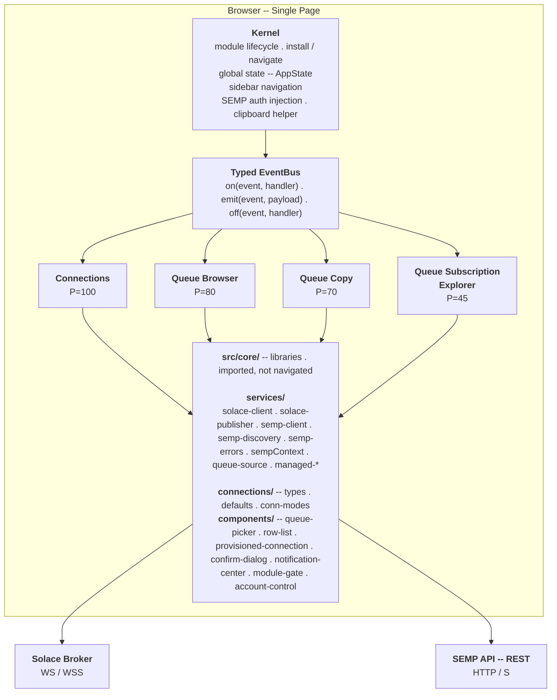
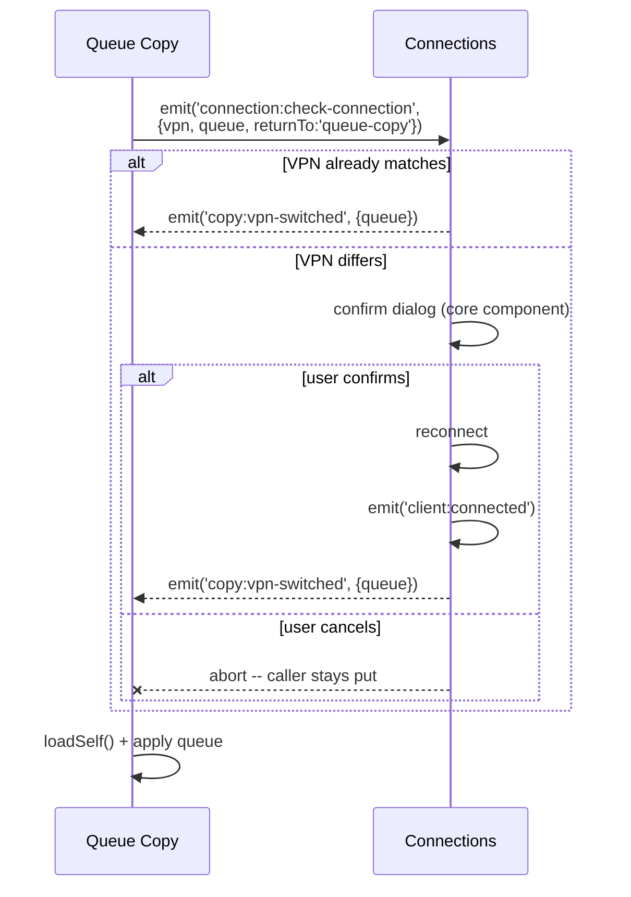
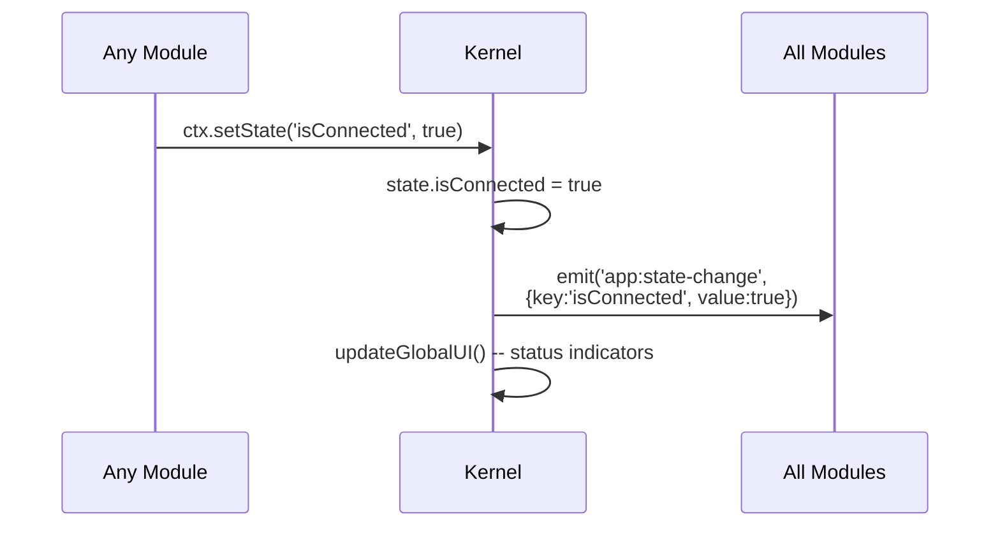
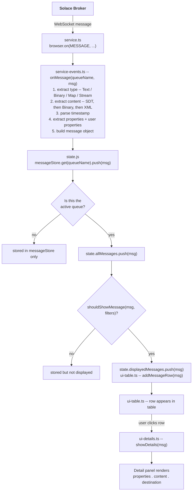
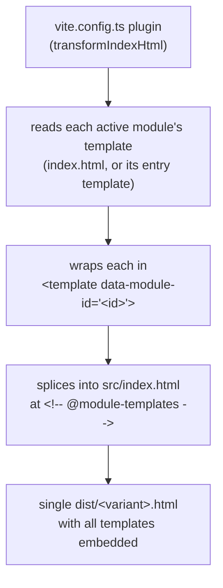

# Architecture

This document is for developers who work on the code, in the web app (`src/`) or in the Go gateway (`go-web-proxy/`). It explains how the pieces fit together and why: the module and event design, the queue browser and queue copy engines, paged discovery, how the build assembles a bundle from a variant, and how Provisioned mode (sign-in, entitlements, the stores, auditing, two-factor, live TLS, restart and the admin modules) is built. It does not repeat how to run the product ([deployment.md](deployment.md), [provisioned-mode.md](provisioned-mode.md)), how to use it ([user-guide.md](user-guide.md)), or the coding conventions and how-tos ([developer-guide.md](developer-guide.md)).

## Contents

- [System Overview](#system-overview)
  - [Publishing pipeline (`solace-publisher`)](#publishing-pipeline-solace-publisher)
  - [Hosted mode (gateway tunnelling)](#hosted-mode-gateway-tunnelling)
  - [Gateway routes](#gateway-routes)
- [Module Isolation](#module-isolation)
  - [Install-phase buffering (`hold` / `release`)](#install-phase-buffering-hold--release)
- [Cross-Module Event Flow](#cross-module-event-flow)
  - [VPN-switch handoff (Queue Copy / Queue Browser -> Connections)](#vpn-switch-handoff-queue-copy--queue-browser---connections)
  - [State Change Propagation](#state-change-propagation)
- [Logging](#logging)
- [Queue Browser Internal Architecture](#queue-browser-internal-architecture)
- [Data Flow: Message Lifecycle](#data-flow-message-lifecycle)
- [SEMP v2 Paged Discovery (core library)](#semp-v2-paged-discovery-core-library)
  - [Service contract](#service-contract)
  - [Consumers: the `QueueSource` seam](#consumers-the-queuesource-seam)
  - [Demo mode](#demo-mode)
- [SEMP v1 Pagination (Queue Subscription Explorer)](#semp-v1-pagination-queue-subscription-explorer)
  - [Topic intersection filter](#topic-intersection-filter)
- [Queue Copy: Verify Flow & Broker Bug Workaround](#queue-copy-verify-flow--broker-bug-workaround)
  - [Two-call SEMP v1 workaround](#two-call-semp-v1-workaround)
  - [Access-type capture (gate for Copy and Move)](#access-type-capture-gate-for-copy-and-move)
  - [Run engine: two-phase model](#run-engine-two-phase-model)
- [DOM Template System](#dom-template-system)
  - [Module registration: variant manifests](#module-registration-variant-manifests)
  - [Build flavors vs variants](#build-flavors-vs-variants)
- [Provisioned Connections (RBAC)](#provisioned-connections-rbac)
  - [Topology](#topology)
  - [Locked decisions](#locked-decisions)
  - [Connection modes](#connection-modes)
  - [The connections module: two entries, one owner](#the-connections-module-two-entries-one-owner)
  - [Managed profile (core-owned, names only)](#managed-profile-core-owned-names-only)
  - [RBAC state + matchers](#rbac-state--matchers)
  - [Kernel gating](#kernel-gating)
  - [Credential custody](#credential-custody)
  - [Stored file schemas](#stored-file-schemas)
  - [Enforcement points](#enforcement-points)
  - [Provisioned secondary connections](#provisioned-secondary-connections)
  - [Provisioned connect sequence](#provisioned-connect-sequence)
  - [The admin app (`/solAdmin`)](#the-admin-app-soladmin)
  - [The demo broker (`demo.html`, `provisioned-demo.html`)](#the-demo-broker-demohtml-provisioned-demohtml)
  - [The audit trail](#the-audit-trail)
  - [The single writer](#the-single-writer)
  - [Two-factor sign-in](#two-factor-sign-in)
  - [Live TLS and restart](#live-tls-and-restart)
  - [Admin modules + the Go store](#admin-modules--the-go-store)
- [CSS Organization](#css-organization)
- [Content-Security-Policy](#content-security-policy)
- [Technology Decisions](#technology-decisions)

---

## System Overview



The broker-side service factories live in `src/core/services/` as **pure libraries** -- they take lifecycle hooks (no AppContext, no UI, no global bus). The connections module (priority 100) is the *primary specialist*: `installDirect` in its `module.ts` (shared by both of its entry files) defines `solaceHooks` / `sempHooks` that bridge factory lifecycle events to global AppState + bus events that other modules consume. This pattern lets another module (queue-copy) own a *secondary* connection by passing different hooks to the same factories -- module symmetry, no cross-module imports.

### Publishing pipeline (`solace-publisher`)

`src/core/services/solace-publisher.ts` is the single home for the "clone an SDK message + force PERSISTENT delivery + stamp a `{ Solace_Msg_Utility_Seq_Num, Original_Msg_ID }` correlation key + send + await ACK/REJECT with a 30-s timeout" pipeline. The factory `createSolacePublisher(session, opts?)` returns `{ send(orig, dest, opts?), rejectAllPending(reason), dispose(reason?), isPending(key) }`. `send()` resolves with `{ ok: true } | { ok: false; error }` (never rejects) and also accepts optional `onAck` / `onReject` / `onTimeout` callbacks for fire-many-then-update-on-resolution patterns. ACK/REJECT listeners attach on construction; `dispose()` detaches them and resolves any in-flight publishes with the supplied reason -- used by callers to surface user-friendly errors like `'Client disconnected.'` end-to-end without writing per-module sweep code.

Two callers today:

- **queue-browser** owns its publisher inside `service.ts`, lifecycle-managed via `client:connected` / `client:disconnected`. `forwardMessage` returns the publisher's `Promise<SendResult>`; `handleForwardSend` fires all sends concurrently and updates UI status from `.then` / `.catch`. `hasInFlightForward` delegates to `publisher.isPending` so the forward modal still detects UUID collisions across modal sessions.
- **queue-copy** stores `state.destPublisher` and `state.primaryPublisher` (one per Solace session), created in the corresponding hooks/bus subscribers. `service-copy.ts runCopyJob` takes the publisher `selectPublisher(state)` names (the primary's when Same Broker and Same VPN are both on, otherwise the destination's, and only one connected for the destination the form names now) and awaits each `send()` sequentially.

Two publishers can coexist on the same session (e.g. queue-copy's sameVpn case, where the primary session also hosts the secondary publisher) -- each maintains its own pending-key map, and the listener pair only resolves entries it owns. The publisher knows nothing about AppContext, bus events, or modules; modules know nothing about ACK correlation, timer management, or the property-copy chain. This is the same module-symmetry split as solace-client / semp-client.

### Hosted mode (gateway tunnelling)

The PWA can run standalone (talking directly to brokers) OR behind the Go gateway in `go-web-proxy/`, which serves the same bundle and also reverse-proxies SEMP HTTP and Solace WebSocket traffic. In the gateway deployment, the broker is internal and unreachable from the browser; every broker URL must be tunnelled through the gateway's path scheme `{pageOrigin}/{scheme}/{port}/{host}{urlPath}`, where `scheme is one of http, https, ws, wss`.

The gateway's settings live in `config.yaml` ([go-web-proxy/configfile.go](../go-web-proxy/configfile.go)). On the first start the file is seeded from the environment and written (an unwritable path is fatal); afterwards it is authoritative and a differing environment variable is only reported. The file and the stores sit at fixed paths under `/data`, and the three TLS paths come only from the environment, so neither the file nor a request can point the gateway at another secret. The seeding rules are in [deployment.md -> Settings](deployment.md#settings), the variables and keys the gateway refuses or ignores in [the section after it](deployment.md#variables-and-keys-the-gateway-refuses-or-ignores); the file's keys are in [developer-guide.md -> Writing a config.yaml by hand](developer-guide.md#writing-a-configyaml-by-hand-development-only). `go-web-proxy/live_test.go` `TestFileConfig_EveryKeyIsClassifiedOnce` fails when a `fileConfig` key is not exactly one of live or restart-only (`hosted` is the only restart-only key). Tests that need the stores elsewhere set the `process.dataDir` seam (`config.inDataDir`), which moves the three files under a temporary directory; `main` leaves it empty. The request pipeline is `accessLog(withClient(clientACL(root)))` ([access.go](../go-web-proxy/access.go)): `withClient` resolves the client address once (trusted proxies) for the access list and the sign-in throttle, and the access list runs on every route, inside the access log so a denial is recorded as a 403 like any other response; an empty allow list admits everyone.

**Live settings.** The keys an administrator can change without a restart (`connModes`, `defaultConn`, `logLevel`, `access.*`, `session.*`, `login.*`, `modules.*`, `tls.standardRoots` and `tls.insecureSkipVerify`, which `apply` hands to the trust holder, see [Live TLS and restart](#live-tls-and-restart)) are not read from `config` after startup. `serve()` copies them into a `*live` ([live.go](../go-web-proxy/live.go)), an `atomic.Pointer` swapped as one value plus the logger's `slog.LevelVar`, and passes it to every reader: `withClient`, `clientACL`, `/hosted`, the bundle gate, the session table and the throttle each load the current value per request. The only writer is the settings endpoint ([settings.go](../go-web-proxy/settings.go)): `PUT /managed/settings` decodes into a copy of the saved file, runs the same `toConfig` and connection-mode checks as startup, refuses `connModes: direct` (it would end Provisioned mode, and the console with it, at the next restart, so that change is the host's), refuses a body that names a TLS path (`400 bad_request`, an unknown field: the paths come only from the environment, so the endpoint can never point the gateway at its own secrets), an access list that would deny the requesting client (`would_lock_out`) and a write over a hand edit (the bytes on disk differ from the fingerprint of what it last read or wrote, `config_changed_on_disk`; a file it cannot read is `config_unreadable`, not a hand edit), writes atomically, then swaps the live value. `restartOnlyKeys` (`[]string{"hosted"}`) lists the rest and is read only by the classification test: the settings API reports no restart state (`GET` answers the file and its `rev`, `PUT` answers `{rev}`). A new live key goes in `liveSettings` and `apply`; a reader must take it from `*live`, never from `config`.

**Limits are read through accessors.** The sign-in limits reach the throttle as a `loginLimits` and the session limits as a `sessionLimits` ([configfile.go](../go-web-proxy/configfile.go)); a zero field means the default, through methods (`clientThreshold`, `resetAfter`, `minPassword`, `ticketTTL`, `connectsPerMinute`), so a test that builds a bare struct gets the default behaviour. `login.perClient` is held inverted (`perClientOff`) for the same reason. Four of the settings are not about guessing: `login.passwordMinLength` is the minimum `checkPasswordPolicy(pw, min)` enforces wherever a user password is set (an administrator's create or reset, a user's own change, the forced change and the bootstrap password from the environment; `passwordRuleError(min)` builds the error), while a backup passphrase keeps the fixed 12 to 128 of `checkPassphrase`; `login.twoFactorMinutes` is the sign-in ticket's lifetime (`newSigninTickets(ttl, now)` reads it per call, so a shorter value also ends tickets already issued); `session.connectsPerMinute` is the limit of the per-user connect window (`newRateWindow(limit func() int, window, now)`), shared by `POST /managed/dial` and the SMF gate. A backup decodes its settings over `defaultFileConfig()`, so one that lacks a key reads it as the default.

**The throttle** ([throttle.go](../go-web-proxy/throttle.go)) counts sign-in failures per username against `login.maxFailures` and, unless `login.perClient` is off, per client (IPv6 by its /64) against `login.clientMaxFailures`. A key at its limit is blocked for `login.backoffSeconds`, doubled with each further failure up to `login.maxBackoffSeconds`, and a blocked attempt is refused before the password is checked. A count is forgotten after `login.resetMinutes` without a failure. A successful sign-in clears the account's count only: the client's is left to age out, so signing in to one's own account cannot wipe the guesses made from that address against others. Apart from the failure counts, each client has a token bucket of `login.unauthenticatedPerMinute` that every request without a session draws from, and so does every `POST /login`, including one from a browser that already has a session (`authPages.ServeHTTP`). The tables are capped (`throttleMaxTracked`).

The connections module probes the gateway-only `/hosted` endpoint at the very start of its `install(app)`. A 200 response carrying JSON `{hosted, connModes, defaultConn}` flips the singleton in `src/core/hosted.ts` **and** resolves the deployment's connection modes (see [Connection modes](#connection-modes)); a plaintext `true` body is also accepted and means *hosted, Direct only*. `probeDeployment` has three outcomes. A **hosted** answer is the 200 above. A **conclusive no-gateway** answer (a non-OK status below 500 such as the 404 of a standalone deployment, `false` or an empty body, a non-JSON body, or `hosted: false`) leaves hosted mode off and the app Direct-only. An **inconclusive** answer (no complete answer within `HOSTED_PROBE_TIMEOUT_MS`, a network error, or a 5xx) returns the same Direct-only placeholders plus `inconclusive: true` on `DeploymentInfo`, with a warn log carrying the cause. One deadline (`raceDeadline`) covers the fetch **and** the body read, so a gateway that sends headers and stalls on the body also ends inconclusive; `managedRequest` in `core/services/managed-api.ts` applies the same single deadline through its internal `exchange()` (a stalled answer or body is code `timeout`, whether the status was ok or not; `network` is kept for a request that could not be sent, since after a timeout a change may still be applied). The connections entries act on `inconclusive`: [module.ts](../src/modules/connections/module.ts) stays standalone and shows `#conn-probe-notice`; [module.managed.ts](../src/modules/connections/module.managed.ts) hides the Direct panel, shows `#conn-probe-notice-managed`, publishes no `connConfig` and installs no panels or routers (a Provisioned bundle has no Direct-only fallback). Retry is `location.reload`, injectable as `install(app, { reload })`; the shared `showProbeNotice` is exported from `module.ts`. The probe is awaited before any service factory is created so a Connect click can't race the flag.

`buildBrokerUrl(scheme, host, port, urlPath, isWebSocket)` in `src/core/hosted.ts` is the single rewrite point. In direct mode it returns the original `${scheme}://${host}:${port}${urlPath}` shape; in hosted mode it returns `${wireScheme}://${pageHost}/${scheme}/${port}/${host}${urlPath}`, with `wireScheme` upgraded to `wss`/`ws` for WebSocket (matching the page's https/http) and `https`/`http` for plain HTTP. Both `solace-client` and `semp-client` route through this builder. A SEMP caller never builds a URL itself: it passes a path (`/SEMP/v2/monitor/...`, or `/SEMP` for a v1 RPC) to `sempCtx.fetch`, which rebuilds the full URL through `buildBrokerUrl` on every call (or, in a Provisioned session, prefixes the relay base), so every downstream request (SEMP v2 fetches, SEMP v1 RPCs, the queue-discovery paged fetches, queue-subscription-explorer's RPC POSTs, the queue-picker's caches) inherits the rewrite. `sempCtx.baseUrl` is diagnostic only (log lines, error text), never a request base, and a broker-emitted URL such as `nextPageUri` is cut to its path and query before it is fetched.

**Plain schemes on an https page.** A browser blocks an https page's `ws://` and `http://` requests as mixed content, so without the gateway the app offers them only on a page that is not https (an `http://` server, or the Standalone HTML from disk); behind the gateway all four stay, as the browser's hop is to the gateway on the page's own scheme and the gateway makes the plain one. `plainSchemesUsable()` in `src/core/hosted.ts` is the rule. `limitSchemeOptions(select)` hides and disables the plain options of an editable protocol select (the connections form, queue-copy's destination) and moves a selected one to its TLS form; it runs at install, after the `/hosted` probe, as neither input changes while the page is open, and never re-enables an option the template disables. `usableScheme(scheme)` maps a saved scheme the same way: the connections form's `applyConfig` loads a saved `ws`/`http` as `wss`/`https` with a warning toast, since the saved port is most likely the plain one. Queue-copy's source fields mirror the primary connection and are left as they are.

Two related details:

- A SEMP v1 RPC is a `POST` of `/SEMP` through the same `sempCtx.fetch` (the connection's URL path, if any, in front), so in hosted mode it routes through the gateway exactly as a v2 call does.
- The wss TLS handshake probe in `solace-client.ts` is skipped in hosted mode. The browser only sees the gateway's TLS endpoint (already trusted by the PWA load); probing the internal broker would be wrong. Same reasoning suppresses the "click to trust this URL" help link in connection-error toasts.

`AppState.sempCredentials` carries the user-typed `protocol/host/port/urlPath` alongside the rewritten `baseUrl`, so UI code (queue-copy source/dest readout, modal summary) displays the broker the user reached for -- not the gateway-prefixed wire URL.

The container image (its paths, mounts and the way to serve your own build) is described in [deployment.md](deployment.md); the image is `FROM scratch` and runs as UID `65532`.

### Gateway routes

`newRootHandler` ([main.go](../go-web-proxy/main.go)) routes on the path, first match wins, inside the access log and the access list (`clientACL`: a denied client gets `403` on every route). Every response carries `X-Robots-Tag: noindex, nofollow`. "Provisioned" means `connModes` is `provisioned` or `both`; a cell names the one it means where they differ. The gates read `connModes` from `*live` per request, so a settings change moves a route between columns without a restart. Files only (`hosted: false`) is always Gateway's `connModes`: Provisioned with it stops the start.

| Path | Served by | Gateway mode | Provisioned mode | Files only |
| --- | --- | --- | --- | --- |
| `/robots.txt` | `robotsTxt` (main.go) | `Disallow: /` for every crawler | Same | Same |
| `/hosted` | `hostedHandler` ([proxy.go](../go-web-proxy/proxy.go)) | JSON `{hosted, connModes, defaultConn}`, `no-store`; left out of the access log (asked on every page load: each connections entry probes it once, at install) | Same | `404`: the app stays Direct and browsers connect to brokers themselves |
| `/solAdmin`, `/solAdmin/` | `adminHandler` behind `gateAdmin` ([pages.go](../go-web-proxy/pages.go)) | `404` (also `/solAdmin/`) | `solAdmin.html` (`no-store`) for a signed-in administrator; `/solAdmin/` is a `308` to `/solAdmin` once the route is enabled. No session -> `/login?next=/solAdmin`, a forced change -> `/login/password`, not an administrator -> a `403` page | `404` |
| `/managed/...` | `managedHandler` ([managed.go](../go-web-proxy/managed.go)) | `404` | A session (`401 unauthenticated`, throttled per client), same origin (`403 cross_origin`), and under a forced change only `/managed/logout` (`403 password_change_required`). `/managed/relay/...` is the SEMP relay ([relay.go](../go-web-proxy/relay.go)), `/managed/smf/...` the SMF gate ([smf.go](../go-web-proxy/smf.go)), the rest the API mux: `me`, `logout`, `dial`, and through `adminOnly` `users`, `connections`, `settings`, `backup/...`, `tls/...` and `restart`. An unknown path or method is `404 not_found`, never `405`. All `no-store`. | `404` |
| `/login`, `/login/password`, `/login/code`, `/login/two-factor` | `authPages` (pages.go) | `404` (the app has no `/login` here) | The sign-in, password-change and two-factor pages; a cross-site POST is a `403` page | `404` |
| `/{http,https,ws,wss}/{port}/{host}/...` | `reverseProxy` (proxy.go, `parseProxyPath`) | The Direct relay to that broker; a malformed path, or a host that is not a host name or IP address (`validHost`), is `400` | Under `both`, the Direct relay. Under `provisioned`, `404` (`gateDirect`): sessions reach brokers only through `/managed/relay/` and `/managed/smf/` | `403` (`refuseRelay`): browsers connect to brokers themselves |
| Anything else | `pwaHandler` (proxy.go) | `index.html` at `/`; `404` for any other path that is not a file; other files from `appRoot`; `solAdmin.html` and `provisioned.html` by name `404` | The same with `provisioned.html`. Under `provisioned`, `gateApp` sends a visitor without a session to `/login` (a path with an extension gets `401`; throttled per client) and a forced change to `/login/password`; under `both` the app is open, and sign-in is the Provisioned tab's | As Gateway mode |

A new route goes in `newRootHandler` above the app's catch-all, or under `/managed/` when it needs a session; anything that falls through is the app's, so a path the gateway does not serve is a `404`, never a redirect.

**Which bundle is served.** `pwaHandler` ([proxy.go](../go-web-proxy/proxy.go)) serves `index.html` at `/` in Gateway mode and `provisioned.html` in Provisioned mode (`appIndexFile`), and `404` for any path that is not a file: there is no history-mode fallback, because the app has no client-side routes and the bundle's relative vendor paths (`solclient.js`, `jszip.min.js`) only resolve at `/` and `/solAdmin`. Such a path is never redirected either: a browser keeps a permanent redirect, and would go on sending the path to `/` after the gateway had started to serve it. `solAdmin.html` is reached only through `/solAdmin`, behind the admin gate, and a request for `solAdmin.html` or `provisioned.html` by name gets `404`.

---

## Module Isolation

Modules have **zero cross-module imports**. Each module is a self-contained directory with its own service layer, UI management, and state. The only shared code is in `src/core/`.

```text
src/core/                          Shared infrastructure
  types.ts                         Interfaces only -- no runtime code
  event-bus.ts                     Pub/sub factory
  kernel.ts                        Orchestrator (module lifecycle, state, navigation, SEMP auth)
  dom.ts                           `required()` helper -- fail-fast required-element assertion
  utils.ts                         Pure utilities (escapeHtml, escapeXml, formatBytes, generateUuid, matchString,
                                   matchContains, topicsIntersect, topicFilterMatches, normalizeUrlPath, errMessage,
                                   isValidHost, isValidPort)
  icons.ts                         Shared inline SVG icons (ICONS) + iconButton() for labelled icon-only buttons
  download.ts                      downloadBlob(): save a Blob as a named file (queue-browser's downloads, backup's export)

src/modules/connections/                  Module -- primary connection setup: module.ts (Direct, every Release bundle), module.managed.ts (Direct + Provisioned tabs, provisioned.html)
src/modules/queue-browser/                Module -- queue-browser session + message table
src/modules/queue-copy/                   Module -- cross-broker queue copy
src/modules/queue-subscription-explorer/  Module -- flat (vpn, queue, topic) table (SEMP v1)
src/modules/queue-discovery/              Module -- carried in the tree; no variant activates it
src/modules/admin-login/                  Module -- /solAdmin entry point (admin variant)
src/modules/user-management/              Module -- admin-only user + entitlement CRUD
src/modules/connection-management/        Module -- admin-only broker-connection CRUD
src/modules/gateway-settings/             Module -- admin-only config.yaml editor
src/modules/tls-certificates/             Module -- admin-only gateway certificate and trusted broker CAs
src/modules/backup/                       Module -- admin-only export, import and scheduled backups

Install order + sidebar order are the priorities in the variant manifest ([src/variants/](../src/variants/)), one `'<id>': <priority>` line per module; [src/registry.ts](../src/registry.ts) turns each line into a `{ module, priority }` tuple, so a variant's whole ordering decision lives in its one file.
```

There are no `*-mock` service siblings: the demo build (`vite build --mode demo`) runs these same modules against the in-browser broker -- see [The demo broker](#the-demo-broker-demohtml-provisioned-demohtml); the build commands are in [developer-guide.md](developer-guide.md).

All module coordination goes through the EventBus -- every module publishes and subscribes through the single shared bus instance, with no direct module-to-module references.

The kernel builds one `AppContext` for each module: its own `container` (an isolated DOM subtree) and `loadSelf` (bound to its id), plus the shared `appState`, `eventBus`, `setState`, `sempFetch`, `managedProfile`, `notifications`, `queuePicker` and helpers, all the same references for every module. How a module uses the context, and how a circular dependency inside a module is broken with late `wire()` binding (queue-browser's `service-events.ts` is the example), is in [developer-guide.md](developer-guide.md).

### Install-phase buffering (`hold` / `release`)

Modules install in priority order, so an earlier module that emits during its `install()` could reach later-installing modules that haven't subscribed yet. The kernel wraps the install loop in `eventBus.hold()` / `eventBus.release()` -- emits fired while held are queued FIFO and flushed (in order) once every module has finished install. Subscriptions made during install are honoured when the flush runs.

Modules do emit during install, and rely on the flush: queue-browser announces `browser:available` at the end of its install (queue-discovery's "Open in Browser" listens for it); the managed connections entry publishes `connConfig` (an `app:state-change`), and its panel's session restore emits `rbac:changed`, on which the kernel and the session-gated modules settle what they show. A module installing later would otherwise miss each of them. No `setTimeout`, no sticky-event semantics -- just a single install-phase gate.

These methods are kernel-only. Modules never call `hold()`/`release()`.

---

## Cross-Module Event Flow

### VPN-switch handoff (Queue Copy / Queue Browser -> Connections)

A module that needs the primary connection on a specific VPN emits `connection:check-connection` with `{vpn, queue, returnTo}`. Connections either confirms it's already on that VPN (fires the finish event synchronously and the caller resumes) or prompts the user, reconnects, and fires the finish event once the new session is up. This is the same conditional-reconnect flow queue-copy and queue-browser both use when a picked queue lives in a different VPN than the current primary.

**Navigation contract -- single source of truth.** The connections module navigates the user to its own screen **only when there is actual connection work to do**, and only at the moment the work is committed:

| Path | Navigates? |
| --- | --- |
| Auto-connect (not yet connected) | yes -- before initiating connect |
| Already on the target VPN | no -- nothing to do |
| VPN switch, user confirms | yes -- *after* confirm |
| VPN switch, user cancels | no -- caller stays put |

The `returnTo` field only selects which finish event fires (`browser:browse-queue` for `'queue-browser'` and the default, `copy:vpn-switched` for `'queue-copy'`) -- it does **not** alter navigation. Future modules using this handshake inherit the policy automatically: pick a `returnTo`, add a finish-event branch in `finish()` in [connections/vpn-switch.ts](../src/modules/connections/vpn-switch.ts), don't reintroduce per-caller navigation differences. Tests in [tests/modules/connections/module.test.ts](../tests/modules/connections/module.test.ts) lock the four rows above in place.

**Why the picker does not own the confirm.** The reusable queue picker (`ctx.queuePicker.pick()`) resolves a `{vpn, queue}` tuple and nothing more. Whether that VPN matches the consumer's "current" VPN (different concept across consumers -- primary for queue-browser, destination form for queue-copy's dest picker) and whether to disrupt the primary session are app-layer decisions. Keeping them in the consumer + connections module lets the picker stay generic across all current and future callers.



### State Change Propagation



---

## Logging

Every runtime log goes through the singleton `logger` in [src/core/logger.ts](../src/core/logger.ts) -- a drop-in replacement for `console.*` with a level filter:

```ts
import { logger } from '../../core/logger';
const log = logger.withTag('Module');
log.debug('fine-grained trace');
log.info ('lifecycle event');
log.warn ('recoverable mismatch');
log.error('failure', err);
```

Levels (numeric severity, defined in [src/core/constants.ts](../src/core/constants.ts)): `DEBUG=0`, `INFO=1`, `WARN=2`, `ERROR=3`, `SILENT=4`. A call fires when the current level is `<=` the call's level; `SILENT` mutes everything.

The current level is module-scoped state, set once at boot in the kernel's `start()` from the `?logLevel=<NAME>` URL parameter (case-insensitive). Invalid values fall back to `DEFAULT_LOG_LEVEL` (`INFO`). The logger is **not** routed through `AppContext` -- it's set-once boot configuration, not application state, and forcing every service factory to take a `logger` argument purely for delegation would be high churn for no reuse benefit.

What a line says -- the level by meaning, the component tag, facts as attributes, no secrets -- follows the one standard for the web app and the gateway in [developer-guide.md -> Logging standard](developer-guide.md#logging-standard); [deployment.md -> Logs](deployment.md#logs) covers the gateway's side.

Each `logger.*` method delegates to the matching `console.*` channel so DevTools severity filtering keeps working and existing test instrumentation (`vi.spyOn(console, 'warn')`) is unchanged.

Inside [src/core/services/solace-client.ts](../src/core/services/solace-client.ts), `connect()` registers a generic `logger.debug` listener for every value of `solace.SessionEventCode` (in addition to the typed handlers that drive the lifecycle hooks). This means the full Solace SDK event stream is observable with `?logLevel=DEBUG` without per-event wiring, and any new codes the SDK adds are picked up automatically.

`connect()` refuses (warn, returns `{ ok: false, error: CONNECT_IN_PROGRESS }`) while an earlier connect on the same client is still in flight, for GUI and programmatic callers alike. Every typed handler is registered through an `own()` wrapper that acts only while its session is still the client's current one; an event from a replaced session is logged at debug, disposes that old session, and drives neither the hooks nor the new session, so a late `DISCONNECTED` from the old session cannot dispose the new one or fire `onDisconnected`.

The raw `console.*` calls in [src/index.html](../src/index.html) (the inline `<script>` that loads `solclient.js` and `JSZip`) are intentionally not routed through the logger -- they fire before any module imports complete.

**Shell composition and the vendor loader.** The shell holds two `<!-- @vendor:start -->` ... `<!-- @vendor:end -->` blocks: the head loader and the library banner with its small after-banner script. A variant manifest may export `NEEDS_VENDOR_SCRIPTS = false` (declared after `ACTIVE_MODULES`; `admin` does), and `injectModuleTemplates` in `vite.config.ts` then strips both blocks with `stripVendorBlocks` (`variantNeedsVendorScripts` and `stripVendorBlocks` are exported by `scripts/module-registry-plugin.mjs`), so `solAdmin.html` has no `solclient.js`/`jszip.min.js` loader and no banner. `check:bundles` requires every other bundle to carry all the markers (`js/solclient.js`, `jszip.min.js`, `missing-lib-banner`) and `solAdmin.html` none. The banner ships visible and neutral (`.notification-banner.is-pending`, "Loading the Solace library..."). The loader records the banner outcome (none yet, hide, or error HTML) and exposes `window.solaceLibApplyBanner`; the script after the banner applies it, so whichever of the two runs second wins when the outcome arrives before the banner is parsed. A 30 s watchdog replaces "Loading" with a did-not-finish message and is replaced in turn by a late outcome, and cleared by success or failure. A `solclient.js` that loads without defining `window.solace` counts as a failure and tries the `js/` fallback, then missing.

**Startup placeholder and install failures.** The shell's `#module-container` holds one child, `#app-loading` ("Loading..."). The kernel leaves the container alone at `start()`; it removes `#app-loading` on the first `navigateTo`, and when no module is installed (none registered, none visible, or every install failed) replaces its text with "No modules are available. Check the browser console." A module whose `install` throws gets one 8 s error toast naming it (the console has the error) and the others still install; a missing template only logs. The `hold()` / install / `release()` sequence is wrapped in `try/finally`, so a throw outside a module still releases the bus. `src/main.ts` logs a rejected `kernel.start()` instead of leaving an unhandled rejection.

---

## Queue Browser Internal Architecture

The largest module is decomposed into single-responsibility files:

```text
queue-browser/
  module.ts          Orchestrator -- wires DOM events to handlers
       |
       +--- service.ts           Broker operations + publisher lifecycle
       |      createBrowser()       Create queue browser
       |      forwardMessage()      Delegate to core/services/solace-publisher
       |      hasInFlightForward()  Delegate to publisher.isPending
       |      deleteMessages()      Remove from queue + UI
       |
       +--- service-events.ts    Broker event callbacks
       |      onMessage()           Parse incoming messages
       |      onBrowserUp()         Queue connected
       |      onConnectFailed()     Connection error
       |
       +--- state.js             Local state (not shared via EventBus)
       |      messageStore          Map<queueName, Message[]>
       |      browserInstances      Map<queueName, QueueBrowser>
       |      shouldShowMessage()   Filter evaluation engine
       |
       +--- ui-core.js           DOM management
       |      initElements()        Cache all DOM references
       |      updateVisibility()    Show/hide based on connection state
       |      updateCounts()        Refresh Total/Displayed/Selected
       |
       +--- ui-events.ts         User action handlers
       |      handleBindClick()     Bind queue
       |      handleBulkForward()   Forward selected messages
       |      handleBulkDelete()    Delete selected messages
       |      applyFilters()        Apply filter criteria
       |
       +--- ui-table.ts          Table rendering
       |      renderList()          Full table re-render
       |      addMessageRow()       Append single row (real-time)
       |      downloadMessagesZip() ZIP export
       |
       +--- ui-details.ts        Detail panel
       |      showDetails()         Render message details
       |      showBinary()          An image payload's Show content, or why not
       |      addPropertyFilterRow() Dynamic filter rows
       |
       +--- payload.ts           Attachment bytes, text vs binary, download names
       +--- file-kind.ts         Kind from the first bytes, image size
       +--- sdt.ts               Map and stream bodies decoded, as YAML and JSON
       |
       +--- ui-forward.js        Forward modal
       |      openForwardModal()    Prepare modal with messages
       |      updateForwardStatus() Update ACK/REJECT status
       |
       +--- constants.js         Module-scoped SVG icon strings (downloadContent, forward, delete, copy ...)
```

**Message bodies (payload flavor).** `extractPayload` in `service-events.ts` stores what the pane shows in `content`, and the original bytes in `bytes`:

- A text body keeps its text.
- A binary attachment keeps its bytes, and `classifyAttachment` (`payload.ts`) decides whether they are text. UTF-8 with no stray control characters is text; anything else is `binary`, shown as a size placeholder.
- A map or stream (an SDT container) keeps its wire bytes, which the SDK still holds as the attachment. `decodeSdt` (`sdt.ts`) turns the container into a typed tree that the pane shows as YAML (`toYaml`, also what Copy Content copies and the body filter matches) and that Download Full adds as `payloadDecoded` (`toJsonValue`). A container the SDK cannot parse falls back to its bytes, with a warning.

`file-kind.ts` reads a binary payload's first bytes against a list of signatures. The result names the kind in the payload's placeholder (`classifyAttachment` in `payload.ts`, at ingest), and, for PNG, JPEG, GIF and WebP, decides **Show content**: `imageSize` reads the header when the message is selected, and an image above 40 megapixels or with no size gets a note instead of the button. The image is decoded only on request, in place of the Content Preview box, from a `blob:` URL, which the bundle's policy allows (`img-src data: blob:`) and which is revoked when the pane moves on. The hex of any payload is in **Show Raw Content**, the SDK's `message.dump()`; the demo SDK's `dump()` keeps the SDK's layout (`dumpBytes` in [src/mock-broker/sdk/message.ts](../src/mock-broker/sdk/message.ts)). An executable is only named: its download suggests `.bin`. `contentFileName` (`payload.ts`) names a download, single or in the content ZIP, `solace-message-<id>.<ext>`. `saveBlob` ([src/core/download.ts](../src/core/download.ts)) opens the browser's save dialog where there is one and falls back to a plain download. The blob is always `application/octet-stream`, so the browser never renders it.

Queue-browser's production `service.ts` runs unmodified in both real and demo builds. In the demo, its SDK calls reach the `window.solace` emulation installed by the demo broker, and publish-with-ACK (delegated to the core `solace-publisher`) round-trips through the broker's acknowledgement events -- see [The demo broker](#the-demo-broker-demohtml-provisioned-demohtml).

## Data Flow: Message Lifecycle



---

## SEMP v2 Paged Discovery (core library)

SEMPv2 monitor endpoints page their results -- the `meta.paging.nextPageUri` field on a response carries an absolute URL for the next page. Brokers in production frequently host hundreds of VPNs/queues, so the discovery service streams pages instead of accumulating them.

### Service contract

The paged-fetch generator lives in **core** at `src/core/services/semp-discovery.ts` and is parameterized by a `SempContext` (a `{ fetch, baseUrl }` pair scoped to a specific broker). This decouples the pagination logic from any particular connection so a module can drive the same generator against a *primary* OR *secondary* broker by passing its own SempContext.

```ts
// src/core/services/semp-discovery.ts
export function createSempDiscovery(sempCtx: SempContext): {
    fetchVpns(maxCount?: number): AsyncGenerator<FetchPage>;
    fetchQueues(vpn: string, maxCount?: number): AsyncGenerator<FetchPage>;
};

type FetchPage = { ok: true; data: string[] } | { ok: false; error: string };
```

A primary `SempContext` is built via `unfilteredPrimarySempContext(ctx)` from `src/core/services/sempContext.ts` (named for what it does NOT do -- see [Enforcement points](#enforcement-points)); secondary SempContexts (queue-copy's destination broker) are built directly from the secondary `createServiceSemp` factory's `onConnected` hook.

A shared `fetchPaged()` helper drives the pagination loop:

```text
while (url) {
    if (pageNum > 0) await sleep(PAGE_DELAY_MS);   // 370ms throttle between pages
    sempCtx.fetch(url) -> yield { ok: true, data: [...] }
    url = json.meta?.paging?.nextPageUri || null
}
```

The first error terminates the stream -- the generator yields `{ok: false, error}` and returns. Any pages already yielded remain valid for the caller. The throttle protects the broker from a burst of back-to-back requests when paging through hundreds of items.

### Consumers: the `QueueSource` seam

Discovery is a capability **of a connection**, owned by whoever owns that connection -- never by the reusable consumer. Components receive a `QueueSource` (the discovery analog of `SempContext`) and call `listVpns()` / `listQueues(vpn)`; they never run their own SEMP discovery:

```ts
// src/core/services/queue-source.ts
export interface QueueSource {
    key: string;                                  // cache identity
    listVpns(): AsyncGenerator<FetchPage>;
    listQueues(vpn: string): AsyncGenerator<FetchPage>;
}
export type Scope  = 'browse' | 'operate';
export type Access = { session: ManagedSession; broker: string; scope: Scope } | 'unmanaged';

export function sempQueueSource(sempCtx: SempContext, access: Access): QueueSource;    // live SEMP, filtered by access
export function queueSourceFrom(ctx: AppContext, scope: Scope): QueueSource | null;   // primary
```

`queueSourceFrom(ctx, scope)` is the single place that branches managed-vs-direct. `scope` says what the list is FOR: `browse` filters by `isQueueVisible`, `operate` by `canOperate` -- so a destination picker (copying into a queue is a write) cannot offer a queue the user may only read.

- **VPNs** -- managed yields the **provisioned set** (`appState.managed.vpns`, published by the connections module from `/managed/me`) with no SEMP call; standard does live SEMP discovery. This is why the managed queue-picker lists exactly the VPNs the Connections dropdown shows, instead of every VPN a broad entitlement glob (`msgVpns: '*'`) would admit.
- **Queues** -- always live SEMP (no provisioned queue inventory exists anywhere; RBAC specifies queue *globs*, applied by `filterSempFetch`). The asymmetry is in the *data*, not the handling -- both are `QueueSource` methods.
- **`key`** -- managed folds in the provisioned set + entitlement rows, so a permission/provisioning change (e.g. via Refresh) flips it and the picker's cache (keyed by `key`, not `baseUrl`) misses -> re-reads. Standard uses the `baseUrl`.

The reusable queue picker, [`ctx.queuePicker.pick(source, opts?)`](../src/core/components/queue-picker/index.ts), consumes a `QueueSource` with `for await`, accumulating + sorting + re-rendering after every yielded page:

```ts
for await (const page of source.listVpns()) {
    if (page.ok) {
        currentVpnList = [...currentVpnList, ...page.data].sort();
        renderOptions(vpnList, currentVpnList);   // incremental render
    } else {
        vpnInput.placeholder = page.error;
        return;
    }
}
```

The user sees results populate progressively rather than waiting for every page. queue-browser builds its source with `queueSourceFrom(ctx)`; queue-copy uses `queueSourceFrom(ctx)` for the source / same-broker destination and `sempQueueSource(state.destSempCtx)` for a different-broker destination. The picker behaves identically in every variant -- the connection's source decides where the names come from, and the picker never calls SEMP itself.

### Demo mode

There is no discovery mock: the real `semp-discovery` runs in the demo against the demo broker's SEMP v2 interceptor, so the same generator and consumer code paths are exercised -- see [The demo broker](#the-demo-broker-demohtml-provisioned-demohtml).

---

## SEMP v1 Pagination (Queue Subscription Explorer)

Subscription listing uses SEMP **v1** -- the `<rpc><show><queue><subscriptions/>` endpoint -- not the v2 monitor REST API. The two pagination protocols differ:

| | SEMP v2 (core paged discovery) | SEMP v1 (queue-subscription-explorer) |
| --- | --- | --- |
| Transport | `GET /SEMP/v2/...?count=100` | `POST /SEMP` with raw `<rpc>` XML body |
| Continuation | `meta.paging.nextPageUri` (full URL) | `<more-cookie>` block with the next-page `<rpc>` body |
| Page-size knob | `count` query param | `<num-elements>` element |
| Auth | `Authorization` header (same as v2) | `Authorization` header (same as v2) |

Callers pass the literal path `'/SEMP'` to `sempCtx.fetch`; the kernel's `sempFetch` assembles the wire URL from `appState.sempCredentials` (via `normalizeUrlPath` + `buildBrokerUrl`) on every call, so the v1 RPC inherits hosted-mode routing exactly like a v2 request.

The subscription service (`src/modules/queue-subscription-explorer/service.ts`) follows the same async-generator shape as `createSempDiscovery` -- same `{ ok, data | error }` envelope, same `PAGE_DELAY_MS = 370ms` throttle between pages -- so the consumer code in `module.ts` looks structurally identical:

```ts
let body: string | null = INITIAL_BODY;       // <rpc>...<num-elements>100</num-elements>...</rpc>
while (body) {
    if (pageNum > 0) await sleep(PAGE_DELAY_MS);
    res = await sempCtx.fetch(url, { method: 'POST', headers, body });
    text = await res.text();
    parsed = parseSubscriptionsResponse(text);   // SubscriptionRow[] + nextPageBody
    yield { ok: true, data: parsed.page.rows };
    body = parsed.page.nextPageBody;             // null when broker has no more pages
}
```

The XML->`SubscriptionRow[]` parser is split into its own `parse.ts` module so the pure logic (queue/topic extraction, more-cookie inner-`<rpc>` serialization via `XMLSerializer`) is unit-testable without mocking `fetch`. Queues with zero topic subscriptions are intentionally omitted from the dataset -- the user opted to drop them rather than render blank-subscription rows.

### Topic intersection filter

The Subscription column filter uses **`topicFilterMatches(filter, topic)`** -- an intentionally *asymmetric* wrapper (the user's pattern is matched loosely; the broker-stored topic follows Solace's stricter wildcard rule), which normalizes onto the symmetric intersection primitive: both the user-typed pattern and the stored subscription may carry `*` (single-level) or `>` (multi-level trailing) wildcards, and the filter matches when the topic-sets overlap. The pure helper lives in core at `src/core/utils.ts` as `topicsIntersect(a, b)` so both sides are split on `/` and matched level-by-level -- this is symmetric in `a` and `b` by design.

VPN and Queue column filters use a different rule (per user spec): plain substring match by default, escalating to anchored wildcard via `matchString()` when the input contains `*`. The shared `matchString` helper lives in `src/core/utils.ts`.

---

## Queue Copy: Verify Flow & Broker Bug Workaround

The queue-copy module's verify phase snapshots the source queue (count, oldest-msg-id, newest-msg-id, access-type) before the run phase begins. The snapshot is **immutable for the duration of the run**: the engine copies oldest -> newest in one pass and stops. New arrivals after verify are explicitly out of scope. The newest-msg-id is the **hard stop boundary** for the copy engine; the access-type gates the modal's Move button when the source queue is read-only.

### Two-call SEMP v1 workaround

The broker SEMP v1 `show queue ... detail` RPC has a bug (`soltr/10_25_0VMR`): `<info>/<newest-msg-id>` always returns `0`. The same bug surfaces in SEMP v2 as `highestMsgId`. To recover the real value, [`verifyViaSempV1`](../src/modules/queue-copy/service-verify.ts) issues a **second** SEMP v1 POST per verify call:

1. **Detail call** -- `<rpc><show><queue><name>...</name><vpn-name>...</vpn-name><detail/></queue></show></rpc>` -> populates count, size, quota, max-msg-size, oldest-msg-id from `<info>/*`. The `<newest-msg-id>` field is intentionally ignored (parse line commented out for traceability).
2. **Supplementary call** -- `<rpc><show><queue><name>...</name><vpn-name>...</vpn-name><messages/><newest/><count/><num-elements>1</num-elements></queue></show></rpc>` -> returns one spooled-message record; `result.newestMsgId` is taken from `spooled-messages/spooled-message/message-id`.

The supplementary call is best-effort: on non-2xx, parse error, fail execute-result, or non-numeric ID, `newestMsgId` stays `null` without failing verification. An empty queue legitimately yields `null`. The signal is checked between the two calls so Cancel-during-verify still aborts promptly.

The QueueBrowser-accumulate fallback (no-SEMP path) is unaffected -- it tracks max(seenIds) directly from the browsed messages.

### Access-type capture (gate for Copy and Move)

Both verify paths populate `result.accessType: 'no-access' | 'read-only' | 'read-write' | null`:

- **SEMP path:** the existing detail RPC's `<info>/<others-permission>` value is parsed in `parseSempV1Response` via [`normalizeAccessType`](../src/modules/queue-copy/service-verify.ts). Format examples: `Read-Only (1000)`, `No-Access (1001)`, `Consume (1100)`, `Modify-Topic (1110)`, `Delete (1111)`. Match by prefix (the trailing `(NNNN)` is broker-version-dependent and ignored). Mapping: `No-Access*` -> `'no-access'`; `Read-Only*` -> `'read-only'`; `Consume*` / `Modify-Topic*` / `Delete*` -> `'read-write'`. The SEMP RPC also returns `<info>/<owner>`, captured into `result.owner`.
- **QueueBrowser fallback:** the temp browser's `_messageConsumer._permissions` (same SDK property queue-browser reads) is captured on UP and normalized. SDK returns `'READ_ONLY'` or `'READ_WRITE'`. The SDK has already evaluated the user's effective access from the client's perspective -- owner status is baked in -- so `result.owner` is left null and the gate trusts `accessType` directly.

**Modal owner override (SEMP path only).** SEMP queue metadata reports `<owner>` and `<others-permission>` independently -- the broker's actual access-control rule "owners have full access regardless of others-permission" is the application's responsibility to apply. After `verifySource` returns, `runVerify` in [`ui-modal.ts`](../src/modules/queue-copy/ui-modal.ts) performs a **case-sensitive strict equals** between `result.owner` and `clientUser` (from `ctx.appState.solaceConnection?.user`, defaulting to `''`). On match: lift `result.accessType` to `'read-write'`. On mismatch: fall through to the others-permission gate downstream. The only guard is `result.owner !== null` -- null means SEMP didn't surface owner (element missing) or the path was QB-fallback (where owner is not extracted because the SDK's `_permissions` already factored it in). Empty owner is a legitimate value (server-created queue) and is compared with strict equals like any other string.

**Gate matrix.** `evaluateStartGate`:

| `accessType` | `mode === 'copy'` | `mode === 'move'` |
| --- | --- | --- |
| `'no-access'` | blocked (no-access banner) | blocked (no-access banner) |
| `'read-only'` | enabled | blocked (read-only banner) |
| `'read-write'` | enabled | enabled |
| `null` | enabled (permissive -- let broker enforce) | enabled |

Move requires consume-or-higher because it deletes from the source after publishing to the destination. The engine itself contains no permission check; gating is entirely a verify-phase + modal concern.

### Run engine: two-phase model

The copy engine separates **stop detection** (the stop phase) from **outcome evaluation** (the outcome phase). MESSAGE handlers, the idle timer, browser-event handlers, and the cancel-check together set a single first-wins `stopReason` and call `browser.stop()`; in-flight publishes settle naturally (cancel rejects them via `publisher.rejectAllPending`). Once `inFlight` drains to zero, `evaluateAndFinish` consumes the `stopReason` plus `cancelRequested` and produces a `status` of `'completed' | 'cancelled' | 'error'`, calling `onComplete` exactly once.

Stop reasons: `cancel`, `source-drift` (first msg id != recorded oldest), `max-consumed` (msg id > recorded newest AND we never saw the recorded newest -- see below), `reached-max` (processed the recorded newest), `idle` ([`IDLE_TIMEOUT_MS`](../src/modules/queue-copy/constants.ts) = 30 s with no MESSAGE), `publish-error`, `browser-error`. `reached-max` and `idle` produce `completed` only when `copied === total` -- otherwise `error` with a count-mismatch message. Cancel always upgrades the final classification. The failure text follows the same rule: the source browser's `CONNECT_FAILED_ERROR` and `DOWN_ERROR` handlers write `job.lastError` only while no stop reason is set, so when two browser events stop one run the reason shown after it is the first event's (the log line still carries each event's text).

All five tunable knobs (`IDLE_TIMEOUT_MS`, `PUBLISH_CONCURRENCY_HIGH=20`, `PUBLISH_CONCURRENCY_LOW=10`, `BIND_PROBE_TIMEOUT_MS`, `ACCUMULATE_IDLE_MS`) live in [`queue-copy/constants.ts`](../src/modules/queue-copy/constants.ts) -- single source of truth. `service-copy.ts` / `service-verify.ts` re-export them via barrel lines for existing test imports.

**`msgId > maxMsgId` is disambiguated by a `seenMaxMsgId` flag, not blindly fatal.** Same-broker copy/move creates a feedback loop: our own published clones land back on the source queue and may be re-delivered as MESSAGE events while the originals' ACKs are still in flight. To distinguish "benign clone" from "the recorded max was consumed externally", the engine sets `seenMaxMsgId = true` synchronously (before the publish await) when a MESSAGE matches the recorded max. The pre-process gate then branches:

- `msgId > maxMsgId` AND `seenMaxMsgId === true` -> silent drop. The maxMsgId message is somewhere in our in-flight set, and the post-process gate will end the run when its ACK lands.
- `msgId > maxMsgId` AND `seenMaxMsgId === false` -> `triggerStop('max-consumed')`. Solace delivers QB messages in spool-ID order, so a strictly-greater id without ever having seen the recorded max means the max is gone from the queue.

**The stop phase calls `browser.disconnect()`, not `browser.stop()`.** Disconnect is permanent -- no further MESSAGE events can be delivered, even speculatively, while the outcome phase waits for in-flight publishes to settle. This is the cut that prevents same-queue clones from racing the ACK drain.

**Backpressure: source browser pauses at `PUBLISH_CONCURRENCY_HIGH`, resumes at `PUBLISH_CONCURRENCY_LOW`.** The Solace SDK enforces a per-session publish window (default ~50 unACK'd messages); exceeding it makes the next `session.send` return "Guaranteed Message Window Closed". To stay safely under the broker limit even with messages already buffered in the SDK transport window, the engine calls `browser.stop()` when in-flight reaches HIGH and `browser.start()` when it drops to LOW. Hysteresis between the two prevents flapping. Pause is reversible (the SDK's transport buffer holds undelivered messages and re-flushes them on `start()`); separate from the permanent `disconnect()` used by `triggerStop`.

**The idle timer is suspended for the duration of a pause.** Idle's semantics is "no MESSAGE arrived in `IDLE_TIMEOUT_MS`" -- but during pause no MESSAGE *can* arrive, because we asked the broker to stop sending them. Leaving the timer armed would erroneously fire `'idle'` whenever the pause exceeds the timeout while in-flight publishes are still settling. So when pausing: `clearTimeout(idleTimer); idleTimer = null`. When resuming: `resetIdleTimer()`. The `finally` block's idle-reset is gated on `!browserPaused` so ACKs landing during pause don't re-arm the suspended timer.

A late cancel detected during pause triggers stop on the next ACK landing -- no need to wait for the idle timer.

**In-flight publishes that ACK after a stop still count toward `copied`.** When a stop fires (e.g. `max-consumed` because a brand-new msg arrived after the recorded max was consumed externally), publishes that were already in flight to the destination continue to settle. Their successful ACKs increment `copied` -- the messages truly made it, so the user-facing count must reflect that. The outcome phase's `copied` vs `total` comparison then produces the right outcome (`error` with "Sent N of M expected" rather than the misleading "Sent 0 of M"). For move mode, the per-message `removeMessageFromQueue` is skipped when the source browser is already disconnected, so the source-queue copy of a successful publish remains and will be re-delivered to the next consumer (best-effort: we'd rather leave a duplicate than lose a message). Only failed in-flight publishes (e.g. `publisher.rejectAllPending` resolutions on cancel) are skipped -- and only the FIRST publish failure escalates to `publish-error` (subsequent failures land with `stopReason` already set and are no-ops).

In move mode, `browser.removeMessageFromQueue(msg)` is called per message immediately after that message's publish ACK lands -- never batched.

---

## DOM Template System

Each module owns its own `index.html` next to its code:

```text
src/modules/<id>/index.html   <- canonical per-module HTML
src/modules/<id>/module.ts
src/modules/<id>/...
```

The repo-root `index.html` is a generic PWA shell -- sidebar, header, `#module-container`, status bar -- and contains a single marker comment where module templates get injected at build time:

```html
<!-- index.html (repo root) -- shell only -->
<div id="module-container"></div>
...
<!-- @module-templates -->
```

The `inject-module-templates` Vite plugin in `vite.config.ts` reads each active module's template at build time, wraps each in `<template data-module-id="<id>">...</template>`, and replaces the `@module-templates` marker with the concatenated blocks. Only the active variant's modules are injected, so the output single-file bundle has exactly those templates inline, ready for the Kernel to find at startup. A module's template is its `index.html`, unless the variant maps it to an entry (`MODULE_ENTRIES`, below): then `index.<entry>.html` is used, with the base `index.html` spliced in at its `<!-- @module-base -->` marker. Composition lives in `readModuleTemplate` ([scripts/module-registry-plugin.mjs](../scripts/module-registry-plugin.mjs)), which the tests' `loadModuleDOM(id, entry?)` also calls, so a test DOM is exactly the shipped one.



At startup, the Kernel:

1. Finds `<template data-module-id="X">` for each module
2. Creates a wrapper `<div id="module-view-X" class="module-view hidden">`
3. Clones the template content into the wrapper
4. Passes the wrapper as `container` in AppContext
5. Calls `module.install(ctx)`

Navigation toggles the `.hidden` class on module wrappers -- no routing, no page reloads.

**Editing rule:** Module HTML changes go in `src/modules/<id>/index.html` only. Don't edit the shell `src/index.html` for module markup -- those edits won't survive the next build (the marker gets re-expanded). The shell itself (sidebar layout, header, status bar) stays in `src/index.html`.

### Module registration: variant manifests

Active modules are listed in **variant manifest** files under [src/variants/](../src/variants/). Each manifest is a small file exporting `ACTIVE_MODULES: Record<string, number>` -- id -> priority. To disable a module in a variant, comment one line. To enable, uncomment. To create a new module, drop `src/modules/<id>/{module.ts, index.html}` and add a line to the variant. No second list to maintain. A manifest may also export `MODULE_ENTRIES: Record<string, string>` (id -> entry name) to install a different entry file for a module: `{ connections: 'managed' }` installs `src/modules/connections/module.managed.ts` with `index.managed.html`. The module keeps its id and sidebar entry; only the file changes. An override for an id the manifest does not list fails the build.

```ts
// src/variants/standard.ts -- every module the default build ships
export const ACTIVE_MODULES: Record<string, number> = {
    'connections':                 100,
    'queue-browser':                80,
    'queue-copy':                   70,
    'queue-subscription-explorer':  45,
};

// src/variants/min.ts -- minimal: connections + queue-browser only
export const ACTIVE_MODULES: Record<string, number> = {
    'connections':                 100,
    'queue-browser':                80,
};

// src/variants/managed.ts -- the bundle served in Provisioned mode (dist/provisioned.html):
// standard's modules, with connections on its managed entry
export const ACTIVE_MODULES = { 'connections': 100, 'queue-browser': 80, 'queue-copy': 70, 'queue-subscription-explorer': 45 };
export const MODULE_ENTRIES = { 'connections': 'managed' };

// src/variants/admin.ts -- the standalone /solAdmin app (no messaging modules)
export const ACTIVE_MODULES: Record<string, number> = {
    'admin-login':                 100,
    'user-management':              20,    // admin-only (gated by isModuleVisible)
    'connection-management':        15,    // admin-only
    'gateway-settings':             10,    // admin-only: config.yaml
    'tls-certificates':              8,    // admin-only: gateway certificate, trusted broker CAs
    'backup':                        5,    // admin-only: export, import, scheduled backups
};
```

[src/variants/_active.ts](../src/variants/_active.ts) is a one-line re-export from one variant (default `./standard`). The registry imports `ACTIVE_MODULES` from `_active`, so the registry never changes when variants do. To ship a different variant, build with `node scripts/vite-build.mjs --variant=<name> --out-filename=<name>` -- the wrapper exists because Vite's CLI parser rejects unknown options, and passes both flags to `vite.config.ts` as private env vars. The variant drives `vite.config.ts`'s variant-redirect resolver (which rewrites `_active` to the chosen variant file), the module registry and the template injection. Do not edit the re-export instead: with no `--variant`, the registry plugin falls back to `standard` regardless of what `_active` points at.

A module directory may exist on disk but not appear in any variant (e.g. [`src/modules/queue-discovery/`](../src/modules/queue-discovery/)). Neither its `<template>` block nor its code is emitted: the `inject-module-templates` plugin and the **module registry** both work from the active variant's manifest only (see below), so the kernel never installs it. This is the intentional "carry the code, ship the bundle without it" shape -- stronger than tree-shaking, because the unlisted module's `module.ts` is never imported.

**Manifest-driven registry (manifest is authoritative for bundling, not just activation).** [src/registry.ts](../src/registry.ts) reads `ACTIVE_MODULES` from `_active` for the id->priority map and resolves each id to its `PwaModule` via `moduleFiles` from the **`virtual:module-registry`** module. That virtual module is generated per build by the `moduleRegistryPlugin` ([scripts/module-registry-plugin.mjs](../scripts/module-registry-plugin.mjs)) -- it reads the active `src/variants/<name>.ts`, then emits literal `import * as` statements for **exactly** the listed ids (each id's `module.ts`, or `module.<entry>.ts` under `MODULE_ENTRIES`), keyed by module id. So a module absent from the active variant is never imported and never reaches the bundle, and neither is the entry file a variant does not select. For the one split that matters today, the build proves it on the output: `npm run check:bundles` ([scripts/check-bundles.mjs](../scripts/check-bundles.mjs), run by the `build` task) fails if any Release bundle carries a managed-UI marker, or if `provisioned.html` lacks one. If a manifest lists an id with no matching entry file, the plugin fails the build; if an entry file's exported `.id` doesn't match its directory, the registry throws a clear error -- boot fails fast. (vitest registers the same plugin so tests resolve `virtual:module-registry`, defaulting to the `standard` variant.)

The `inject-module-templates` Vite plugin takes the active variant's module ids and entries (from the same manifest as the registry) and injects each one's template as a `<template data-module-id="<id>">...</template>` block, so a non-active module's markup never reaches the shipped HTML. A module in the active variant with no template on disk is skipped by the plugin and surfaces a kernel console error at startup.

**To add a new module**: create `src/modules/<id>/` with `module.ts` and `index.html`, then add a line to whichever variant should ship it. The build plugin and the registry pick it up automatically.

**To ship a build variant**: drop a new `src/variants/<name>.ts` listing the desired subset, then `node scripts/vite-build.mjs --variant=<name> --out-filename=<name>.html` (and add it to the `build` npm script if every release should carry it; a bundle the Release uploads must also join `RELEASE_BUNDLES` in `scripts/check-bundles.mjs` -- through `DIRECT_BUNDLES`, which must carry no Provisioned UI, unless it is the Provisioned demo -- and the `RELEASE_BUNDLES` env value in `tag.yml`, which a test keeps equal). The dev server takes a variant the same way: `__VITE_VARIANT=managed npm run dev` serves the managed bundle.

### Build flavors vs variants

A **variant** decides *which modules* ship (the `ACTIVE_MODULES` manifest). A **flavor** decides *how a module behaves* at build time, via a build-time feature flag -- orthogonal to the variant. The two compose: any variant can be built in any flavor.

The first flavor is the queue-browser **no-payload** build. [src/modules/queue-browser/features.ts](../src/modules/queue-browser/features.ts) exports `showPayload()`, which reads `import.meta.env.VITE_SHOW_PAYLOAD` (default `'true'`). The flag is module-local -- only queue-browser consumes it, and "payload" is a queue-browser concept (cross-module RBAC gating is a separate mechanism -- see [Provisioned Connections](#provisioned-connections-rbac)). When `VITE_SHOW_PAYLOAD='false'`:

- **The body is never decoded onto state.** `service-events.onMessage` skips the SDT/binary/XML decode and never sets `content` on the stored message object, so the payload is completely inaccessible through app state. The raw SDK message (`_originalMsg`) is retained only because Forward/Delete need it.
- **Payload DOM is removed at install.** Every payload-bearing element in [index.html](../src/modules/queue-browser/index.html) carries a `data-payload` attribute (the single source of truth for "what is payload"); `module.ts` removes `[data-payload]` nodes up-front, and the `required()` assertion list is conditional so the removed elements aren't asserted. Removed: Content Preview, Copy Content, Show Raw + Raw modal, Download Content, Download Full, and the Body-Content filter. **Kept**: Forward, Delete, all metadata, and every other filter.
- **The build plumbs the flag** through `scripts/vite-build.mjs` (`--show-payload=false` -> `__VITE_SHOW_PAYLOAD`) into a `vite.config.ts` `define` of `import.meta.env.VITE_SHOW_PAYLOAD`. Because `showPayload()` then folds to a constant, Rollup dead-code-eliminates the payload branches from `dist/no-payload.html` (the inert `data-payload` markup stays in the injected `<template>`, but the live nodes are removed at install and the decode/wiring JS is gone). Emitted by `npm run build:no-payload`.

---

## Provisioned Connections (RBAC)

**Provisioned** is a connection *mode* that only one product bundle carries. Every Direct Release bundle installs the Direct-only connections entry; the login-gated (**Provisioned**) path ships in `dist/provisioned.html` (the `managed` variant -- internal names keep "managed": the variant, [module.managed.ts](../src/modules/connections/module.managed.ts), the `/managed/*` API, `managedProfile`), which the gateway serves at `/` in Provisioned mode, and in the offline `provisioned-demo.html` (against a fake gateway, see The demo broker). Within that bundle, which of the two modes the app offers is resolved at runtime from the gateway. Provisioned mode abstracts broker credentials away from the user: they sign in with an app account, and the deployment holds the broker credentials and grants each account a scoped set of brokers, VPNs and queues. It runs only behind the [go-web-proxy](../go-web-proxy), with `connModes` `provisioned` or `both` (and `hosted` true, the default). The threat model (what this protects and what it does not) is in [provisioned-mode.md -> Security model](provisioned-mode.md#security-model); running it is in [provisioned-mode.md](provisioned-mode.md) and [deployment.md](deployment.md). This section is the *how*.

On the gateway side there is **one binary and one image** for every container mode. `main.go` reaches the store and the `/managed/*` handler through `newManagedRouting`, which builds them only when the `connModes` at startup offers Provisioned sign-in (`config.provisioned()`); in Gateway mode it returns nil and `/managed/*`, `/login` and `/solAdmin` are 404s. The image ships both app bundles, and `appIndexFile` picks the one served at `/`: `index.html` (Direct only) in Gateway mode, `provisioned.html` in Provisioned mode; neither file, nor `solAdmin.html`, is served by its own name.

Enforcement is **proxy connection-gating + client guardrails**: the proxy returns only the connections a user is entitled to (plus per-queue permission globs), `dial` and the SMF gate open only an entitled VPN, and the SEMP relay is read-only (SEMP v2 `GET`/`HEAD`, a v1 `<show>`) and refuses a broker the user may not use; the client filters discovery and guardrails the UI. Within an entitled broker the relay filters neither VPNs nor queues, so those filters and the per-queue Operate / Read-only split are client guardrails: UX, not a security boundary.

### Topology

```text
 Browser (provisioned.html, served by go-web-proxy in Provisioned mode)
   /login (gateway page) -- password -> session cookie (HttpOnly, SameSite=Lax)
   connections -- Provisioned tab: GET /managed/me on the cookie
        +- profile (broker + VPN NAMES only) -> core managed profile; on Connect:
             SEMP -- /managed/relay/{broker}/SEMP/...   (no Authorization header)
             SMF  -- POST /managed/dial {broker, vpn} -> {smfPath, vpn, user, pass}
                     -> SDK opens wss://{page host}/managed/smf/{broker}/{vpn}
   queue-browser -- entitlement-filtered queue picker; read-only rows downgrade Delete
   queue-copy -- source filtered the same way; with a Provisioned primary the destination is
                 the shared provisioned connection card (no typed destination)
   administration is a separate app at /solAdmin (admin-login, user-management,
   connection-management, gateway-settings, tls-certificates, backup), served only to an
   administrator's session; it opens no broker connection
        | every request: same origin, same session cookie
        v
 go-web-proxy (Provisioned mode)
   /hosted {hosted, connModes, defaultConn}, the app bundle
   Direct relay /{scheme}/{port}/{host}/... -- 404 under connModes provisioned, open under both
   users.yaml + connections.yaml sealed whole with the store key, loaded strictly;
     a missing users file is bootstrapped with one administrator who must change the password
   /login, /login/password, /login/code, /login/two-factor
     -> slow per-user password hash, throttle, optional TOTP, session cookie
   GET /managed/me -> entitled broker/VPN names + queue globs + modules; POST /managed/logout
   /managed/relay/{broker}/SEMP... -> reads only; adds the stored SEMP account
   POST /managed/dial -> one VPN's client credential to an entitled user
   /managed/smf/{broker}/{vpn} -> own-origin WebSocket joined to the broker's SMF port (TLS);
     closed on revocation
   /managed/{users,connections,settings,backup,tls,restart} (administrators only)
        v
 Solace broker (SEMP + SMF over WebSocket) -- use a read-only, least-privilege SEMP account
```

### Locked decisions

These hold across the code; changing one is a design change, not a refactor.

- **Gateway custody per broker and VPN, client guardrails per queue.** The gateway holds every broker credential and relays SEMP (reads only) and SMF only for a signed-in user entitled to the broker and VPN. Queue globs filter discovery and guardrail the UI in the browser.
- **The gateway owns sign-in and the session.** Passwords go over TLS to the gateway's own `/login` page and are checked against a slow per-user hash with a constant-time compare; the gateway throttles guessing and sets an `HttpOnly`, `Secure`, `SameSite=Lax` session cookie whose idle and absolute limits are `session.idleMinutes` and `session.absoluteMinutes` in `config.yaml`. Every `/managed/*` call, admin calls included, authenticates by that cookie. See [Credential custody](#credential-custody).
- **SEMP never reaches the browser; SMF needs the password once.** The relay forwards reads only (`403 read_only` otherwise). `POST /managed/dial` returns the VPN's client login to an entitled user; the browser passes it straight to the SDK inside the dial callback, and a reconnect dials again.
- **A socket is revocable.** The SMF socket closes on sign-out, a password change, a deleted user, a changed administrator flag, or an entitlement, VPN or broker removed.
- **Bootstrap administrator.** A missing users file is created with one administrator (`admin`, no broker access). Its password comes from `SMU_ADMIN_PASSWORD` or `SMU_ADMIN_PASSWORD_FILE`, or is generated and logged once; the first sign-in must change it before anything else is reachable.
- **Entitlement rules.** `operate` contains `read-only`, and the pickers show the union. Globs are case-sensitive and take multiple, leading, middle and trailing `*`. A row matches only when its `brokers`, `msgVpns` and `queues` all match the connected broker, VPN and candidate queue. The matchers are in [src/core/rbac.ts](../src/core/rbac.ts), mirrored in the gateway's `rbac.go` and pinned by a shared conformance vector.
- **Modules that cannot be filtered are hidden, not trusted.** See [RBAC state + matchers](#rbac-state--matchers).
- **Provisioned is a convenience unless the deployment makes it exclusive.** Under `connModes: both` a user can use the Direct tab and type any credentials they know, so every entitlement guarantee holds only under `connModes: provisioned`. `both` is supported for mixed audiences and is a documented bypass.
- **The profile is core-owned and injected.** Broker and VPN names live in [managed-profile.ts](../src/core/services/managed-profile.ts), reached through `AppContext.managedProfile`; `AppState.managed` carries matcher inputs only. A second module opens a provisioned connection by asking the profile to dial a target it names, without importing the connections module and without credential-bearing state.
- **Writes are gated where they happen.** Copying into a queue is a write: the destination picker lists at `operate` scope, and topic destinations are refused on any provisioned publish path (see [Enforcement points](#enforcement-points)).

### Connection modes

[src/core/connections/conn-modes.ts](../src/core/connections/conn-modes.ts) holds a single enum, `connModes: 'direct' | 'provisioned' | 'both'`, plus `defaultConn` (which tab opens first when both are offered). `resolveConnTabs(cfg)` turns it into the ordered tab list -- never empty, so a "no connection UI at all" state is structurally impossible.

The config reaches the app through the gateway probe only:

- **No `/hosted`** (static file, any web server, `dist/index.html` opened from disk) => `DEFAULT_CONN_CONFIG` => **Direct only**. Provisioned can never appear without a gateway, because without one there is nothing to authenticate against.
- **Hosted** -> the gateway reads `connModes` / `defaultConn` from its `config.yaml` (seeded from `SMU_CONN_MODES` / `SMU_DEFAULT_CONN` on the first start) and returns them in the `/hosted` JSON (`{hosted, connModes, defaultConn}`); [core/hosted.ts](../src/core/hosted.ts)'s `probeDeployment` applies it over the default. A plaintext `true` body is also accepted and means *hosted, Direct only*. `coerceConnConfig` never throws -- a malformed response degrades to Direct only.
- The gateway **refuses to start** when `connModes` offers Provisioned sign-in with `hosted: false` (`validateConnModes`, run on the loaded file and before the file is first written), so a half-configured deployment fails at boot rather than showing a tab that cannot work.

The resolved config is published once to `AppState.connConfig` by the connections module, so no other module probes the gateway again. Queue Copy does not read the enum: its destination mode follows the primary connection (a signed-in managed profile means Provisioned), so `conn-modes.ts` keeps only `resolveConnTabs`.

### The connections module: two entries, one owner

[src/modules/connections/](../src/modules/connections/) owns the primary connection in both modes, through two entry files with the same id and sidebar entry:

- [module.ts](../src/modules/connections/module.ts) is the Release entry. It exports `installDirect(app, { onBeforeConnect? })` -- the Direct form (`ui.js` / `config.js`), its factory pair bridged to global state, and the Direct VPN-switch dance -- and installs it alone. It publishes a Direct-only `connConfig` whatever `/hosted` advertises (warning when the gateway offers Provisioned sign-in), so no module offers a provisioned mode this bundle cannot back.
- [module.managed.ts](../src/modules/connections/module.managed.ts) is the managed entry. It renders the Direct / Provisioned tab bar, calls the same `installDirect`, then builds [managed-panel.ts](../src/modules/connections/managed-panel.ts) (which uses the `/managed/*` client in [core/services/managed-service.ts](../src/core/services/managed-service.ts)). Its template `index.managed.html` wraps the shared Direct markup in the Direct tab panel.

Both modes drive the *same* pure core factories and produce the same AppState writes and bus emits -- the module is still the one place that bridges factory hooks to global state.

Three consequences of running both modes in the managed entry are load-bearing:

- **Mode interlock.** Only one mode may be live. Connecting on Provisioned tears down a Direct session (`direct.disconnect()`); connecting on Direct clears `appState.managed` (the entry's `onBeforeConnect`). Without this, RBAC -- which keys entirely off that field -- would keep filtering a session it knows nothing about. Switching *tabs* is non-destructive; teardown happens at connect time.
- **Single cross-module router.** In the managed entry, `connection:check-connection` and `connection:edit-requested` route to the Provisioned panel when `appState.managed` is set, else run the Direct form's VPN-switch dance. The Release entry routes both to the Direct form and registers no `rbac:sign-out-requested` listener, since no Provisioned session can exist there. Callers stay mode-agnostic. `rbac:sign-out-requested` is routed the same way, to the Provisioned panel's logout (the Direct-connect interlock's teardown), and is a no-op without a Provisioned session.
- **The Provisioned tab is offered only when the deployment offers it** -- tab visibility *is* the availability signal, so there is no "gateway required" card.

**The gateway owns the session.** Users sign in on the gateway's own page (`/login`, a form with no script); the gateway checks the password against a slow per-user hash, throttles guessing, and sets an `HttpOnly` `SameSite=Lax` session cookie (go-web-proxy: `pages.go`, `session.go`, `throttle.go`, `password.go`). The bundle never sees a password or a credential for the gateway. At install the Provisioned panel calls `GET /managed/me` (`restore()`): a live session's profile goes to the managed profile (below), `appState.managed` is published and the Provisioned tab opens; `401` leaves the signed-out view, whose **Sign in** button is a plain link to `/login`; `403 password_change_required` points it at `/login/password`. Because the cookie survives a page reload, so does the session. **Refresh** re-reads `/managed/me`; a `401` there means the gateway ended the session (idle or absolute limit, or an admin changed the account) and the panel drops its local state to match. **Sign out** calls `POST /managed/logout` and clears local state. All `/managed/*` calls go through [managed-api.ts](../src/core/services/managed-api.ts) (`managedRequest`, which never rejects, and `managedErrorMessage`, which maps the gateway's JSON error codes to text). A Provisioned session reaches brokers only through the gateway: SEMP through its relay and SMF through its socket gate, both behind the session (see Credential custody below); under `SMU_CONN_MODES=provisioned` the Direct relay answers `404`.

### Managed profile (core-owned, names only)

`/managed/me` names the user's brokers and Message VPNs and nothing else: no address, port, username or password. [src/core/services/managed-profile.ts](../src/core/services/managed-profile.ts) holds that profile; the kernel creates one per app and passes it on every `AppContext` as `managedProfile`, so it is injected, never global. The managed entry attaches the gateway calls (`attachDialer`, from `createManagedService`), which keeps the `/managed/*` endpoint paths out of every bundle without the Provisioned UI (`check:bundles`).

```ts
interface ManagedProfileStore {
  setProfile(p: ManagedProfile): void;
  clear(): void;
  attachDialer(d: ManagedDialer): void;      // { dial(broker, vpn), relayBase(broker) }
  isActive(): boolean;
  brokers(): string[];                       // names only
  vpnsFor(broker: string): string[];
  dial(t: SolaceTarget, cb: { connect(c: SolaceDial): void | Promise<void> }): Promise<void>;
  dial(t: SempTarget,   cb: { connect(c: SempDial):   void | Promise<void> }): Promise<void>;
}
```

The **dial interface** is what makes this shareable. A caller names a *target* (`{broker, vpn, kind:'solace'}` or `{broker, kind:'semp'}`) and supplies a callback; the profile checks the target against the provisioned set and invokes the callback with a ready config:

- **SEMP** needs no credential in the browser at all: the callback gets `{cfg, broker}` whose `cfg.relayBase` is `/managed/relay/{broker}`. `semp-client.ts` and the kernel's `sempFetch` then send every request there with no `Authorization` header (`credentials: 'same-origin'`), and the gateway adds the broker's stored SEMP account.
- **Solace (SMF)** must log in from the SDK, so the profile calls `POST /managed/dial` and hands the callback `{cfg, broker, pass, clientName}`: `cfg.smfPath` is the gateway's socket path, which `solace-client.ts` opens as `wss://{page host}{smfPath}` (`gatewayWsUrl`), and `pass` is the VPN's client password. The callback passes it straight to the SDK; nothing keeps it, so `AppState.solaceConnection.pass` is `''` and a reconnect (a VPN switch) dials again.

An inactive session or an unprovisioned target is refused before any gateway call (`Broker "x" is not provisioned for this account.`); a refused dial rejects with the gateway's code as text, and `isSessionEnded(e)` tells the caller when that code means the gateway session ended, so the session owner signs out. A dial answered after a sign-out never reaches the callback, and a socket path outside `/managed/smf/` is refused. `dial` is **overloaded on target kind**, so a Solace target requires a `vpn` and a SEMP target cannot supply one. Because the profile composes the connection identity, the `clientName` always matches the `clientNameId` inside the config it hands over.

### RBAC state + matchers

One optional field is added to `AppState` ([src/core/types.ts](../src/core/types.ts)): `managed?: ManagedSession | null`. `null`/absent => allow-all (every Direct session), so the helpers below are safe to call unconditionally.

```ts
interface ManagedSession {
  admin: boolean;      // gates the admin-only modules
  username: string;    // to recognise a change to the session's own account; not a credential
  broker: string;      // connected broker NAME -- the `broker` arg to matchers
  vpns: string[];      // PROVISIONED VPN names for that broker (names only)
  operate: QGlob[];    // queues the user may browse + delete on (operate includes read-only)
  readOnly: QGlob[];   // queues the user may only browse
}
```

**Matcher inputs only.** The provisioned names live in the profile above, and no broker credential exists in the browser for a Provisioned session (`AppState.sempCredentials` carries the relay base with blank `user`/`pass`); the gateway session is an `HttpOnly` cookie script cannot read. Nothing that could dial a broker or call the gateway ever enters `AppState`.

[src/core/rbac.ts](../src/core/rbac.ts) holds **stateless, case-sensitive** matchers -- `matchGlob(pattern, value)` (multi / leading / middle / trailing `*`), `isModuleVisible(s, id)`, `isVpnVisible(s, broker, vpn)`, `isQueueVisible(s, broker, vpn, queue)` (union of operate + read-only), and `canOperate(s, broker, vpn, queue)` (operate only). `explainAccess(rows, broker, vpn, queue)` reports which of those a set of rows grants (`operate` / `read-only` / `vpn-only` / `none`) and the row that grants it, built on the same row predicates so it cannot disagree with them; the admin app's User Management **Permission test** card (`src/modules/user-management/access-test.ts`) renders it. List search in the admin editors uses `matchContains` from `utils.ts` instead (contains, case-insensitive, `*` = any run) -- a screen filter that grants nothing. The same glob/entitlement logic is mirrored in the proxy's `rbac.go`, pinned by a shared TS<->Go conformance vector.

Module visibility is a **requirement map**, `MODULE_REQUIREMENTS: Record<string, 'admin' | 'unfiltered-semp'>`:

| Requirement | Modules | Rule |
| --- | --- | --- |
| `admin` | `user-management`, `connection-management`, `gateway-settings`, `backup` | visible only when `session.admin` |
| `unfiltered-semp` | `queue-discovery` | visible when there is **no** Provisioned session; hidden in **every** Provisioned session, admin included |

`unfiltered-semp` exists for a module that reads over **SEMP v1 RPC**, which the discovery filter deliberately never rewrites (below), with nothing else filtering its rows -- its listing would be entirely unfiltered under RBAC, so it is hidden. `queue-subscription-explorer` also reads over v1 RPC (one broker-wide `<show><queue>...<subscriptions/>` paged by `<more-cookie>`), but in a Provisioned session its service passes each page through `visibleQueueRows(managed, rows)` ([managed-semp-filter.ts](../src/core/managed-semp-filter.ts)): a row stays when its VPN is one of the provisioned VPNs (`isListedVpn`, the rule the VPN-list filter uses) and its queue passes `isQueueVisible`. So it is under module control like Queue Browser and Queue Copy. The broker's whole subscription list still reaches the browser; like the queue lists, this is an app-side guardrail, not a gateway boundary.

A module absent from the map is under **module control**: in a Provisioned session it is visible only if it is in `session.modules`, except the `connections` module, which is always visible; `admin-login` is shown only while no one is signed in (`SIGNED_OUT_ONLY` in [rbac.ts](../src/core/rbac.ts)). `session.modules` comes from `/managed/me`: the user's own `modules` list in `users.yaml`, or `config.yaml`'s `modules.userDefault`, always cut down to `modules.offered`. The gateway grants only ids in `moduleCatalog()` ([configfile.go](../go-web-proxy/configfile.go)) -- `queue-browser`, `queue-copy`, `queue-subscription-explorer` -- which leaves the `unfiltered-semp` modules out, so they stay hidden twice over. A `config.yaml` keeps the `modules.offered` it holds until an administrator adds a module to it. [tests/variants.test.ts](../tests/variants.test.ts) checks that the catalog equals the managed variant's module-controlled modules: a module added to the `managed` variant must be added to `moduleCatalog()` too, or no signed-in user can ever see it.

### Kernel gating

`renderSidebar()` filters entries through `isModuleVisible(state.managed, id)` and re-applies `.active` after rebuilding; first-module activation skips hidden modules. The kernel subscribes once to the `rbac:changed` bus event -> re-renders and, if the active module is now hidden, navigates to the highest-priority visible module. All of this no-ops when `managed` is null. Three modules emit `rbac:changed`: the connections module's Provisioned panel (session restore / sign-out / refresh, and the Direct-connect interlock), `user-management` (when an admin edits their own entitlements), and `admin-login` (the `/solAdmin` session restore and sign-out). A change that ends the session at the gateway is not patched in place: when an admin sets their own password, changes their own administrator flag or deletes their own account, or any admin call gets `401`, `user-management` / `connection-management` emit `rbac:sign-out-requested` and the module owning the session runs its ordinary sign-out, which emits `rbac:changed` as usual.

### Credential custody

Broker credentials live in the gateway only, and the browser never holds one longer than an SDK login:

- **At rest.** `users.yaml` and `connections.yaml` are sealed whole with AES-256-GCM ([storecrypt.go](../go-web-proxy/storecrypt.go)): a 6-byte header, `SMUS`, a format version and a role byte (users, connections, the backup schedule, or a backup file's data), is the associated data, so a file cannot be swapped for another store or replayed under another version, and every write takes a fresh random nonce. The 32-byte key is the file `/data/store.key` (64 hex characters, a fixed path; [keyfile.go](../go-web-proxy/keyfile.go)), generated only on a fresh volume; a store the gateway cannot open stops the start. Inside the sealed connections file the broker passwords are plaintext, so the admin app sends them as typed, over TLS.
- **SEMP.** The read-only relay ([relay.go](../go-web-proxy/relay.go), below) adds the broker's stored SEMP account to each request; the browser never sees it.
- **SMF.** `POST /managed/dial` ([dial.go](../go-web-proxy/dial.go)) returns one VPN's client username and password to an entitled user, and the SMF gate ([smf.go](../go-web-proxy/smf.go)) carries the SDK's WebSocket to the broker; open sockets close on revocation ([sockets.go](../go-web-proxy/sockets.go)). A user's dials and socket opens together draw from one window of `session.connectsPerMinute`; beyond that, the registry caps what stays open at 20 sockets per user and 1000 in all (`maxSocketsPerUser`, `maxSocketsTotal`; `socketRegistry.add` returns `(remove, ok)` and refuses without registering when a ceiling is met), and the SMF gate answers `429 rate_limited` with `Retry-After` and logs a warning. The dialled password is the one broker credential the browser ever receives.
- **Direct relay.** Under `SMU_CONN_MODES=provisioned` the open Direct relay (`/{scheme}/{port}/{host}/...`) answers `404`, read live, so a Provisioned-only deployment offers no path to a broker that skips the session; under `both` it stays for the Direct tab.

[provisioned-mode.md -> Security model](provisioned-mode.md#security-model) states what this protects and what it does not.

### Stored file schemas

The two stores are sealed whole, so they are never edited by hand; these are the shapes the gateway loads and writes (`userRec` and `connRec` in [store.go](../go-web-proxy/store.go)). The administrator edits them through the admin app only.

```yaml
# users.yaml
seq: 12                          # counter, moves by one on every commit
msg-utility-users:
  - username: admin
    rev: 3                       # the seq of the last change the list view shows
    password: <password hash>    # written by the gateway; the password never leaves it
    mustChangePassword: true     # until the first password change
    admin: true
    operate:   [{ brokers: '*', msgVpns: vpn1, queues: queue1 }]
    read-only: [{ brokers: '*', msgVpns: '*',  queues: '*' }]
    modules:   [queue-browser]   # optional: absent = modules.userDefault, [] = none
    totp: { secret: <base32>, recovery: [<sha-256 hex>, ...] }   # present once two-factor is set up
# connections.yaml  (use a read-only SEMP account)
seq: 7
msg-utility-connections:
  - broker: broker-name
    rev: 7
    hostname: www.example.com
    semp:   { port: 1943, username: monitor, password: <password> }   # added to relayed SEMP requests
    client: { port: 1443, msgVpns: [ { name: vpn-name, username: default, password: <password> } ] }   # handed out by dial
```

A blank `scheme` on `semp` or `client` means TLS (https and wss); an administrator may choose `http` or `ws` per connection. How `seq` and `rev` work is in [The single writer](#the-single-writer).

A save (`PUT /managed/connections/{broker}`) also holds the usernames to what a broker accepts (`checkBrokerUsernames` in [store.go](../go-web-proxy/store.go)): `semp.username` up to 32 characters from `A-Z a-z 0-9 _ -`, and each VPN's `username` up to 189 printable ASCII characters without `?` or `*`. Load and import check `validateConn` only, so a stored or restored record with another name loads as it is, and its next save asks for a valid one. The app's forms apply the same rules (`sempUsernameOk` and `clientUsernameError` in [src/core/utils.ts](../src/core/utils.ts)), and `validation.json` holds both sides to them.

### Enforcement points

Five seams do the work. Everything else in the app calls the ordinary APIs and inherits the filtering.

**1. Discovery -- the `QueueSource` seam.** The queue-picker never touches SEMP; it consumes a `QueueSource` (see the *QueueSource seam* section above). `sempQueueSource(sempCtx, access)` takes a typed **`Access`**:

```ts
type Scope  = 'browse' | 'operate';
type Access = { session: ManagedSession; broker: string; scope: Scope } | 'unmanaged';
```

`'unmanaged'` is not an absence of information -- it is an explicit, greppable declaration that this list is deliberately unfiltered, so the audited bypasses can be enumerated. `queueSourceFrom(ctx, scope)` builds the primary's source and is the **one** managed-vs-direct branch point: in a Provisioned session VPNs come from the provisioned set (`appState.managed.vpns`, no SEMP call at all) and queues come from live SEMP filtered by `scope`. `browse` filters by `isQueueVisible`, `operate` by `canOperate` -- so a *destination* picker (copying into a queue is a write) cannot offer a queue the user may only read.

The source's `key` -- the picker's cache identity -- folds in scope, broker and an entitlement fingerprint, so a cached list can never be served across a change of identity, scope or permissions.

**2. Fetch-layer backstop.** `unfilteredPrimarySempContext(ctx)` ([src/core/services/sempContext.ts](../src/core/services/sempContext.ts)) wraps `ctx.sempFetch` with `filterSempFetch` ([src/core/managed-semp-filter.ts](../src/core/managed-semp-filter.ts)) whenever `appState.managed` is set: it bounds the `.../monitor/msgVpns` list to the provisioned set (falling back to the `isVpnVisible` glob before a set is published), drops non-entitled queues from `.../msgVpns/{vpn}/queues`, and preserves `meta` so pagination still works.

The name is a warning, not a description: **only those two SEMP v2 monitor list shapes are rewritten.** Single-object GETs, non-200s, non-JSON, and **every SEMP v1 RPC (`POST /SEMP`)** pass through untouched; the one v1 lister, `queue-subscription-explorer`, filters its parsed rows itself with `visibleQueueRows`. Treat a context obtained this way as unfiltered unless the call is one of those two shapes. Its docstring lists the sanctioned consumers; a new one needs design sign-off.

**3. Bind + read-only gating.** On connect, the connections module's managed panel monkey-patches the SDK session's `createQueueBrowser`: binding a non-entitled queue **throws** (queue-browser's existing `createBrowser` try/catch surfaces it via `showBindError`). Read-only rows are applied by queue-browser itself: `ui-table.ts` reads `appState.managed` and applies `canOperate`, which only ever downgrades what the broker's own `_messageConsumer._permissions` allows, so the badge + Delete-hide logic gates by entitlement. Read-only blocks **Delete** only; Forward stays allowed (broker-consistent). The bind wrapper couples to the SDK session's shape and is validated by a real-broker E2E.

**4. Module requirements and module control.** `isModuleVisible` + `MODULE_REQUIREMENTS` (above) keep whole modules out of a Provisioned session when they cannot be filtered, and module control hides every other module the user was not granted. Queue Subscriptions is granted like any module and filters its own rows (`visibleQueueRows`, above).

**5. The queue-copy gate pipeline.** Queue Copy reaches the broker over paths the seams above do not cover -- verify is SEMP v1 RPC, and publishing is not a read at all -- so it carries its own gates, in order:

| Stage | Where | Refuses |
| --- | --- | --- |
| Source gate | `runVerify`, **before** the probe is spawned | a source queue failing `isQueueVisible` -- otherwise a signed-in user could type any queue name and read back its depth, size and message IDs over v1 RPC |
| Verify | `service-verify` | broker truth, unchanged |
| Start gate | `evaluateStartGate` | intersects the broker's verdict with RBAC: `effectiveSourceAccess` downgrades read-write -> read-only when `canOperate` is false, and -> no-access when `isQueueVisible` is false, so **move** on a browse-only queue is blocked |
| Destination gate | `destinationRefusal`, last check before any publish | a **topic** on a provisioned publish path (entitlements are per queue; a topic fans out to every queue subscribed to it, so it cannot be checked), and a destination queue failing `canOperate` |
| Run | engine | -- |

`destinationRefusal` resolves *where the publish will actually land* -- the primary's broker/VPN when the destination reuses it, or `destForm.provisioned` when a secondary was dialled with provisioned credentials -- and checks that. A **typed-credential** destination is ungated, which is the documented bypass; it is reachable only with a Direct primary connection, where no managed session governs the publish, so the gate does not apply.

The provisioned connection card -- [src/core/components/provisioned-connection/](../src/core/components/provisioned-connection/) (`createProvisionedConnectionCard`) -- serves two features, which is what qualifies it for core: the connections module's Provisioned entry (`managed-panel.ts`, the primary connection) and Queue Copy's destination. Queue Copy builds it in `ui-events.ts` with a profile wrapper that lists only the primary's own broker while Same broker is on; its `onConnect` hands the chosen names to `module.ts` (`connectDestProvisioned`), which sets `destForm.provisioned`, runs the [connect sequence](#provisioned-connect-sequence) and mirrors its progress and outcome into the card (`mirrorProv`). The card never sees a credential. The destination mode is derived, not chosen: `deriveDestMode` pins `destForm.credMode` from `ctx.managedProfile.isActive()` (Provisioned primary: the card; Direct primary: the typed cards), and a mode change under a live destination disposes it.

### Provisioned secondary connections

Queue Copy's destination is a *secondary* connection: its hooks write only module-local state, never AppState and never the bus. It is opened one of two ways, which follows the primary connection (`deriveDestMode` in `ui-events.ts`):

- **Typed** (Direct primary: Standalone or Gateway mode) -- the user types host + credentials in the Destination cards.
- **Provisioned** (Provisioned primary) -- the shared connection card replaces the typed cards: the user picks a broker and VPN from `managedProfile.brokers()` / `vpnsFor(broker)`; there are no password fields. `module.ts` runs the [connect sequence](#provisioned-connect-sequence), whose steps call `managedProfile.dial(target, { connect })` and open the module's own factory pair inside the callback: SEMP through the gateway's relay, SMF with the dialled credential, which goes straight to the SDK. A relay `401` or a dial refused because the session ended asks the session owner to sign out (`rbac:sign-out-requested`); the connection's lifecycle stays entirely in the module.

A destination Client connect is guarded three ways: the engine publishes through the session the form names (`selectPublisher`), a late session whose target differs from the connect generation (`destSolPending` vs `destTargetKey`) is discarded in `onConnected`, and the controls that choose the target stay locked while it is in flight (the Same-broker / Same-VPN toggles via `setDestTargetLocked`, the provisioned card via `card.lock` and its own Connecting state). The `rbac:changed` teardown applies only to a live or connecting provisioned secondary (`destLive` in `module.ts`), never to a destination that was not connected.

While a run is in flight the whole page is locked. Every control on it sits in one fieldset (`#copy-content`), and `setFormDisabled` disables the fieldset, not each control, so when the run ends each control is back under its own rule (the Same-broker lock, a connected destination, the Next gate). A control added inside `#copy-content` is locked with the rest.

This is the payoff of the dial interface: a second module opens a provisioned connection **without importing the connections module** and **without credential-bearing state**.

When entitlements change under a live run (`rbac:changed`), the module halts the run through the engine's ordinary halt path -- the same one Cancel uses, deliberately reported as `cancelled` because the treatment is mechanically identical and `rbac:changed` only ever fires downstream of a user action. Teardown applies to the **destination only**: the source rides the app-wide primary connection, which the connections module owns, so revoking one queue must never disconnect it.

### Provisioned connect sequence

A provisioned connection is two connections opened by one Connect: SEMP through the gateway's relay and messaging through the SDK. [src/core/services/provisioned-connect.ts](../src/core/services/provisioned-connect.ts) holds the one sequence both callers run. It sits in core because two features use it, the connections module's Provisioned panel (`managed-panel.ts`, the primary connection) and Queue Copy's provisioned destination (`connectDestProvisioned` in `module.ts`), and it is pure like the other core services: no DOM, no `AppState`, no bus. The caller owns the clients and hands `connectProvisioned(steps)` four things: a `semp` step (omitted when the connection needs none), a `messaging` step, the `dropSemp` / `dropMessaging` callbacks, and an `onStep` callback that drives the status line.

- **Order.** SEMP first, then messaging **every time**, so a failed Connect reports both reasons at once. Two failures stop the sequence after SEMP: the gateway session ended (`stop: 'session-ended'`, the caller signs out) and a target that is not provisioned (`stop: 'not-provisioned'`, which messaging would refuse the same way).
- **Both or neither.** The outcome is connected only when every step that ran is up. Otherwise the half that did come up is dropped and listed in `outcome.closed`, so the card can say "connected, closed because the other failed". A step that throws counts as that step's failure; its `.code` is read by `gatewayCodeOf`. The sequence itself never throws.
- **Held halves.** Each step opens its connection and **holds** it unannounced: no `AppState` write, no bus event, nothing installed in module state. Only when the outcome is known does the caller announce, so no other module ever sees a half-connected provisioned connection. The primary announces SEMP first (`sempCredentials`, `isSempConnected`, `semp:connected`), then messaging (`isConnected`, `selectedVpn`, `solaceConnection`, the `createQueueBrowser` RBAC wrap, `client:connected`, the connected view) and emits `config:max-messages-changed`. A destination installs its SEMP context and then its session (`installDestSemp`, `installDestSession`, which still discards a session whose target changed while it connected).
- **Reasons.** `shortReason` turns a failure into the card's few words from the gateway's error code (`upstream_unavailable`, `upstream_auth`, `forbidden` / `not_found`, `rate_limited`, `network`, `timeout`, `server_error` / `bad_response`), a timeout, a raw reason of at most `SHORT_REASON_MAX` (60) characters, or "failed, details in the log". `outcomeLines` builds the card's lines (`PART_LABEL` names the halves: "SEMP (management)", "Messaging (client)"); `outcomeDetails` gives the full texts. The callers log each detail and add it to `app.notifications` (`error`, with the module's name), and show the lines joined by newlines (the card's `.prov-conn-error` keeps them with `white-space: pre-line`). The code reaches the sequence because `semp-client.ts`'s `onError` hook carries the gateway's code when the relay refused the probe (`relayRefusal` in `semp-errors.ts`).

**The two callers.** The primary's hooks (`solaceHooks`, `sempHooks`) check whether a step is waiting (`sempProbe`, `messagingStep`) and, if so, record the result and hold the connection; otherwise they behave as a connected session's hooks. The card stays `connecting` for the whole sequence, which keeps Connect disabled, and the status line names the step. A relay `401` during the probe and a dial refused because the session ended sign out; signing out while the sequence runs drops whatever was held and shows nothing on the card. A destination skips the SEMP step when `sameBroker` (the primary's SEMP serves), keeps its target locked through `destSolPending`, and treats a Disconnect while it runs as a cancel: `destSolPending` is cleared, anything held is closed and the card stays as the Disconnect set it. A session-ended outcome sets the card to `disconnected`, unlocks the target and emits `rbac:sign-out-requested`.

**One connection afterwards.** A provisioned connection stays whole after it is up: when the messaging session drops unexpectedly, SEMP is closed too (the primary's `onDisconnected`, the destination's when its installed session drops), and the primary's card says "Messaging (client): connection dropped, so SEMP was closed too". A Disconnect or sign-out sets `closing` and is not a fault (the card reads `disconnected`). **The VPN switch is the exception:** `vpn-switch.ts` calls `mode.disconnect` and then `mode.connect`, and the panel's `disconnect` sets `switching`, so the drop keeps SEMP while messaging reconnects on the new VPN. A switch whose reconnect fails (`onConnectFailed`, `onError` or a refused dial) closes SEMP too. A connect start that is refused without reaching `onError` (`ConnectStart` `ok: false`) fails the messaging step during a Connect.

### The admin app (`/solAdmin`)

The entitlement editors and the settings page do not ship in the everyday bundles. They live in their own variant ([src/variants/admin.ts](../src/variants/admin.ts) -> `dist/solAdmin.html`) served by the gateway at **`/solAdmin`**, and only when it is running **hosted AND managed** -- there is no point offering an editor for a store the deployment does not have. The route is a dedicated handler rather than a file in the SPA tree for two reasons: the app handler would otherwise answer `/solAdmin` with a redirect to `/`, and a disabled deployment must 404 exactly like a wrong URL. The image keeps `solAdmin.html` (and `provisioned.html`) in the app directory, so the PWA handler answers `404` for either plain file: only the gated route serves the console, and only `/` the Provisioned bundle.

[admin-login](../src/modules/admin-login/module.ts) is its entry point. The gateway serves `/solAdmin` only to an administrator's session (no session: redirect to `/login?next=/solAdmin`; a non-admin: `403`), so admin-login signs no one in: it restores the session like the Provisioned tab (`GET /managed/me` -> publish `appState.managed` -> emit `rbac:changed`) **minus the broker** -- it opens no Solace or SEMP connection, so `isConnected` / `isSempConnected` stay false for the app's whole lifetime -- and mounts the shared account control (below) with `next: '/solAdmin'`, so its Change password and Two-factor sign-in links return to the console. Its own page is only the signed-out screen (Sign in and the error line); `isModuleVisible` hides `admin-login` in any managed session, so after sign-in the kernel's `rbac:changed` handling moves the active module to the highest-priority visible one (User Management). After sign-out every page is visible again (no session means no filtering) and `admin-login`'s own `loadSelf()` brings the console back to Administration. A non-admin profile (a race with a demotion) is refused before anything is published. It adopts nothing into `managedProfile`: the admin app opens no provisioned connection.

[gateway-settings](../src/modules/gateway-settings/module.ts) edits `config.yaml` through `GET`/`PUT /managed/settings` (see Live settings above). Its form is table-driven (`FIELDS`: a key and how its input holds the value) and sends the whole file with the opaque `rev` string it loaded (the file's checksum; the answer carries the new one); `changedOnDisk` disables Save. Every section is its own full-width `.card`; short fields share a row through the shared `.form-cols` class, and the offered modules are toggle tiles (`button.gw-set-tile`, `aria-pressed`). The **Gateway** card's Restart gateway button asks, posts `POST /managed/restart`, shows the restarting banner and polls `/hosted` until it answers, then goes to the sign-in.

[backup](../src/modules/backup/module.ts) is Backup & Restore, over the gateway's `/managed/backup*` routes ([backup_api.go](../go-web-proxy/backup_api.go); the format and the scheduler are in [backup.go](../go-web-proxy/backup.go)):

| Route | Does |
| --- | --- |
| `GET /managed/backup` | The schedule and its next run, the last run, `dirProblem` (why `/backup` cannot be written, or `""`), and the saved files, newest first. |
| `GET /managed/backup/files/{name}` | One saved backup as written -> `{filename, content}`, the export's shape, which the page saves through `downloadBlob`; a name the gateway does not write, or no such file, is `404 not_found`. |
| `PUT /managed/backup/schedule` | Save `{kind, minute, hour, weekday, day, keep, passphrase, rev}`; `passphrase: ""` keeps the current key; `rev` 0 creates (`409 exists` when one is set) -> `{rev}`. |
| `DELETE /managed/backup/schedule` | Remove it (`?rev=N`); the files stay. |
| `POST /managed/backup/run` | Back up now with the schedule's key; `409 backup_unavailable` with the reason when the file cannot be written. |
| `POST /managed/backup/export` | `{passphrase}` -> `{filename, content}`; the page saves it through `downloadBlob` ([src/core/download.ts](../src/core/download.ts)). |
| `POST /managed/backup/preview` | `{file \| backup, passphrase}` -> per-section added/changed/removed names, the changed settings keys, and whether each users mode would end the caller's session, plus the `basis` the import must send back. |
| `POST /managed/backup/import` | The same plus `users`, `connections` (`replace` / `merge` / `skip`) and `settings` (`replace` / `skip`) -> `{signedOut}`. |

- **Format.** A JSON envelope, `{"format":"smu-backup","version":1,"kdf":{"name":"pbkdf2-sha256","iter":N,"salt":...},"data":...}`. `data` is the stores' own sealing (`sealer.seal` in [storecrypt.go](../go-web-proxy/storecrypt.go): AES-256-GCM, random nonce, the authenticated `SMUS` header) with role `backup` (4), under a key PBKDF2 derives from the passphrase at the password hasher's cost and in its slots, never the store key. So a file opens on any deployment, and a store file can never pass for a backup or the reverse. The kdf parameters need no separate authentication: changing them derives another key, so the file does not open. The sealed text is JSON under the store files' YAML names (`msg-utility-users` with password hashes, `msg-utility-connections` with credentials, `settings`), which the gateway decodes with the stores' strict YAML rules (JSON is YAML) and the demo's fake gateway reads without a YAML parser.
- **Import.** Stateless: preview and import each resend the file or a saved file's name (which must match `smu-backup-<UTC>.json`, so no path reaches the directory) and the passphrase. The body also carries the `basis` the preview returned, and a section whose versions moved since is refused with `409 stale`. Everything is validated inside the writer's transaction, on the current lists: the load rules and `409 last_admin` when no administrator would remain (`store.stageImport`), and the settings through `checkSettings`, the check `PUT /managed/settings` runs. Then users, connections and `config.yaml` commit as one journaled transaction: all three change or none. `stageImport` returns the users whose sessions end (removed, or a new hash or admin flag: `sessionEnders`), and the store's `onChange` re-checks the open SMF sockets as for any edit. Preview compares records as the store file holds them (`sameRecord`), so an export of an unchanged gateway previews as no change.
- **Schedule.** One schedule: hourly, daily, weekly or monthly in UTC (`nextRun`; a monthly day past the month's end runs on its last day). It is kept in `/data/backup.yaml` beside the users file, sealed with the store key (role `backup schedule`, 3), holding the passphrase-derived key and its salt, never the passphrase, and a `seq` that is the schedule's rev; a missing store key beside it refuses to start, as beside a store. The image has no cron: `serve()` runs `backupService.loop`, the gateway's one periodic goroutine, on a context it cancels at shutdown (and waits for a backup in progress). The loop sleeps at most an hour at a time and keeps the due time across wake-ups, so a suspended host or a changed clock delays a run rather than skipping it; a schedule change wakes it. Each run writes `smu-backup-<UTC>.partial` (0600, created exclusively, synced) and only then renames it to `smu-backup-<UTC>.json`, never over an existing file, so a `.json` is always whole; it first deletes any `.partial` a stopped run left (runs are serialised, so none is in progress). The directory is `backupRoot` (`/backup`, fixed like `appRoot`; `config.backupDir` exists only for tests). After a run the oldest `.json` beyond `keep` are deleted, touching only names the gateway writes. The last run is kept in memory for the page and logged.

**Account control.** A core component ([account-control](../src/core/components/account-control/index.ts), with its own `styles.css`): Change password, Two-factor sign-in and Sign out as three icons, the signed-in user to their right and a divider below. `createAccountControl(onSignOut, { next })` takes the path the gateway's pages return to (`/solAdmin` in the admin console; none in the main app). The connections module's Provisioned panel and `admin-login` mount it at the top of the sidebar, above the page items, through `AppContext.mountSidebarAccount`, an empty shell slot (`#sidebar-account`) the kernel fills on request. So the actions stay on every page and through a broker connection, while the markup still comes only from modules that use it: Release bundles, which install the Direct `module.ts`, never carry it. `admin-login` mounts it only once it holds the session, so in the kitchen-sink build the Provisioned tab keeps the slot while it owns the session.

**Session lifecycle.** `admin-login` is the only writer of the session in this app. Its Sign out button and `rbac:sign-out-requested` (from `user-management` after a change to the admin's own account, or from either admin module on a `401`) run the same sign-out: `POST /managed/logout`, clear `AppState.managed`, emit `rbac:changed`, show the signed-out view and `loadSelf()`. With `managed` null nothing is filtered, so the kernel does not navigate by itself: `loadSelf()` is what returns the console to Administration, where the admin pages' own gates ask the visitor to sign in. `admin-login` answers the request only while it holds the session (a closure flag, not `appState.managed`), because in the kitchen-sink build the Connections Provisioned tab may own the session instead and answers through the connections router.

### The demo broker (`demo.html`, `provisioned-demo.html`)

The demo build does not stub the app's services. It stands up an **in-browser broker** at the transport boundary
and lets the real code run against it.

`src/main.ts` calls `boot()` from [src/core/boot.ts](../src/core/boot.ts), a no-op seam. In demo mode the single
entry `demoRedirects(variant)` returns resolves that import to [src/mock-broker/boot.ts](../src/mock-broker/boot.ts)
instead (the `managed-demo` variant gets [boot.managed.ts](../src/mock-broker/boot.managed.ts), so neither boot's
code reaches the other's bundle; what both do to the shell is in [shell.ts](../src/mock-broker/shell.ts)), which
installs three things before any module installs:

1. **`window.solace`** -- a full SDK emulation (factory, constructors, enums, session, queue browser, message). A message may carry a map or stream body (`sdt` in [src/mock-broker/sdk/message.ts](../src/mock-broker/sdk/message.ts)); its wire bytes are a labelled stand-in, not Solace's SDT encoding.
2. **A `window.fetch` interceptor** answering `/hosted` (hosted, Direct only), the SEMP v2 monitor endpoints and
   SEMP v1 RPCs, for the demo host `broker.solace.com` only (`sempHost` reads it from the hosted URL, `file://`
   pages included), as the SDK emulator connects only to it. What it does not answer, SEMP for any other host
   included, goes to the `passthrough` its boot passes to `installMockServer`: both demos pass `refuseNetwork`
   ([network.ts](../src/mock-broker/network.ts)), so the server module never references the original `fetch` and
   neither demo works with a real broker. A `routes` option answers ahead of the broker. demo.html is a Release
   bundle, so it has no Provisioned tab and no `/managed/*` surface.
3. **The demo control panel**, which drives queue state, connection faults, and latency/volume. It opens on the tab's
   first load (a sessionStorage flag per demo), says at its top that nothing leaves the page, and in demo.html
   offers **Fill the connection form**, which types the demo host, a chosen VPN and demo credentials into the Direct
   form with the events typing raises.

Both boots also call `blockNetworkApis`, which makes `WebSocket`, `EventSource`, `XMLHttpRequest.open` and
`sendBeacon` throw: the app uses none of them, and the SDK emulator replaces the one WebSocket user.

Because both seams present the real contract, `solace-client`, `semp-client`, `solace-publisher`,
`semp-discovery`, queue-copy's verify and copy engines and the subscription parser all run **unmodified** in the
demo. That is the point of the design: the demo exercises shipping code paths, so it cannot drift from them.

**Isolation** is structural, not tree-shaking: `serviceDemoRedirect` is only registered when `mode === 'demo'`
([vite.config.ts](../vite.config.ts)), so a production build has no import edge into `src/mock-broker/` and Rollup
never parses it. The control-panel UI lives inside that tree for the same reason.

**Statefulness is the feature.** The broker holds queues and messages, so actions compose: deleting drops the
depth, a copy run really moves messages, and a topic publish fans out to the subscribed queues of the session's Message VPN. The SEMP layer reports
depth and spool usage by reading the same store, so verify's numbers always agree with what browsing shows.
`fixtures.BROKERS` maps each broker to its VPNs: demo.html has only `direct`, and `setBrokers` adds the managed
demo's. A VPN name is unique across the demo, so queues stay keyed `vpn/queue`; the SEMP handlers, the by-name
lookups and a publish take a broker (default `direct`) and see only its queues.

**The fake gateway** ([src/mock-broker/gateway/](../src/mock-broker/gateway)) is what the Provisioned demo adds: `/hosted`
and `/managed/*` answered in the browser over fake users, connections and settings, behind the gateway's gates in
their order, with the relay answered by the demo broker. It is held to the gateway's contract: the cases in
[go-web-proxy/testdata/contract/](../go-web-proxy/testdata/contract) are proved against the real gateway by
`contract_test.go` and against the fake by `tests/mock-broker/gateway/contract.test.ts`, so a change to one that the
other does not follow fails a test. Entitlement is `matchGlob` from `rbac.ts`, and every answer is typed with the
app's own interfaces. Each file states what it does not simulate (cross-site checks, body caps, throttles, the
enforcement of a saved access list).
Backup & Restore ([backup.ts](../src/mock-broker/gateway/backup.ts)) seals and opens the gateway's backup format with
WebCrypto, and both sides open the same file, `testdata/contract/backup.json`; its backup directory is in memory, its
schedule runs only through Back up now, and since the fake keeps passwords in plain text, so do its backups (a real
gateway refuses those users).
SMF sockets are the SDK emulator's sessions: one opened on a `/managed/smf/{broker}/{vpn}` URL goes through the
socket gate the Provisioned demo's boot sets (`setSocketGate`), which checks the page's session, the entitlement and the
dialled login, and closes it on the same revocations as `sockets.go`.
The gateway's own pages, `/login` and `/login/password`, are layers over the app with the same copy and flow
(`gateway/pages.ts`); a capture-phase listener catches the app's sign-in links. A sign-in reloads the page, as the
gateway's redirect does, so [boot.managed.ts](../src/mock-broker/boot.managed.ts) carries the gateway, the cookie,
the queues and the scenario across in sessionStorage (a new tab starts from the seed in `gateway/seed.ts`). Like
demo.html, it cannot reach a network (`network.ts`, above).

**What ships, and what keeps it honest.** `provisioned-demo.html` (variant
[managed-demo.ts](../src/variants/managed-demo.ts)) is the managed variant's messaging modules plus the admin pages
(the three editors and Backup & Restore), which an administrator finds in the sidebar instead of at `/solAdmin`. It has no `admin-login`, because the
Provisioned panel owns the session. It is a Release asset, so [check-bundles.mjs](../scripts/check-bundles.mjs) proves on
every build that it carries the managed and the demo markers and nothing that reaches past the page: no captured
`fetch`, no other network API, no form action, no URL to a real host. demo.html is held to the same no-network
rules and must carry the network refusal, but neither the managed markers nor the fake gateway's; the four
production Direct bundles carry no demo marker at all. `tests/build/no-network-apis.test.ts` keeps
the app's source on `fetch`, which the interceptor answers. Past the contract:
- `tests/mock-broker/gateway/routes.test.ts` calls every gateway route through the service that ships, and fails on a
  `/managed/<name>` in `src/` with no row;
- `error-codes.test.ts` places every error code in `managed-api.ts` (`MANAGED_ERROR_CODES`): a contract golden, a
  panel fault, made by the app itself, or not simulated;
- `tests/mock-broker/demo-flow.test.ts` runs whole sessions through the real Kernel and the variant's modules.

Fidelity details that are load-bearing rather than decorative, each covered by a test in `tests/mock-broker/`:
the session's `createQueueBrowser` is a **reassignable own property** and the event emitter is **synchronous and
FIFO**, as in the real SDK (the managed panel in `provisioned.html` patches the method and needs its `UP` handler to run
before queue-browser's, and the Provisioned demo runs that patch against the emulation); publish acks round-trip through
`ACKNOWLEDGED_MESSAGE` with the correlation key nested exactly where the publisher looks; the queue browser
delivers in **spool-ID order** and its `stop()`/`start()` genuinely suspend delivery (the copy engine's drift
detection and backpressure depend on both). The SEMP v1 detail response even reproduces the broker bug the product
works around -- `newest-msg-id` of `0` -- so the two-call workaround is exercised rather than bypassed.

### The audit trail

[audit.go](../go-web-proxy/audit.go) holds the audit stream of Provisioned mode: an always-on record of who did what, kept apart from the application log, never filtered by `LOG_LEVEL` and never read back to rebuild state (OWASP Logging Cheat Sheet, NIST SP 800-92, ISO 27001 A.8.15). Operator reference: [provisioned-mode.md -> Audit trail](provisioned-mode.md#audit-trail).

- **The auditor** is a closure-held writer: `openAuditor(path, lv, stdout, logger)` opens `/data/audit.log` (`0600`, append) and returns an `*auditor`; `record(category, entry)` is the only call handlers make. A nil `*auditor` records nothing, so Gateway mode and the many tests that build a handler without one need no guard.
- **Where it is opened.** `newManagedRouting` ([managed_routing.go](../go-web-proxy/managed_routing.go)) opens it after `buildManagedRoutes`, from `config.auditFile` (`/data/audit.log`, moved by `inDataDir` in tests), and hands it to `setAuditor`, the single wiring point that assigns the pointer to `managedRoutes`, `managedHandler`, the throttle, the sign-in pages, and the relay, SMF and dial endpoints. `buildManagedRoutes` keeps its signature and leaves the auditor nil. `serve` closes it at shutdown. `process.stdout` carries the optional copy; the application log stays on standard error, so the two streams stay separate.
- **Category filter and live keys.** `admin` and `auth` entries are always written; `access` entries are dropped while `audit.access` is false. The two keys (`audit.stdout`, `audit.access`) are in the live set (`liveSettings.audit`, [live.go](../go-web-proxy/live.go)), read at each `record` call, so a Gateway Settings save applies at the next event. `audit.stdout` is seeded by `SMU_SHOW_AUDIT` (`seedVars` in [configfile.go](../go-web-proxy/configfile.go)); `audit.access` has no variable. `audit.onFailure` (`continue` or `refuse`) is a live key too, read by the writer's gate; no variable seeds it.
- **Writing.** One mutex serialises whole lines: an entry is marshalled to one JSON object plus a newline and written in a single call, so concurrent requests never interleave. `record` sets `time` (RFC 3339, UTC) itself. A write that would take the file past 10 MB (`auditMaxBytes`) first rotates: `audit.log` to `.1`, `.1` to `.2`, up to `.50` (`auditKeepFiles`), and the oldest beyond is deleted, so the trail is at most about 500 MB. The gateway rotates because the image has no logrotate and runs non-root on a read-only root filesystem with only `/data` writable. A line longer than the cap goes to an empty file on its own.
- **Fail loud at setup, then the owner's choice per write.** A file that cannot be opened stops a Provisioned start (systemic misconfiguration). A failed write or reopen loses that record: it is logged at `error` as `AUDIT RECORD LOST` with the entry's fields (never a secret) and the request proceeds, or, with `audit.onFailure` set to `refuse`, the next change is refused until a write succeeds (see [The single writer](#the-single-writer)). A rotation that fails still appends the line to the current file, logs the failure, and is not a lost record.
- **Where entries come from.** Admin routes are registered through `managedHandler.audited(pre, fn)` ([managed.go](../go-web-proxy/managed.go)), which composes `adminOnly` with one `admin` entry written after the handler answers: a status below 400 is `ok`, otherwise `refused` with the error body's code (captured by `auditWriter`). Handlers fill the `*auditCall` they are given (action override, target, names changed, and `wrote`, the store files the commit wrote with their seq, written as `wrote` on `ok` entries). Sign-in, sign-out, password change and two-factor set-up are recorded in `authPages` ([pages.go](../go-web-proxy/pages.go)); an administrator's two-factor reset is an `audited` admin route, lockouts in the throttle ([throttle.go](../go-web-proxy/throttle.go)), and the access category in the dial, SMF and relay endpoints. `auditFor(r, action)` builds the common part: the actor the session gate recorded (`requestUser`) and the client address `withClient` resolved.
- **Not in backups, not in the demos.** The audit file is not one of the backup sections and a restore does not touch it. The fake gateway carries the two settings keys only ([demo.md](demo.md#how-it-differs-from-a-real-gateway)).

### The single writer

Every change to `users.yaml`, `connections.yaml`, `backup.yaml` and `config.yaml` goes through one entry point, `writer.Do(ctx, op)` in [writer.go](../go-web-proxy/writer.go), so two administrators can never overwrite each other unseen and a crash never leaves the files half changed. Operator view: [provisioned-mode.md -> Stored files and recovery](provisioned-mode.md#stored-files-and-recovery). How to add a write: [developer-guide.md -> Writing to the store](developer-guide.md#writing-to-the-store).

- **One lock for all store files.** The lock is a one-slot channel, held around a whole transaction. A request that waits for it gives up when its client goes away (`clientGoneError`, status 499, nothing written and not audited). `loadStore` ([store.go](../go-web-proxy/store.go)) builds the one writer, keyed by the store key, and settings, the backup schedule and the import share it (`st.wr`); nothing else builds one. Two writes happen before any writer exists, both through the same journal: the bootstrap admin on a fresh volume (`sealer.writeDoc`) and the one-time seed of `config.yaml` (`seedConfigFile`).
- **A transaction.** Inside the lock `Do` checks the request context once, runs the gate (the audit refusal, below), then the caller's `op`. The `op` re-checks the caller against the current snapshot, checks the disk (`tx.check`), finds the record, compares the rev, validates, and stages the new bytes of each file it changes (`tx.stage`, or `sealer.stageDoc` for a sealed file). It plans on copies and never touches live memory. If it staged anything, `Do` repeats the disk check on every staged path, commits through the journal, publishes, and runs the after-commit hooks, still under the lock. An `op` that returns an error writes nothing, publishes nothing and runs no hook.
- **Publishing.** `tx.onPublish` registers the memory swap (a store's lists, the settings, the schedule). All swaps for one commit run in one critical section under the publish lock (`pub`), so a reader never sees half of an import. Reads (the lists, `GET /managed/settings`, `/managed/me`, the relay and the SMF gate) never take the writer lock. A backup, an export or a scheduled run reads users, connections and settings inside `writer.snapshot`, which holds the publish lock for reading. Lock order is writer, then `pub`, then a store's or the settings file's own mutex; nothing waits for the writer while holding another lock, and slow work (hashing a password, deriving a backup key) is done before `Do`.
- **seq and rev.** Each sealed file starts with `seq`, a counter that moves by one on every commit and is stored, never derived. Each user and each connection carries `rev`, the file's seq as of the last change that its list view shows (`userToOutput`, `connToOutput`, compared by `sameUserView` and `sameConnView`). A create and an import stamp the new seq. A save that only sets a password keeps the rev: the hash is never returned, and a blank password means "keep", resolved inside the lock against the current record. A rev is never reused, because a delete moves seq and no record holds it. At load every rev must be between 1 and the file's seq, or the gateway refuses to start. `backup.yaml` holds `seq` and the schedule; its rev is that seq, a delete keeps the file with the counter and no schedule, and no schedule is rev 0. The rev of `config.yaml`, a plain file with no counter, is its checksum.
- **The checksum.** `checksums` ([storecrypt.go](../go-web-proxy/storecrypt.go)) is a keyed hash over a file's bytes (the sealed bytes for a sealed file), with a key derived from the store key. It lives in memory only and is recomputed at load: a stored copy could add no protection. Each loader remembers the bytes it read (`rememberDisk`, `remember`), a file that did not exist is remembered as absent, and the settings rev is that checksum as opaque text. Sealing uses a fresh nonce, so a file is never compared by sealing it again.
- **Reads come from memory; the disk is checked when writing.** Memory is a cache of the last read or write. Before a write, the checksum of the bytes on disk must equal the remembered one, else the request is refused (`store_changed_on_disk`, or `config_changed_on_disk` for `config.yaml`) and every later write to that file is also refused until a restart, because the cause persists. The disk check runs before the rev compare, so it wins over `stale`. A check on every read is parked with the multi-instance plan.
- **The commit journal.** One path for every write, one file or three ([fileutil.go](../go-web-proxy/fileutil.go)), in the data directory only. (1) Write `txn`, a small JSON file naming the targets and which of them did not exist, and sync it. (2) Copy each existing target to `<target>.bak`. (3) Seal the new content, write each `.tmp-*` file and sync it, then open and parse it again (the round-trip check): a file the gateway could not read back fails the commit here. (4) Rename each temp over its target and sync the directory. (5) Delete `txn`: this is the commit point. (6) Delete the backups. A rename is old or new, never torn, and `txn` makes the group atomic, since several renames are not.
- **When a write fails.** Before the commit point `Do` rolls back in the running process (restores the backups, removes temps and `txn`), answers `500 store_write_failed` and publishes nothing. A rollback that itself fails, or a panic after the commit point, is logged and the process exits (an injectable `exit` hook, `os.Exit` in production), so the restart's recovery settles it. A panic before the commit point rolls back and goes up to the recover middleware. A client that leaves after the commit started does not stop it. A failure after the commit point (syncing the directory, deleting a backup) is logged and the commit stands.
- **Recovery at start.** `recoverDataDir` runs once in `serve()`, before `config.yaml` is read, in every mode that has a data directory. With a `txn` present it restores every backup over its target, removes the targets recorded as not existing before, removes the temps and `txn`: the change that was in flight never happened. With no `txn` it sweeps stray backups and temps left by a completed change. It touches only `.tmp-*` and the `.bak` of the four store file names, and a `txn` it cannot parse, or that names anything outside the directory, stops the start with instructions rather than being guessed at. Then the loaders run: keyed checksums, the load check on seq and rev.
- **Two kinds of write.** A whole-record save (`PUT` and `DELETE` of a user, connection, settings or schedule, and an import) carries the rev the administrator read. A field-scoped change carries none: it sets only its own fields on the current record inside the lock and keeps the rest. Four writes are of this kind: a user's own password (`POST /login/password`, [pages.go](../go-web-proxy/pages.go)): the current password is checked and the new one hashed before the lock, and inside the lock the stored hash must still be the one that was checked, else it is refused as a wrong current password; and the three two-factor writes (`setTOTP`, `useRecoveryCode`, `clearTOTP`), described under [Two-factor sign-in](#two-factor-sign-in). An administrator's reset stays a whole-record save with a non-blank password.
- **Import.** The preview returns a `basis`: the seq of the users and connections files and the settings rev. The import sends it back, and for each section it applies it must still match, else `409 stale` with the current basis; a skipped section is not compared. Because seq moves on every commit, even a password change after the preview makes the import stale. Users, connections and `config.yaml` then commit as one transaction (`store.stageImport` and `managedHandler.stageSettings` stage into the import's own `Do`), with every imported record restamped; a `rev` inside the backup file is ignored.
- **Errors, in one place.** The refusals a transaction returns are typed errors mapped by `classifyStoreError` and `writeStoreError` ([writer.go](../go-web-proxy/writer.go)): `rev_required` 400, `not_found` 404, `exists` 409, `stale` 409 (carrying the current `rev`, or `basis`), `store_changed_on_disk` and `config_changed_on_disk` 409, `store_write_failed` 500, `audit_unavailable` 503. The handlers' own `storeFailed` and `backupFailed` add the validation codes (`invalid`, `last_admin`, `would_lock_out`, 401 and 403). The order of checks is fixed: input that needs no store state (`invalid`, `rev_required`), the lock, the audit gate, the caller, the disk, existence, the rev, the cross-record rules, the commit.
- **Audit around a commit.** The line is written after the commit, with the files written and their seq in `wrote`, from an after-commit hook (`committed` in [managed.go](../go-web-proxy/managed.go); the own-password page writes its own the same way), so while the writer lock is still held: the lines follow the order of the commits, and a lost record is known before the next transaction reaches the gate. The lock is therefore held across one audit write; a refusal's line is written by the `audited` wrapper after the handler has answered, outside it. An administrator's sign-outs (a password set, an admin flag changed, a user deleted) are not part of the transaction: they run once `Do` has returned, after the commit that calls for them, and every request reads the store again, so access ends when the commit is published. If the line cannot be written the change stands. `audit.onFailure` chooses what happens next: `continue` logs `AUDIT RECORD LOST` and carries on; `refuse` makes the gate refuse every transaction with `503 audit_unavailable` until an audit write succeeds, the one that was already waiting for the lock included. Reads and a sign-in that writes nothing are never refused. The gate is the writer's, so a sign-in step that is a store write passes it too: a recovery code (which is spent in the store), a forced password change and a forced two-factor set-up are refused, and a recovery code refused this way shows `recoveryAuditText` on the code page with status 503 and is not used up. The TLS files have their own journal and never pass the writer, so the certificate and trusted-CA routes ask the gate themselves (`tlsChangeAllowed`, [tls_api.go](../go-web-proxy/tls_api.go)); Restart gateway does not, because it changes no stored file and a restart may be what makes the log writable again. The refusal's own audit line is what clears the state once the log is writable again.
- **Socket order.** A socket is added to the registry before its access is checked against the current snapshot, and `store.onChange` (`sockets.recheck`) runs as an after-commit hook, under the writer lock and after the new snapshot is published. It closes every registered socket whose user has no access under that snapshot. It is level-triggered, so running it twice is safe, and a socket opened during a commit is either refused or closed by the hook. Sessions of a user whose password, administrator flag or account changed are dropped right after `Do` returns.
- **In the demo.** The fake gateway ([src/mock-broker/gateway/](../src/mock-broker/gateway)) applies the same seq and rev rules and the same codes for versions (`versions.ts`), so a stale save and a deleted-meanwhile save can be shown; it has no disk, so it has no journal, no recovery and no change on disk for the store files. See [demo.md](demo.md#how-it-differs-from-a-real-gateway).

### Two-factor sign-in

A second step at sign-in: a TOTP code (RFC 6238) from an authenticator app, with one-time recovery codes. The setting is `login.twoFactor` (`optional`, `admins`, `mandatory`; there is no `off`, so two-factor is always available and no host setting skips it); the operator's view is [provisioned-mode.md -> Two-factor sign-in](provisioned-mode.md#two-factor-sign-in). Go: [totp.go](../go-web-proxy/totp.go) (the primitives), [session.go](../go-web-proxy/session.go) (tickets), [pages.go](../go-web-proxy/pages.go) (the steps), [store.go](../go-web-proxy/store.go) (the record and its writes), [managed.go](../go-web-proxy/managed.go) (the reset). The fake gateway has its own: see the end of this section.

- **One rule decides.** `need(mode, isAdmin, enrolled)` in totp.go returns nothing, `code` or `enrol`: `optional` asks for a code of whoever is enrolled; `admins` also sends an administrator who is not enrolled to `enrol`; `mandatory` sends everyone who is not enrolled to `enrol`. The mode is read from the live settings at each sign-in (`liveSettings.twoFactor`), so a change applies to the next sign-in and ends nothing already open. A missing key reads as `optional`; a bad value, `off` included, is refused at start (`toConfig`) and on a settings save (`422`, field `login.twoFactor`).
- **A half-finished sign-in is a ticket, never a session.** After a correct password, when `need` is not empty, `authPages` creates a ticket (`session.go`: an in-memory table beside the sessions, an id of 32 random bytes, the user, the stage `code`, `enrol` or `setup`, the password hash that was checked, the forced-change flag and a pending secret) and sets `__Host-smu-signin` (`HttpOnly`, `Secure`, `SameSite=Strict`, `Path=/`, no `Max-Age`). No session exists until the last step passes, so nothing that checks sessions (the gate, the relay, the SMF gate, `/managed/*`) learns a new state, and a ticket opens only `/login/code` and `/login/two-factor`. A ticket lives `login.twoFactorMinutes` (10 by default) from its creation (a lookup does not extend it) and is swept on every create. `sessions.dropUser` and `dropOthers` end the user's tickets too, so one call revokes both. The Direct relay strips the cookie like the session cookie (`proxy.go`).
- **Steps.** `POST /login/code` takes a TOTP code or a recovery code (six digits is a TOTP code once the spaces and hyphens are taken out, `codeSeparators` in `spendCode`; anything else is a recovery code) under the sign-in throttle; on success it opens the session through `ifUnchanged(user, ticket.hash)`, so an account changed meanwhile is refused as at the password step. `/login/two-factor` is the enrol page for an `enrol` ticket and, for a signed-in browser, the set-up page: `step=verify` checks the password (and a code or a recovery code when enrolled) and makes a `setup` ticket; `step=confirm` checks a code against the ticket's new secret and writes. The page content policy is unchanged (no script, no image source): the QR code is inline SVG drawn by `qrSVG` with `rsc.io/qr`, one unit per module and a four-module quiet zone.
- **TOTP.** HMAC-SHA-1, six digits, a 30 s step from the Unix epoch, the steps now-1, now and now+1 accepted, compared in constant time. The secret is 20 random bytes in base32. Replay: `totpGuard` (one per gateway, made in `newAuthPages` and shared with the reset handler by `buildManagedRoutes`) keeps the last accepted step per user in memory, refuses a step at or below it, and records it under the same lock as the check, so two requests with one code cannot both pass. `forget(user)` runs when a secret is replaced or removed. The confirming code of a set-up is checked outside the guard (the new secret has no history) and then recorded, so it cannot also sign in. The shared vectors are [testdata/contract/totp.json](../go-web-proxy/testdata/contract/totp.json), read by the Go tests and by the e2e helper's tests.
- **Recovery codes.** Ten per set-up, 16 characters from an alphabet without look-alikes, shown as `XXXX-XXXX-XXXX-XXXX` once, on the page that follows. Stored as the lower-case hex SHA-256 of the normalised code (upper case, no hyphens or spaces), compared in constant time over the whole list. A used one is removed from the record.
- **The store field and the rev rule.** `userRec.TOTP` (`userTOTP{Secret, Recovery}`, YAML `totp`, omitted when nil) lives in `users.yaml`, so it is sealed with the rest. Load refuses a secret that is not 32 base32 characters or a recovery entry that is not 64 lower-case hex characters, naming the user and the rule, never the value. The console's view carries one bit, `twoFactor`, and `sameUserView` compares it: the first set-up and an administrator's reset move `rev`; setting up again (on to on) and a used recovery code move `seq` only. `saveUser` keeps an existing user's `TOTP`, as a blank password keeps the hash, and a `PUT` body naming `twoFactor` or `totp` is an unknown field (`400`).
- **Field-scoped writes.** All three go through `writer.Do`, carry no rev and set only their own fields inside the lock. `setTOTP(ctx, user, secret, recoveryHashes, expect, committed)` needs the password hash the check saw (`errAccountChanged` otherwise) and runs its `committed` hook under the lock, where the enrol path opens the session and writes the audit line, so the session exists only once two-factor does; afterwards the user's other sessions end. `useRecoveryCode(ctx, user, hash)` removes the hash when present and reports how many are left. `clearTOTP(ctx, caller, user, committed...)` is the administrator's reset: caller re-check, `errNotFound`, and no commit (and no hook) when there is nothing to remove.
- **Audit.** `twofactor.enrol` (category `auth`) is written in the `setTOTP` hook, with `wrote`; a sign-in finished with a recovery code says how many are left; `user.twofactor.reset` (category `admin`) comes from the `audited` wrapper on `DELETE /managed/users/{name}/totp`. Refused `signin` and `twofactor.enrol` entries carry the code `bad_code` for a wrong code. No secret, recovery code or typed code reaches a log line, an entry or an error; tests sweep for them.
- **Backup.** The sealed export carries `totp` as part of the user record; an import restores it through the same load check. `sessionEnders` names a user whose secret was added, removed or replaced, and `openBackup` reads a missing `login.twoFactor` as `optional`. An import restores two-factor as the file holds it.
- **Locks.** The order is writer lock, then store lock; the hooks call `sessions.create` and read the store under the writer lock, `ifUnchanged` takes the store lock and then the session lock, and nothing takes the writer while holding either.
- **In the demo.** The fake ([authenticator.ts](../src/mock-broker/gateway/authenticator.ts), [tickets.ts](../src/mock-broker/gateway/tickets.ts), [pages.ts](../src/mock-broker/gateway/pages.ts), [store.ts](../src/mock-broker/gateway/store.ts)) applies the same rule, tickets, steps, rev rule and stable ids, but its codes are not TOTP: `mockCode(secret, step)` is the FNV-1a 32-bit hash of `<secret>:<step>` modulo a million, with the same window and replay rule, so the Demo controls' Authenticator can show them. It writes no audit lines. See [demo.md](demo.md#trying-two-factor-sign-in).
- **The browser side.** `GET /managed/me` carries `twoFactor: { mode, enrolled }` and the users list a `twoFactor` flag; [managed-api.ts](../src/core/services/managed-api.ts) carries it in the profile. The account control and `admin-login` always show a **Two-factor sign-in** link to `/login/two-factor`; `user-management` shows the column and the **Reset two-factor** action (`resetTwoFactor` in its `service.ts`); `gateway-settings` has the select. The browser never holds a secret or a code.

### Live TLS and restart

Neither the gateway's certificate nor its trust is read once at start and then fixed: both live in holders ([tls.go](../go-web-proxy/tls.go)) that every connection consults when it is made, so a console change applies at once and nothing restarts.

- **Server certificate.** The listener's `tls.Config` has no fixed certificate; its `GetCertificate` is `certHolder.getCertificate`, which returns the current pair (`certHolder` holds an `atomic.Pointer`, `set` swaps it). A handshake after the swap presents the new pair; a connection already open carries on with the old one.
- **Broker trust.** `trustHolder` holds the trust directory's CA pool, the standard-roots flag and the skip flag as one atomic value, and the standard roots as a pool of their own, read once at start (`loadStandardRoots(standardRootsFile)`, the bundle the image copies from the Go build stage; never Go's system roots). The three outbound users share the one transport `newUpstreamTransport(trust)` ([proxy.go](../go-web-proxy/proxy.go)): the SEMP relay, the Direct relay and the SMF gate. The transport dials its own TLS (`dialUpstreamTLS`, which offers HTTP/1.1 only) and verifies in `VerifyConnection` against `trust.verify(cs, host)`, with `ServerName` set to the host it dialled: `crypto/tls` leaves `ConnectionState.ServerName` empty for an IP address, so verifying there would never check the name of a broker reached by IP. Each connection takes the pool and flag as they are when it connects. A change registers `trust.onChange`, which closes idle upstream connections so the next request handshakes under the new trust; connections and sockets in use carry on. `live.apply` calls `setSkip(cfg.insecureSkipVerify)`, so `tls.insecureSkipVerify` changes on a settings save and on an import through the same path; `setSkip` logs the warning whenever it goes from false to true; `setStandard(cfg.standardRoots)` comes the same way. `verify` checks the chain against the trust directory's pool and, when that fails and the standard roots count, against theirs, returning the first failure. The directory's pool is every certificate in `*.crt` and `*.pem` files directly in it, rebuilt after every add or delete. `GET /managed/tls` lists the standard roots under `standard`, with whether they count and the bundle's problem, if any.
- **`tlsManager`.** Built in `serve` from the three environment paths and the two holders. `state()` is the `GET /managed/tls` body: the gateway's certificate described (`subject`, `issuer`, `names`, RFC 3339 UTC `notBefore` and `notAfter`, upper-case colon-separated `sha256`, `selfSigned`, `expired`), `certificateWritable` and `trustWritable` (probes: the certificate and its key must be in one directory, and a directory must accept a temporary file), and every trust file with its certificates or a `problem` (unreadable, or no certificate in it). Paths never appear in an answer. One mutex serialises the three writers (`replaceCertificate`, `addTrust`, `removeTrust`); no rev is sent, the last write wins.
- **Verify, then write.** `checkCertificate` parses and checks before the lock and before the read-only test, so a refusal never depends on the mount: the certificate field holds one or more CERTIFICATE blocks and nothing else, the key field exactly one private key, the pair matches (`tls.X509KeyPair`), and the leaf is valid now. Each refusal is a `*tlsInvalidError{Field, Reason}` (`422 invalid`); the reason is in plain words and never repeats key bytes (a parse error names only a block type). `replaceCertificate` then writes the certificate and the key as one journaled commit in the certificate's directory (the journal of [fileutil.go](../go-web-proxy/fileutil.go), reached through `recoverDir` and `sweepLeftoversOf`, which take a directory), key mode `0600`, certificate `0644`, so a crash never leaves half a pair; `recoverTLSPair` runs that directory's recovery in `serve` before the pair loads, and a recovery that fails stops the start. Only after the commit does it swap the holder. `addTrust` and `removeTrust` check the name against `trustNameRE` before any path is built, write with a temporary file and a rename, refuse an existing entry (`Lstat`, so links and directories count as taken) and delete only a regular file directly in the directory; neither follows a link or leaves the directory. Errors map in [tls_api.go](../go-web-proxy/tls_api.go) (`writeTLSFailure`): `errTLSReadOnly` `409 tls_read_only`, `errTLSExists` `409 exists`, `errTLSNotFound` `404 not_found`, `*tlsWriteError` `500 tls_write_failed` (no cause in the body; the manager logs it), anything unnamed the same 500.
- **The API.** `GET /managed/tls` and `POST /managed/tls/certificate/check` (nothing written, not audited), `PUT /managed/tls/certificate` (audit `tls.certificate.replace`, naming the subject and expiry, cut to 200 bytes, never the key), `POST /managed/tls/trust` and `DELETE /managed/tls/trust/{name}` (audit `tls.trust.add` and `tls.trust.remove`, target the file name; both answer with the `GET` body), all behind `adminOnly` and the same-origin check, with the 64 KiB JSON cap. The key is read from the body only. The ok line is written by the handler once the write happened (`recordOK`, with the new `auditCall.detail`, text the message appends in brackets).
- **Restart.** `POST /managed/restart` (`gateway.restart` in the audit trail) writes its audit line, answers `202 {"restarting": true}` and hands `restartRequester`'s channel one pending request ([restart.go](../go-web-proxy/restart.go)). `serve` wraps `serveUntilStopped`, whose select has a third case beside the signal and the listener's failure: on it the gateway shuts down exactly as for `SIGTERM` (requests drain for up to 10 seconds, the stores and the audit log close through the same defers) and returns with `*restart` set; `serve` then calls `p.restart()`, which does not return when it works. `restartInPlace` ([restart_unix.go](../go-web-proxy/restart_unix.go), `//go:build unix`) is `syscall.Exec` of `os.Executable()` with `os.Args` and `os.Environ()`, so the process keeps its PID, container and mounts and reads its environment and files afresh; `restart_other.go` (`!unix`) exits with status 0 instead. If the exec fails the gateway logs `gateway restart failed ...` at error and returns the error, so `main` exits 1 and the platform's restart policy starts it. A shutdown that fails or overruns returns its error and never calls the hook. No lock is held across the exec. After it every session and ticket is gone (they live in memory), and open sockets have closed. `process.restart` is the injectable hook: tests count the call and assert the order (audit line, `202`, shutdown, hook) without exec'ing. The access-log wrapper has no `Flush`, so the flush of the `202` is best effort; the answer is delivered because the shutdown waits for the handler.
- **In the demo.** [src/mock-broker/gateway/tls.ts](../src/mock-broker/gateway/tls.ts) answers the same routes with the same statuses and codes. It cannot read X.509: `parsePem` accepts armour lines and base64 that decodes, and the fake describes a certificate with fixed values (see [demo.md](demo.md#how-it-differs-from-a-real-gateway)). `POST /managed/restart` in `gateway/index.ts` ends every session, ticket and socket, then answers nothing for `RESTART_PAUSE_MS` (1500 ms) and runs the `onRestart` listeners, which make the boot return the page to the sign-in. `gateway.faults.tlsReadOnly` (the Demo controls' "TLS files" switch) turns both writable flags off and makes the writes answer `409 tls_read_only`; `tls_write_failed` has no disk to fail, so `tests/mock-broker/gateway/error-codes.test.ts` lists it as not simulated.

### Admin modules + the Go store

`tls-certificates` (the Certificates page, priority 8 between `gateway-settings` and `backup`, `admin` in `MODULE_REQUIREMENTS`) is the admin module without a `rev`: the TLS writes are last-write-wins (see [Live TLS and restart](#live-tls-and-restart)). Its `service.ts` wraps the six routes through `managedRequest`; the module keeps the private key in a local of one function (`replaceCertificate`) and empties the key field and file input in a `finally`, so no path leaves it in the page. It re-reads the view on `tls_read_only`, and on `not_found` after a delete.

`user-management` and `connection-management` (in the `admin` variant and the Provisioned demo) are admin-only CRUD over the gateway store (`GET /managed/users`, `PUT`/`DELETE /managed/users/{name}`, and the same for `/managed/connections/{broker}`) on the session cookie, through `managedRequest`; every gateway error code is shown as text, and `reportManagedFailure` turns a `401` into a sign-out request. Each renders a full-view **gate** card (the shared "... Required" pattern) whenever `!appState.managed?.admin` -- not logged in, or logged in as a non-admin -- and only shows its list/form for an admin session; the gate re-evaluates on every `rbac:changed` (login / logout / self-demote), so it appears and clears reactively. A change that ended the admin's own session (own password, own administrator flag, own account deleted) instead asks the session owner to sign out (`rbac:sign-out-requested`), so the list is never reloaded on a session the gateway has ended. They import only from `src/core/*` and their own `service.ts` (no cross-module imports). Both share two reusable core components: [row-list](../src/core/components/row-list/) (`createRowList`) for the dynamic entitlement / VPN row editors, and [module-gate](../src/core/components/module-gate/) (`createGate`) for the admin "... Required" gate card. `createGate` is the shared implementation of the full-view gate pattern used across the app -- `queue-browser` / `queue-copy` (primary-connection-required) and `queue-subscription-explorer` (SEMP-connection-required) all create their gate via `createGate` rather than hand-rolled markup (the connections module needs none: the Provisioned tab is simply not offered when the deployment does not advertise it); each module owns the mutual exclusion between the gate and its own views (e.g. queue-browser injects the gate into its `ui` layer via `ui.setGate`, since its `updateVisibility` also drives header fields). `connection-management` sends broker passwords as typed, over TLS, and the gateway keeps them in its encrypted connections file (a blank one on edit keeps the stored one); `user-management` sends the password as typed, over TLS, and the gateway hashes it. The four editing admin modules keep the `rev` of what they loaded and send it back on a save or delete (0 creates); a `stale` or `not_found` answer goes to the shared `handleConflict` in [src/core/admin-conflict.ts](../src/core/admin-conflict.ts), which asks to reload (or says the record was deleted by someone else and reloads), so no module words these itself. The gateway ([go-web-proxy/](../go-web-proxy): `store.go`, `managed.go`, `rbac.go`) keeps the two YAML files encrypted whole with the store key ([keyfile.go](../go-web-proxy/keyfile.go), [storecrypt.go](../go-web-proxy/storecrypt.go): generated only on a fresh volume, and a store it cannot open stops the start), loads them strictly (unknown keys, duplicates and malformed entries stop the start) under an `RWMutex`, persists every mutation through [the single writer](#the-single-writer) (a journaled commit of temp files, then the in-memory swap), versions each record so a save made from a stale read is refused, and bootstraps an admin who must change the password at first sign-in, plus the store key, on first run. The SEMP relay ([relay.go](../go-web-proxy/relay.go)) serves `/managed/relay/{broker}/SEMP...` behind the same gate: it parses the escaped path itself (the router would clean it first), refuses a decoded segment that is empty, `.`, `..`, or holds a backslash, `%`, `;` or a control character, and a query it cannot parse, admits `GET`/`HEAD` under `/SEMP/v2/` and a `POST /SEMP` whose body is one `<rpc>` with one `<show>` (`403 read_only` otherwise), checks the broker against the same entitlement `/managed/me` uses (`entitledVPNs` in `store.go`; an unknown broker and one the user may not use are the same `404`), and sends each request as one round trip on the transport the Direct relay uses (`newUpstreamTransport`), not through a reverse proxy, so no redirect is followed, no interim response or extra header is forwarded, and the allow-lists for the headers in both directions are complete, besides the `X-Forwarded-For` and `Forwarded` headers the gateway adds to name the client (`setForwarded` in [access.go](../go-web-proxy/access.go)); the stored SEMP account is the only `Authorization`, and a v1 body goes out as `application/xml` whatever type the client named. A broker `401`/`407` or redirect becomes `502 upstream_auth`/`upstream_unavailable`, so a wrong stored credential never looks like an ended session; at most 16 requests per user are in flight. `POST /managed/dial` ([dial.go](../go-web-proxy/dial.go)) is the one route that hands a broker credential to the browser: an entitled user, read-only users included, gets `{smfPath, vpn, user, pass}` for one Message VPN (an unknown VPN and one the user may not use are the same `404`); the password is held in a type that prints and logs masked, and nothing is issued as a ticket, so the SDK's own reconnects keep working. The SMF gate ([smf.go](../go-web-proxy/smf.go)) serves `GET /managed/smf/{broker}/{vpn}[/tail]` behind the same gate: it requires an `Origin` naming the gateway itself over `https` (a WebSocket is not subject to CORS, and a `GET` passes the cross-origin write check), a WebSocket upgrade and the entitlement, then opens the broker's SMF port over TLS with one round trip on the same transport and joins the two connections; only the `Sec-WebSocket-*` headers pass in either direction, so the browser's cookie and `Origin` never reach the broker; the gateway adds the same `X-Forwarded-For` and `Forwarded` headers. Dials and upgrades share a window of 20 per minute per user. The gateway sets no timer on an open socket (the SMF API's keep-alive owns its lifetime); [sockets.go](../go-web-proxy/sockets.go) registers each one and closes it on revocation: a sign-out or a replaced session (`sessions.onDrop`), a password change, changed administrator flag or deleted user (`sessions.onDropUser`, which fires even when the session had already expired), and any user or connection edit after which the user cannot reach the VPN (`store.onChange`, which re-checks every socket). A socket is registered before its final session and entitlement check, so a revocation that lands during the upgrade is never missed. Server-side invariants: every `/managed/*` request without a session gets the **same 401** whatever the path; a non-admin gets `403 forbidden`; bodies are capped at 64 KiB and unknown JSON fields are rejected; a state change from another site is refused (`cross_origin`); **list responses strip stored secrets and password hashes**; a blank password on edit keeps the stored one while creating a user with a blank password is rejected (`422`); deleting or demoting the **last admin** is refused (`409 last_admin`); and a new password, a changed administrator flag or a deletion ends that user's sessions.

`src/core/dom.ts` exports `required(root, selector)`, `setError(el, msg)` and `attachBackdropClose(dialog)`. `setError(el, msg)` shows `msg` in an error banner and unhides it, or clears and hides it for null or empty; modules import it instead of keeping a local copy (gateway-settings wraps it in a one-line `setError(msg)` bound to its banner). [`src/core/components/row-list/`](../src/core/components/row-list/index.ts) holds two pieces: `createRowList` (the editable rows of labelled inputs) and `renderAdminRows` (the admin table body: data cells, an Edit and a Delete icon button per row, and the empty or no-match row), used by connection-management and user-management.

---

## CSS Organization

Styles are split by responsibility -- design system vs. per-module. The design system and the reusable components' stylesheets have one entry point, `main.css`; each module's stylesheet follows the variant manifest, like its code and its template.

```text
src/css/
  variables.css     :root design tokens (colors, spacing, radii, shadows)
  reset.css         *, body, box-sizing resets
  layout.css        shell -- app container, sidebar, top bar, nav, status footer
  components.css    generic UI -- buttons, cards, forms, modals, tables, badges,
                    display outputs, scrollbar, spinner
  utilities.css     Tailwind-ish atomics -- flex, gap, spacing, sizing, text
  main.css          @import all of the above + each src/core/components/<name>/styles.css

src/modules/<id>/
  styles.css        module-specific selectors only (e.g. `.browser-*`, `.detail-*`)
```

`src/main.ts` imports `./css/main.css`, then `./registry`, whose `virtual:module-registry` ([scripts/module-registry-plugin.mjs](../scripts/module-registry-plugin.mjs)) imports each active module's `styles.css` after the module code. So a variant's bundle carries exactly its modules' stylesheets (the admin editors' only where a variant lists them, `all-test.html` included, and no module's that no variant lists), after the design system, with no hand-kept list to update; `tests/build/module-registry-plugin.test.ts` holds it for every variant. Vite + `vite-plugin-singlefile` inline everything into `dist/index.html` at build time -- no runtime fetch.

Where a rule goes (module selectors in the module's `styles.css`, shared primitives in `components.css`, atomics in `utilities.css`, shell chrome in `layout.css`, no `!important` to win across files) and the required-element invariant (`required()` in [src/core/dom.ts](../src/core/dom.ts) asserts a module's own elements at install) are conventions for anyone writing code: they are stated once, in [developer-guide.md](developer-guide.md).

---

## Content-Security-Policy

Every bundle carries its policy in a `<meta http-equiv="Content-Security-Policy">` tag, which the build writes right after the charset tag, before any script or style. A meta tag holds wherever the file runs: opened from disk, served by any web server, or served by the gateway. [scripts/csp.mjs](../scripts/csp.mjs) builds it. What it allows depends on the bundle's kind:

| Directive | Direct bundles (`index`, `min`, `no-payload`, `no-queue-copy`) | `provisioned.html`, `solAdmin.html` | Demos (`demo`, `provisioned-demo`) |
|---|---|---|---|
| `script-src` | each inline script by its SHA-256 hash, and `'strict-dynamic'` | the same (`solAdmin.html` has no vendor loader: hashes only) | the same |
| `style-src` | the inlined stylesheet by its hash | the same | the same |
| `connect-src` | `http: https: ws: wss:` (SEMP and messaging to any broker) | `'self'` | `'none'` |
| `frame-src` | `https:` (the TLS probe) | none | none |
| Every bundle | `default-src 'none'`, `img-src data: blob:` (the favicon, and Queue Browser's preview of an image payload), `base-uri 'none'`, `form-action 'none'` | | |

**How the build writes it.** The `content-security-policy` plugin in `vite.config.ts` calls `applyCsp` on each emitted HTML file in a `generateBundle` hook ordered after `vite-plugin-singlefile`'s, so the hashes are of the final inlined text. The browser turns CRLF into LF before it hashes, and so does `hashSource`. The kind follows the build: demo mode is `demo`; a variant manifest that exports `GATEWAY_ONLY = true` (`managed`, `admin`; read by `variantGatewayOnly` in [scripts/module-registry-plugin.mjs](../scripts/module-registry-plugin.mjs)) is `gateway`; every other variant is `direct`. `'strict-dynamic'` is there only with the shell's vendor loader (`NEEDS_VENDOR_SCRIPTS`): the loader adds `solclient.js` and `jszip.min.js` with `createElement('script')`, and a script a hashed script adds is trusted from any origin, `file:` included. Neither library needs `eval`: each holds one `new Function`, which runs only in a browser without `globalThis` (solclient.js) or when JSZip's `setImmediate` polyfill is handed a string.

**What it refuses.** A `style` attribute, in a template or in markup built from a string; `setAttribute('style', ...)`; a `<style>` element other than the inlined stylesheet; an inline event handler; a `javascript:` URL. Writes through the CSSOM (`el.style.width = ...`, `el.style.cssText = ...`) are allowed: the TLS probe hides its frame that way.

**Behind the gateway.** With the app pages (`/` and `/solAdmin`; `setAppPageHeaders` in [go-web-proxy/proxy.go](../go-web-proxy/proxy.go)) the gateway sends a second policy as a header, `frame-ancestors 'none'; connect-src 'self'`, with `Referrer-Policy: no-referrer`, and it sends `X-Content-Type-Options: nosniff` with every file it serves. The browser enforces both policies, so a Direct bundle in Gateway mode connects to the gateway only, which is where [hosted mode](#hosted-mode-gateway-tunnelling) sends every request. A meta tag cannot carry `frame-ancestors`, so the header is what stops another site from framing the app. The gateway's own pages (`/login`, `/login/password` and the two-factor pages) hold no script, and their policy names the template's one `<style>` block by hash (`pagePolicy` in [go-web-proxy/pages.go](../go-web-proxy/pages.go)).

**Checks.** `check:bundles` runs `cspProblems` on every built bundle against its kind (`BUNDLE_CSP` in [scripts/check-bundles.mjs](../scripts/check-bundles.mjs)): one policy tag, before every script and style, with hashes that match the bundle's own text, and no attribute the policy would refuse. `tests/build/no-inline-styles.test.ts` scans the source, the demos included, for the same attributes in templates and in markup strings.

---

## Technology Decisions

| Decision | Choice | Rationale |
| --- | --- | --- |
| No framework | Vanilla TS/JS | Single-file output, no runtime overhead, full DOM control |
| Single-file bundle | vite-plugin-singlefile | Easy deployment (one HTML file) |
| Micro-kernel | `createKernel()` factory | Modules can be added/removed without touching core |
| Typed EventBus | Map + Set with generics | Compile-time safety, zero dependencies |
| Factory functions | Not classes | Closure-scoped state, no `this` binding issues |
| jsdom for tests | Not Playwright/Cypress | Fast unit tests (run in seconds), no browser needed |
| v8 coverage | Not Istanbul | Native coverage, no instrumentation overhead |
