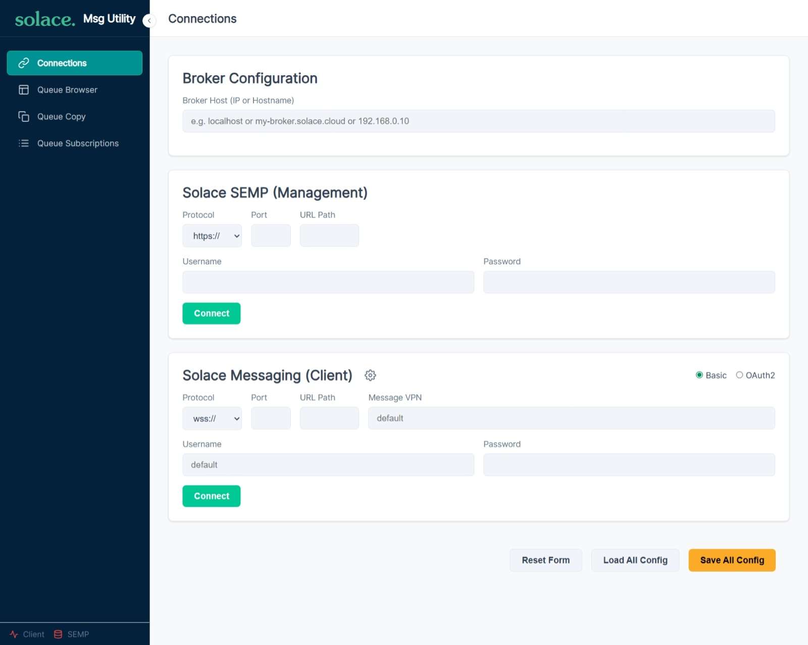
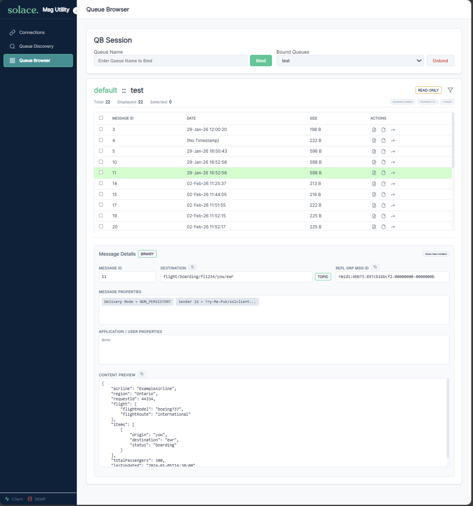
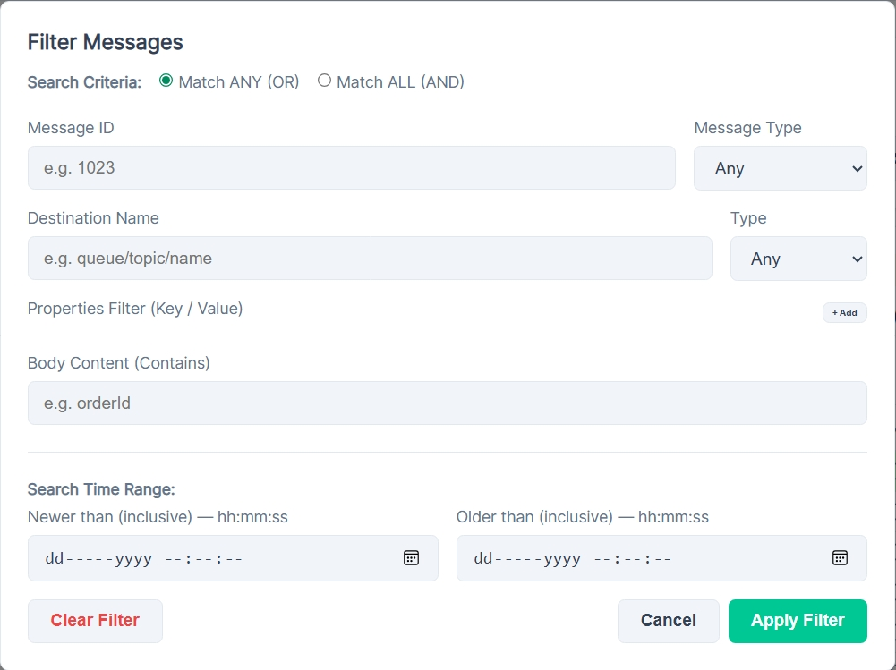
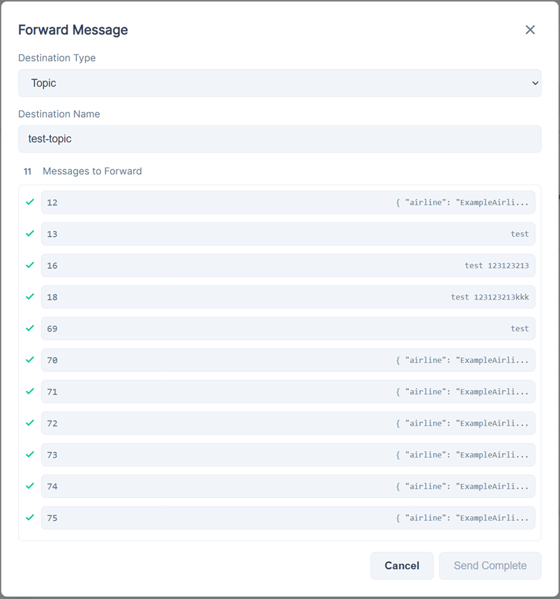
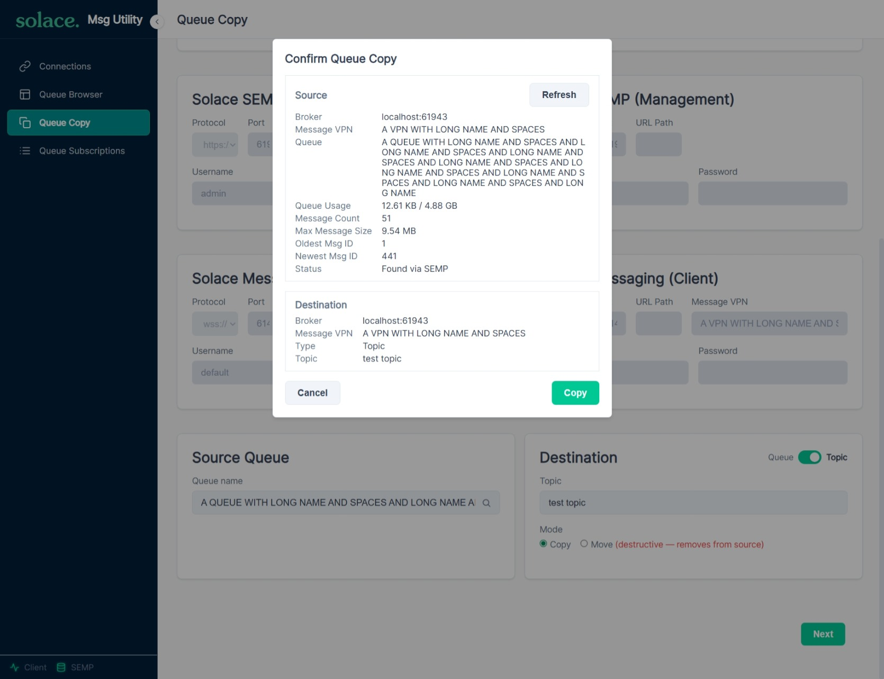
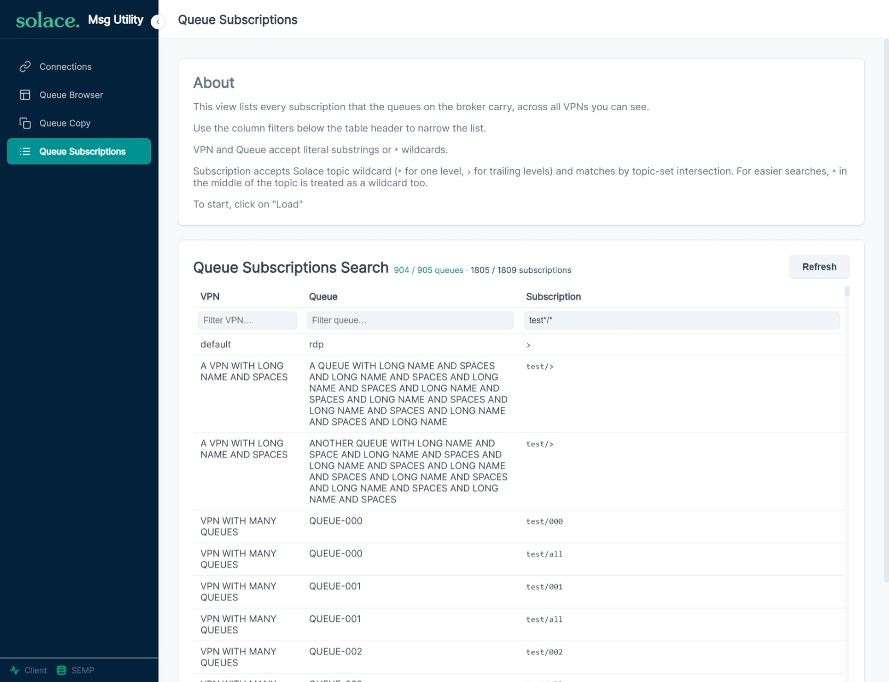

# User Guide

## Contents

- [Overview](#overview)
- [Module 1: Connections](#module-1-connections)
  - [Solace Client Connection (Web Messaging)](#solace-client-connection-web-messaging)
  - [SEMP Connection (Management API)](#semp-connection-management-api)
  - [Connection Profiles](#connection-profiles)
  - [Status Indicators](#status-indicators)
- [Module 2: Queue Browser](#module-2-queue-browser)
  - [Binding to a Queue](#binding-to-a-queue)
  - [Message Table](#message-table)
  - [Message Details](#message-details)
  - [Filtering Messages](#filtering-messages)
  - [Forwarding Messages](#forwarding-messages)
  - [Deleting Messages](#deleting-messages)
  - [Downloading Messages](#downloading-messages)
  - [Keyboard Shortcuts](#keyboard-shortcuts)
- [Module 3: Queue Copy](#module-3-queue-copy)
  - [Two-column layout](#two-column-layout)
  - [Destination credentials (Provisioned sessions)](#destination-credentials-provisioned-sessions)
  - [Destination target](#destination-target)
  - [Important considerations](#important-considerations)
  - [Confirm Queue Copy modal](#confirm-queue-copy-modal)
  - [Refreshing source stats inside the modal](#refreshing-source-stats-inside-the-modal)
- [Module 4: Queue Subscriptions](#module-4-queue-subscriptions)
  - [Workflow](#workflow)
  - [Filter syntax](#filter-syntax)
  - [Caching](#caching)
- [Tips](#tips)
- [Shipped Variants](#shipped-variants)
- [Provisioned Connections](#provisioned-connections)
  - [Signing in and connecting](#signing-in-and-connecting)
  - [What you can see and do](#what-you-can-see-and-do)
  - [Administration (`/solAdmin`)](#administration-soladmin)

---

## Overview

Solace Message Utility is a browser-based tool for managing Solace PubSub+ Event Brokers. It runs as a single HTML page — no installation required beyond a web browser and network access to your broker.

The interface has a **sidebar** on the left for navigation and a **main content area** on the right. The available modules are:

1. **Connections** — Configure and manage broker connections
2. **Queue Browser** — Inspect, filter, forward, delete, and download messages
3. **Queue Copy** — Copy messages from a source queue to a destination queue (same broker or cross-broker)
4. **Queue Subscriptions** — Search every queue subscription on the broker by VPN, queue, or topic

Which modules appear depends on the build [variant](#shipped-variants). The app runs in one of three modes: **Standalone** (the HTML files: your browser connects to the broker itself), **Gateway** (served by the gateway container, which connects to the broker for you) and **Provisioned** (you sign in and pick from the brokers an administrator granted you; see [Provisioned Connections](#provisioned-connections) below). In the first two you type the broker's details on the **Direct** form. [deployment.md](deployment.md#choosing-a-mode) explains how each is set up.

---

## Module 1: Connections

This is the first screen you see. It manages two independent connections.



> **Both connections must use the same hostname or IP address.** The Broker Host field is shared between the Solace Client and SEMP connections to keep configuration consistent and reduce errors.
>
> Connection status indicators are shown at the bottom-left of the sidebar (see [Status Indicators](#status-indicators) below).

### Solace Client Connection (Web Messaging)

This connection uses the Solace Web Messaging protocol (WebSocket) to communicate with the broker for message operations (browsing, forwarding, deleting).

**Fields:**

| Field | Description | Example |
| --- | --- | --- |
| Broker Host | IP address or hostname of your broker | `my-broker.solace.cloud`, `192.168.0.10` |
| Protocol | `ws://` (unencrypted) or `wss://` (TLS) | `wss://` (recommended) |
| Port | WebSocket port | `8008` (ws) or `1443` (wss) |
| URL Path | Optional path appended after the port (e.g. when the broker sits behind a reverse proxy). Hidden until you click **+ URL path**; the **x** in the field clears it and hides it again. A saved or loaded path always shows the field. Leave it out for a direct broker URL. | `/solace`, `/ws` |
| Message VPN | The Solace VPN to connect to | `default` |
| Username | Client username | `default` |
| Password | Client password or OAuth2 token | |

**Auth Modes:**

- **Basic** — Standard username/password authentication
- **OAuth2** — Token-based authentication (the Username field becomes "Client ID" and Password becomes "Access Token")

**Advanced Settings** (gear icon):

| Setting | Default | Description |
| --- | --- | --- |
| Connect Retries | 0 | Number of times to retry initial connection |
| Connect Timeout | 3000ms | How long to wait for connection |
| Reconnect Retries | 1 | Retries after disconnect (-1 = infinite) |
| Reconnect Wait | 3000ms | Delay between reconnect attempts |
| Max Messages per Queue | 100 | Per-queue message cap (1–10 000). When a queue exceeds this, the oldest message is silently dropped from the in-memory store and the UI as new messages arrive. Increasing this lets you keep more history at the cost of browser memory; decreasing it limits memory use during long browse sessions. The cap takes effect when you click **Connect** (the live input is read at connect time — no Save required). |
| Client Name Identifier | (auto-generated UUID) | Identifier embedded into the broker session's `clientName` property. Editable to any alphanumerics or `!@#$%^&*-=_+/.,` symbols (max 100 chars). Surrounding whitespace is trimmed on blur; if the field is left blank, a fresh UUID is filled in automatically. The full `clientName` sent to the broker is composed at Connect time as `SolMsgUtil/YYYYMMDDHHMMSS/{identifier}`, so each session is distinguishable in broker tooling. |

**SSL/TLS Certificate Trust:**
If connecting over `wss://` to a broker with a self-signed certificate, the browser will block the connection. A helper dialog appears with instructions to trust the certificate:

1. Click "Open Broker URL" to open the broker in a new tab
2. Accept the certificate warning in that tab
3. Close the tab and reconnect

### SEMP Connection (Management API)

This connection uses the SEMP v2 REST API for management operations (discovering VPNs and queues).

> [!IMPORTANT]
> SEMP connections are made over HTTP/HTTPS. Your Solace Event Broker must allow **CORS** for this to function. Future versions may include additional connection methods that do not require CORS.

> [!NOTE]
> SEMP interactions are REST calls rather than a persistent connection — each action triggers a new HTTP request using the configured credentials. The "connection" abstraction is preserved for UI consistency with the other modules. Future releases may add alternative SEMP connection methods (e.g. via the client session or OAuth2).

**Fields:**

| Field | Description | Example |
| --- | --- | --- |
| Protocol | `http://` or `https://` | `https://` |
| Port | SEMP port | `8080` (http) or `1943` (https) |
| URL Path | Optional path appended after the port and before `/SEMP/v2/...` (e.g. when SEMP is exposed behind a reverse proxy). Hidden until you click **+ URL path**, as in the Messaging card. Leave it out for a direct SEMP URL. | `/api`, `/management` |
| Username | SEMP admin username | `admin` |
| Password | SEMP admin password | |

The SEMP connection shares the same Broker Host as the Solace client connection.

### Connection Profiles

- **Save All Config** — Saves all connection fields to browser localStorage. If localStorage is unavailable or its quota is exceeded, an error toast is shown instead of a success toast.
- **Load All Config** — Restores previously saved fields
- **Reset Form** — Clears all fields back to defaults

> **Out-of-date `solclient.js`:** if the SDK next to the app is older than the required version, a banner appears at the top of the page and **Connect** refuses with an explicit message naming the required version, rather than failing somewhere inside the SDK. Replace the file to clear it.

### Status Indicators

The sidebar shows two colored dots:

- **Client** indicator — green when Solace client is connected
- **SEMP** indicator — green when SEMP management API is connected

---

## Module 2: Queue Browser

Requires an active **Solace Client connection**. If disconnected, a "Connection Required" message is shown.



### Binding to a Queue

1. Enter a queue name in the "Queue Name" input
2. Click **Bind** (or press Enter)
3. A `Queue "<name>" bound` toast confirms the bind, the queue appears in the "Bound Queues" dropdown, and messages begin arriving in real-time

You can bind up to **3 queues simultaneously**. Switch between them using the dropdown. Each queue maintains its own message store independently. The per-queue moving-window cap is set by **Max Messages per Queue** in the Connections module's Advanced Settings.

To stop receiving messages, select a queue and click **Unbind**.

### Message Table

Messages are displayed in a scrollable table:

| Column | Description |
| --- | --- |
| Checkbox | Select individual messages for bulk operations |
| Message ID | The Guaranteed Message ID assigned by the broker |
| Date | Sender timestamp (or "No Timestamp" if not set) |
| Size | Message size in bytes |
| Actions | Per-row buttons: Download Content, Download Full, Forward, Delete |

**Select All** checkbox in the header selects/deselects all visible messages.

The info bar shows counts: **Total** (all messages in store), **Displayed** (after filtering), **Selected** (checked messages).

### Message Details

Click any row to see its details in the panel below:

- **Message ID** — Guaranteed message ID
- **Destination** — Topic or queue name with a badge showing the type
- **Replication Group Message ID** — If available from the broker
- **Message Properties** — Standard Solace properties (Delivery Mode, TTL, Priority, Correlation ID, etc.)
- **Application Properties** — User-defined key/value properties set by the publisher
- **Content Preview** — The message payload (text, binary, SDT)
- **Show Raw Content** — Opens a modal with the full raw message dump

Copy buttons next to Destination, Repl Grp Msg Id, and Content allow one-click clipboard copy.

### Filtering Messages

Click the **filter icon** in the header bar to open the filter modal.



**Filter Criteria:**

| Field | Description |
| --- | --- |
| Search Criteria | **Match ANY (OR)** or **Match ALL (AND)** |
| Message ID | Filter by message ID (contains) |
| Message Type | Any, Text, Binary, Map, or Stream |
| Destination Name | Filter by destination (contains, supports `*` wildcard) |
| Destination Type | Any, Topic, or Queue |
| Body Content | Filter by payload content (contains, supports `*` wildcard) |
| Properties Filter | Add key/value rows to filter by standard or application properties |

The property filter supports autocomplete for standard Solace properties (App Msg Id, Cache Id, Corr Id, Delivery Count, Delivery Mode, HTTP Encoding, HTTP Type, Priority, Reply To, Sender Id, SeqNumber, TTL, TopicSeqNum).

**Wildcard semantics:**

- `*` matches any sequence of characters (including spaces and symbols).
- For **Body Content**, the wildcard is auto-applied — entering `match text` behaves as `*match text*` (substring contains-match).
- For Message ID and Destination Name, wildcards are explicit — use `*` where you want a wildcard. Without one, the filter is an exact match.

- **Apply Filter** — Filters the displayed messages (original data is preserved)
- **Clear Filter** — Removes all filters and shows all messages
- **Cancel** — Closes the modal without applying

Modals (filter, forward, raw content, settings, certificate trust helper) can also be dismissed by pressing **Escape** or clicking outside the modal box.

### Forwarding Messages

Forward one or more messages to a different destination.



> **Forwarded messages are sent in PERSISTENT delivery mode** to ensure delivery confirmation, even if the original message was DIRECT. The forwarded message is constructed as a new message that copies all properties from the original (see the property-preservation note below).

1. Select messages using checkboxes, then click **Forward** in the toolbar (bulk forward), OR click the forward button on an individual row
2. The Forward modal opens showing the messages queued for forwarding
3. Choose a **Destination Type** and (where applicable) enter a **Destination Name**:
   - **Topic** — fan-out to subscribers of the named topic
   - **Queue** — point-to-point delivery to the named queue
   - **Original Destination** — each message is forwarded to the destination it was originally received on. The Destination Name input is disabled in this mode (the per-message destination is read from each message's broker metadata)
4. Click **Send**

While the send is running, both the type and name inputs are locked and the button shows **Sending...**. They re-enable when the batch reaches a terminal state.

Each message shows a status indicator:

- **QUEUED** — Waiting to be sent
- **SENDING** — In transit
- **SUCCESS** — Broker acknowledged receipt
- **FAILED** — Broker rejected the message (reason shown), the client disconnected mid-send, or the broker did not acknowledge within 30 seconds ("Timed out waiting for broker acknowledgement.")

If any messages fail, the **Send** button changes to **Resend failed messages (N)** with N being the failure count. Clicking it retries only the failed items — successful messages keep their green check and aren't re-forwarded. You can switch the destination type or name (or to/from Original Destination) before clicking resend, so retries can target a different destination than the initial send.

Forwarded messages preserve all original properties (application message ID, correlation ID, delivery mode, priority, TTL, reply-to, user properties, etc.).

> **Note:** Closing the Forward modal (Close button, X, Escape, or backdrop click) discards the in-modal queue. Reopening from the message list rebuilds it with new tracking IDs — pending ACKs from the previous attempt won't update the new view.

### Deleting Messages

> [!IMPORTANT]
> Delete is available only when the queue binding has **read-write** permissions (Consume, Modify, Delete, Owner). On read-only queues the delete button is hidden from each row entirely.

- **Single delete**: Click the delete button on a message row. A confirmation dialog appears.
- **Bulk delete**: Select messages with checkboxes, then click **Delete** in the toolbar. A confirmation dialog shows the count.

Deleted messages are removed from the broker queue and the UI immediately.

### Downloading Messages

Two download formats are available:

- **Download Content** — Exports only the message payload. Each message becomes a separate file in a ZIP archive named `solace-message-{id}`. If the payload is a known binary format (PDF, PNG, DOCX, etc.) the saved file has no extension — rename it before opening.
- **Download Full** — Exports the complete message as JSON including all properties, headers, destination, timestamp, and content. Each message becomes `solace-message-{id}-full.json` in a ZIP archive. The JSON shape is:

  ```json
  {
    "messageProperties":     { ... standard Solace properties + destination + messageType ... },
    "applicationProperties": { ... user/custom properties ... },
    "payload":               "..."
  }
  ```

  > [!IMPORTANT]
  > This JSON structure is proprietary to this tool and may change in future releases. If you build automation against it, version-pin the tool or migrate when the format changes.

Both are available as per-row buttons and as bulk toolbar buttons (when messages are selected).

Requires `jszip.min.js` to be present next to the app (see [Shipped Variants](#shipped-variants) for where to get it). Without it the app still runs — only the ZIP download is disabled.

### Keyboard Shortcuts

- **Enter** in the Queue Name input — triggers Bind
- **Enter** in the Forward Destination input — triggers Send

---

## Module 3: Queue Copy



Requires an active **primary Solace connection**. If the primary client is disconnected, a "Connection Required" message is shown.

Queue Copy moves or copies messages from a source queue to a destination queue (or topic). The destination can be on the **same broker** as the primary connection or on a **different broker** entirely — cross-broker copy is fully supported.

### Two-column layout

The form is split into Source (left, read-only mirror of the primary connection) and Destination (right, editable):

- **Source** cards mirror the primary Broker / SEMP / Client values. Only the Source Queue field is editable. Each card has an **Edit in Connections** button that jumps to the Connections module for credential changes.
- **Destination** cards accept broker host, SEMP creds, Solace client creds, and the destination target. Two shortcuts live at the top of the Destination Broker card:
  - **Same Solace Broker as source** — destination reuses the primary host + SEMP creds.
  - **Same Message VPN as source** — destination reuses the primary VPN + Solace creds (implies Same Broker).

When Same-VPN is enabled, the destination uses the primary Solace session directly — no second connection is needed.

### Destination credentials (Provisioned sessions)

When the destination is *not* just the primary connection, a **Credentials** choice appears on the Destination Broker card:

- **Provisioned** -- pick a **Broker** and **Message VPN** from the ones you are entitled to. There are no password fields: your administrator provisioned the credentials, exactly as for the primary connection.
- **Manual** — type the host and credentials yourself, as before.

Which options you get follows the deployment: a Provisioned-only deployment offers **Provisioned** alone, a direct one offers **Manual** alone, and a deployment offering both connection modes lets you choose. Switching between them clears the destination target, since it was picked against a different broker.

On a provisioned destination you can only copy **into queues you hold Operate on**, and **Topic destinations are unavailable** — entitlements are defined per queue, and a topic delivers to every queue subscribed to it, so there is no way to check it. Switch to manual credentials (where the deployment allows it) if you need to publish to a topic.

### Destination target

Choose one of two targets:

- **Queue** -- point-to-point delivery; pick an existing destination queue (or type the name). A **Pick** button opens a queue selector populated via SEMP. In a Provisioned session it lists only queues you may **write** to on the destination broker.
- **Topic** — fan-out to subscribers of the named topic.

Each run is either a **Copy** (messages stay on the source) or a **Move** (messages are removed from the source after successful publish).

### Important considerations

The modal's top card lists operational constraints:

- Don't run this on a live queue with active publishers/consumers.
- The run stops on the first error (e.g. quota exhausted, permission denied, destination rejects).
- The module snapshots the source queue before starting so the run is bounded.
- Destination must have sufficient spool quota, equal-or-larger max-message-size, and ingress enabled.
- Source queue must have egress enabled.

### Confirm Queue Copy modal

Clicking **Start Copy** opens a two-phase modal:

1. **Verify** — SEMP v1 is probed for the source queue's count, size, quota, max-msg-size, oldest-msg-id, newest-msg-id, and access-type. If SEMP is unavailable, the module falls back to a temporary QueueBrowser bind that accumulates count + oldest/newest IDs from the browsed messages and reads the access-type from the SDK.
2. **Run** — after you confirm, messages stream from source to destination. Progress counters update live; a per-message ACK is awaited before the next publish. In Move mode, each source message is removed immediately after its publish ACK lands (not batched at the end). The run stops when the recorded newest-msg-id is reached, then completes.

The snapshot taken in step 1 is treated as immutable — the engine copies oldest → newest in one pass, then stops. Messages that arrive on the source *after* verify are out of scope for the current run.

**Empty queue:** if verify reports zero messages, a red "Queue is empty" banner appears and the Copy/Move button stays disabled.

**Move on read-only:** if you select Move and the source queue's access type is read-only, a red "Move requires consume permission" banner appears and the button is disabled. Switch to Copy mode to proceed (Copy doesn't need consume permission).

**No access:** if the source queue's `<others-permission>` is `No-Access` AND your client session username doesn't match the queue's `<owner>`, a red "You don't have access to this queue" banner appears and Both Copy and Move are blocked. Re-connect as the queue owner or as a user with at least Read-Only permission, then click Refresh.

**Owner override.** When SEMP is connected and the queue's `<owner>` matches your client session username, you have full access regardless of the queue's `<others-permission>` value. The modal lifts the effective access type to read-write automatically — both Copy and Move are enabled. (The QueueBrowser-fallback path doesn't need an explicit owner check; the SDK already factors owner status into the permission it reports.)

**Stop conditions and statuses.** The run reports one of three final statuses:

- **Completed** — every message from oldest to newest was copied/moved successfully.
- **Cancelled** — you clicked Cancel; the modal shows the partial count.
- **Failed** — surfaces with a specific error message. The most common causes:
  - *Source drift:* the first browsed message ID doesn't match the recorded oldest. The queue contents changed between verify and run.
  - *Recorded newest consumed:* a message ID greater than the recorded newest arrived before the engine reached the recorded newest itself, implying someone else consumed the recorded newest message before our run.
  - *Count mismatch:* the run drained without reaching the recorded count. Messages were drained from the source mid-run by another consumer.
  - *Publish error:* the destination broker rejected a publish (full quota, missing permission, max-message-size exceeded, etc.).

### Refreshing source stats inside the modal

The Confirm Queue Copy modal has a **Refresh** button next to the Source heading. After the initial verify probe completes (whether successful or not), click Refresh to re-fetch the source queue's count, size, oldest/newest message IDs, etc., before clicking Copy. The button is disabled while a probe is in flight and hidden once the copy run starts — drift recovery during the run is still cancel-and-re-click-Next.

---

## Module 4: Queue Subscriptions



Requires an active **SEMP connection**. If SEMP is not connected, a "Connection Required" message is shown.

This view lists every `(VPN, queue, topic-subscription)` triple visible to your SEMP user — useful for answering "which queues subscribe to topic X?" without having to walk every queue manually. Queues that have zero topic subscriptions are omitted. In a Provisioned session it lists only the queues your entitlements let you see, in the VPNs you can pick for the connected broker (see [Provisioned connections](#provisioned-connections)).

### Workflow

1. **Click Load** to fetch the full subscription list from the broker. The button label flips to **Refresh** once the load completes; click it again at any time to re-fetch.
2. **Filter the table** by typing into one or more of the column-filter inputs below the column headers. Filters are AND-combined — a row must match every non-empty filter to render.
3. With all three filters empty, the table prompts *"Type in any column above to start searching."* — the filtered table is only rendered once you start typing, so the page never dumps thousands of rows by accident.

### Filter syntax

| Column | Match rule |
| --- | --- |
| **VPN** / **Queue** | Case-insensitive substring by default — `def` matches `default`. Type `*` anywhere in the input to switch to anchored wildcard matching — `def*` matches names starting with `def`, `*ult` matches names ending with `ult`, `def*ult` matches names that start with `def` and end with `ult`. |
| **Subscription** | Solace topic-set intersection. Both your input and the stored subscription may use Solace wildcards: `*` matches one level, `>` matches one or more trailing levels. The row is included when the two patterns describe overlapping topics. So typing `orders/new` matches a stored subscription `orders/*`; typing `orders/>` matches `orders/new/details`; typing `topic` matches a stored subscription `*`. |

### Caching

The loaded subscription list is held in memory for the session. Subsequent filter changes never re-hit the broker. Click **Refresh** to re-fetch (e.g. after a queue or subscription was added/removed). The cache is dropped automatically if your SEMP connection drops.

---

## Tips

- **Cross-module flow**: Once the primary connection is up, the **Pick** buttons in Queue Browser and Queue Copy let you select a queue from a SEMP-driven dropdown without leaving the current module.

- **Connection profiles**: Save your connection settings before closing the browser. They persist in localStorage and can be restored with one click.

- **Multiple queues**: Bind up to 3 queues and switch between them. Messages accumulate independently per queue. Unbinding a queue removes its messages from the UI but the data stays in memory until you bind again or disconnect.

- **Filtering is non-destructive**: Filters only change what is displayed. All messages remain in memory. Clear the filter to see everything again.

- **Wildcard search**: Use `*` in content and destination filters for glob-style matching (e.g., `order*` matches "orderCreated", "orderUpdated").

- **Verbose troubleshooting logs**: append `?logLevel=DEBUG` to the URL (e.g. `dist/index.html?logLevel=DEBUG`) to surface fine-grained flow logs in DevTools. Accepted values are `DEBUG`, `INFO` (default), `WARN`, `ERROR`, and `SILENT` (mutes everything). Invalid values fall back to the default.

- **Gateway and Provisioned mode**: when the app is served by the gateway container, the gateway connects to the broker for you, so the broker need not be reachable from your browser. You still enter the broker's protocol, host, port and path as if connecting directly, and the page shows those same values.

---

## Shipped Variants

The project builds several HTML variants. The ones below are attached to each [GitHub Release](https://github.com/SolaceLabs/solace-msg-utility/releases), all Direct-only except `provisioned-demo.html`; `index.html` is also what GitHub Pages and the gateway image serve in Gateway mode. In Provisioned mode the image serves its own bundle (`provisioned.html`, standard plus the Provisioned sign-in) at `/`, and `solAdmin.html` at `/solAdmin`; neither is a Release download.

| File | Variant | Use |
| --- | --- | --- |
| `index.html` | **Standard** (default) | Production deployment — every module: Connections, Queue Browser, Queue Copy, Queue Subscriptions |
| `min.html` | **Minimal** | Stripped-down variant — only Connections + Queue Browser. Smaller bundle for environments that don't need the copy/move or subscription-browser modules |
| `no-payload.html` | **No-payload** | Same as Standard, except the Queue Browser never shows or exports the message **body**. The Content Preview, Show Raw Content, Copy Content, Download Content, Download Full, and Body-Content filter are all removed; Forward, Delete, all metadata, and the other filters remain. Use where message bodies must not be visible to the operator. |
| `no-queue-copy.html` | **No Queue Copy** | Same as Standard, minus the Queue Copy module. For deployments where operators should browse and forward but never bulk-copy between queues. |
| `demo.html` | Standard + demo broker | Interactive demo (see [Demos](demo.md#direct-demo-demohtml)) |
| `provisioned-demo.html` | Provisioned + admin pages + demo gateway | Provisioned mode without a gateway or a broker (see [Demos](demo.md#provisioned-demo-provisioned-demohtml)). It makes no network request |

Each HTML file is self-contained for the app code (CSS and JS are inlined), but **two vendor scripts are not bundled and must be downloaded separately** (the gateway image includes both):

- **`solclient.js`** — Solace Web Messaging SDK, required for any broker connection. Get it from the [Solace Developer Portal](https://solace.com/downloads/), npm (`solclientjs`), or your broker's web UI (`http://<broker>:8080/`).
- **`jszip.min.js`** — JSZip library, required for the Queue Browser's ZIP download feature. Get it from a CDN (`https://cdnjs.cloudflare.com/ajax/libs/jszip/3.10.1/jszip.min.js`), npm (`jszip`), or [https://stuk.github.io/jszip/](https://stuk.github.io/jszip/).

Place both files in the **same folder as the HTML**, or in a sibling **`js/`** subfolder — the shell tries both locations automatically. The same files serve every HTML variant; you don't need a separate copy per variant.

> **What happens if a vendor file is missing:**
>
> - Without `solclient.js`, the app boots in a limited mode and shows a vendor-missing banner. Connection features will not work.
> - Without `jszip.min.js`, every other feature works normally; only ZIP download is disabled.

See [deployment.md](deployment.md#external-runtime-dependencies) for download sources and version requirements.

---

## Provisioned Connections

**Provisioned** mode is for users who should not handle broker credentials. Instead of typing connection details, you **sign in** and pick from the brokers and Message VPNs an administrator has granted you.

It appears as a tab in the **Connections** module -- **Direct** (type your own credentials) and **Provisioned** (sign in). Which tabs you see is decided by the deployment: you may get both, or only one. Provisioned runs **only behind the gateway container in Provisioned mode**: the copies of the app attached to a Release, and the gateway in Gateway mode, have no Provisioned tab. See [provisioned-mode.md](provisioned-mode.md) to stand one up.

### Signing in and connecting

1. **Sign in.** On a deployment that offers only Provisioned, opening the app takes you straight to the sign-in page. Otherwise open **Connections**, choose the **Provisioned** tab and click **Sign in**. Enter the username and password your administrator gave you; you return to the app with the **Provisioned** tab open.
2. **First sign-in of a new deployment:** the bootstrap `admin` account is asked to choose a new password (12 to 128 characters) before anything else.
3. Pick a **Broker** and **Message VPN** from the dropdowns -- these list only what you're entitled to, by name. You never see or type the broker's address or credentials.
4. Click **Connect**. From here the **Queue Browser** and **Queue Copy** work exactly as usual, but scoped to your entitlements.
5. **Refresh** re-fetches your entitlements and brokers without signing out (useful right after an admin grants you access). While you are signed in, the sidebar footer shows your username (tagged *admin* for an administrator) above the Client and SEMP lights, with **Change password** (the key icon: the gateway's password page) and **Sign out** (the exit icon). They stay there on every page and while you are connected; signing out while connected disconnects first. In a collapsed sidebar only the icons show.

**Your session** survives a page refresh (F5). It ends after 10 minutes without activity or 30 minutes after you signed in (your deployment may set other limits), when you sign out, and when an administrator changes your password, your administrator flag or deletes your account. You then see *Your session has ended. Sign in again.* the next time the app asks the gateway (for example on **Refresh**). Too many wrong passwords in a row lock sign-in for a while; the page says how long.

**One mode at a time.** Connecting on the Provisioned tab drops a Direct connection, and connecting on the Direct tab ends your Provisioned session -- otherwise your entitlements would be applied to a connection they were never issued for. Just *switching* tabs changes nothing; only Connect does.

### What you can see and do

Your entitlements come in two levels, **Operate** (browse + delete) and **Read-only** (browse only); Operate includes everything Read-only does. They are evaluated per broker + VPN + queue:

- The **VPN picker** lists exactly the VPNs you can connect to — the same provisioned set shown in the **Connections** dropdown (the VPNs your administrator added for you), not every VPN that happens to exist on the broker. The **queue picker** lists only the queues you're entitled to on the chosen VPN — non-entitled queues are filtered out of discovery.
- Typing or selecting a queue you aren't entitled to **fails to bind**, with an error.
- On a **read-only** queue, the **Delete** action is hidden and the queue shows a "Read-Only" badge; **Forward** is still available. On an **Operate** queue, Delete is available.
- In **Queue Copy**, the destination queue must be one you hold **Operate** on -- copying into a queue is a write. See [Destination credentials](#destination-credentials-provisioned-sessions).
- **Which modules you see is up to your administrator.** Besides Connections, a Provisioned session shows only the modules you were given (any of Queue Browser, Queue Copy and Queue Subscriptions). A module you were not given is simply not in the sidebar; a change shows after your next **Refresh** or page reload.
- **Queue Subscriptions** lists only subscriptions on queues you may see, in the VPNs you can pick for the broker you are connected to. It reads the broker's whole list and narrows it in your browser, like the queue lists. Queue Discovery is never shown in a Provisioned session.

If your entitlements change while you are working (you or an admin hit Refresh, or you sign out), anything that depended on what was withdrawn stops: a copy/move run in progress halts the same way pressing Cancel would, and if a provisioned Queue Copy destination is no longer yours, the chosen destination queue is cleared so you cannot start a run against it.

**Messages from the gateway.** *The gateway relays SEMP reads only; this request would change the broker.* means something asked the broker for a change, which a Provisioned session never makes. *The broker refused the credential the gateway holds for it* and *The gateway could not reach the broker...* mean the connection needs your administrator. If the gateway takes your access away while you are connected (you signed out in another tab, your password or administrator flag changed, or an administrator removed your access to that VPN or broker), the connection closes; when your session itself has ended, the app's next request to the gateway returns the Provisioned tab to **Sign in**.

> The gateway connects you only to the brokers and Message VPNs you are entitled to, and its management (SEMP) connection is **read-only**: the app only reads through it. The queue-level limits above are guardrails in the app, on top of least-privilege broker accounts. If your deployment offers **both** tabs, note that the Direct tab is outside this model entirely -- see [deployment.md](provisioned-mode.md#connection-modes).

### Administration (`/solAdmin`)

Administration is a **separate app**, not a pair of extra sidebar entries in the main one. Open `https://<your-gateway>/solAdmin`: without a session you are sent to the sign-in page first, and an ordinary account gets an *Administrator access required* page instead of the app. Its **Administration** page shows who is signed in, with **Change password** and **Sign out**. The admin app never connects to a broker; it only edits the deployment's users, connections and gateway settings, and backs them up. It exists only on deployments running in Provisioned mode; anywhere else the URL simply 404s.

Signed in there, you get four modules:

- **User Management** -- list, add, edit, and delete users. Each row's pencil icon edits the user and the red bin icon deletes them (hover for the name). For each user you set the username (letters, digits and `. _ @ -`, up to 64, not only dots), password (12 to 128 characters), the **Administrator** flag, and the **Operate** / **Read-only** entitlement rows (each row is a *brokers / msgVpns / queues* glob, e.g. `* / vpn-prod / orders.*`, under the column names **Brokers**, **Message VPNs** and **Queues**). An empty list says what it means: with no Operate rows the user changes no queue, and with no Read-only rows either they can sign in but reach no broker. The **Administrator** flag gives no broker access by itself; an administrator needs rows like anyone else. Leave the password blank when editing to keep the current one. **Add user** refuses a username that already exists; use that user's pencil icon to change them. The last remaining administrator cannot be deleted or have the flag removed (to avoid locking everyone out). Setting a user's password, changing their Administrator flag or deleting them signs that user out everywhere. Under **Modules this user may open**, **Deployment default** (ticked for new users) gives the user whatever the gateway settings give everyone, shown greyed out; untick it to choose their own modules. A module tagged *(not offered)* is switched off for the whole deployment in Gateway Settings, so giving it has no effect until it is offered. The **Permission test** card under the list shows what a saved user gets: pick the user, type a broker, Message VPN and queue, and it shows **Operate** (browse, forward, delete, copy into the queue), **Read-only** (browse and forward), **Queue hidden** (the VPN is reachable but no row's queue pattern matches) or **No access**, with the row that decides it and the modules the user may open. It matches names exactly, the way the gateway and the app do (case-sensitive; `*` is a wildcard only in the rows). The broker's own queue permissions still apply, and the broker and VPN must be in Connection Management to be reached.
- **Connection Management** -- list, add, edit, and delete broker connections, with the same pencil and bin icons on each row. For each connection you set the broker name, hostname, the **SEMP** account (port / username / password), the **client** port, and one or more **Message VPNs** (columns **Message VPN**, **Client username**, **Client password**; a broker with none is reachable by no one). Use a **read-only or least-privilege SEMP account**. Passwords are sent to the gateway over TLS and kept in its encrypted store; they are never shown again. Leave a password field blank when editing to keep the stored one. A Message VPN's stored password is matched by its name, so a VPN you add or rename needs its password typed in; **Add connection** refuses a broker name that already exists. The hostname is a bare host name or IP address (no `https://`, port or path), the SEMP port is required once a SEMP username is set, and the client port once a Message VPN is listed; the gateway refuses a save that breaks these rules and says which.
- **Settings** -- the gateway's own settings (its `config.yaml`): which connection tabs the app offers (Provisioned only, or Direct and Provisioned; leaving Provisioned mode is done in `config.yaml` on the host), the client access list, session limits, the sign-in throttle, which modules signed-in users may be given and what a user without their own list gets, the log level, and the file and TLS paths. **Save** applies most changes at once; settings tagged **restart** are saved but take effect only when the gateway restarts, and a banner lists the saved ones still waiting. The file and TLS paths, tagged **edit on host**, are shown but cannot be changed here: edit `config.yaml` on the gateway host and restart. If the gateway cannot read its `config.yaml`, the page says so instead of showing the settings. The gateway refuses an access list that would shut out your own address (the error names it), and refuses any save after someone edited the file directly on the gateway host: a banner says so and Save stays off until the gateway is restarted.
- **Backup & Restore** -- copies of the users, connections and settings, each encrypted with a passphrase (12 to 128 characters) that you need again to restore it. **Export** downloads one. In **Saved backups**, each backup's download icon saves it as written (it opens with the schedule's passphrase). **Import** takes a file, or a saved backup's restore icon, and its passphrase; **Preview** lists what each section would add, change and remove, and you choose per section: **Skip**, **Merge** (add and update, keep the rest), or **Replace** (settings: Skip or Replace). Every choice starts at Skip, and **Import** asks before it applies anything. A warning shows when the users choice would change your own account; the import then signs you out. **Scheduled backup** sets how often the gateway writes a backup into its backup directory (hourly, daily, weekly or monthly, in UTC), how many to keep, and the passphrase (leave it blank when editing to keep the current one); **Back up now** writes one at once, and **Remove schedule** stops them (saved backups stay). The page shows the next and last backup, and a banner when the gateway cannot write to the directory. See [Back up and restore](provisioned-mode.md#back-up-and-restore).

**Searching the lists.** The search box above the users list (by username) and the connections list (by broker or hostname) narrows it as you type. It finds the text anywhere in the name, ignores case, and `*` matches any run of characters in between: `ops*prod` finds `ops-eu-prod` but not `prod-ops`. The search keeps its text across **Refresh**. It only narrows what is shown; it is not the stricter matching used by entitlement rows.

**Changing your own password or Administrator flag signs you out.** As soon as the save succeeds the admin app shows *Password changed. Sign in again.* (or *Administrator flag changed. Sign in again.*) and returns to its signed-out view, because the gateway has ended your session. Deleting your own account signs you out the same way (the confirmation tells you so). Editing your own entitlements **without** entering a password keeps you signed in. (To change only your own password, **Change password** on the Administration page is the shorter way and keeps you signed in.)

Errors name their cause: for example *At least one administrator must remain.* or the gateway's reason for a rejected field.

Entitlement changes reach a signed-in user on their next **Refresh** or sign-in. Glob matching is **case-sensitive** and supports `*` anywhere (leading, middle, trailing, multiple).
