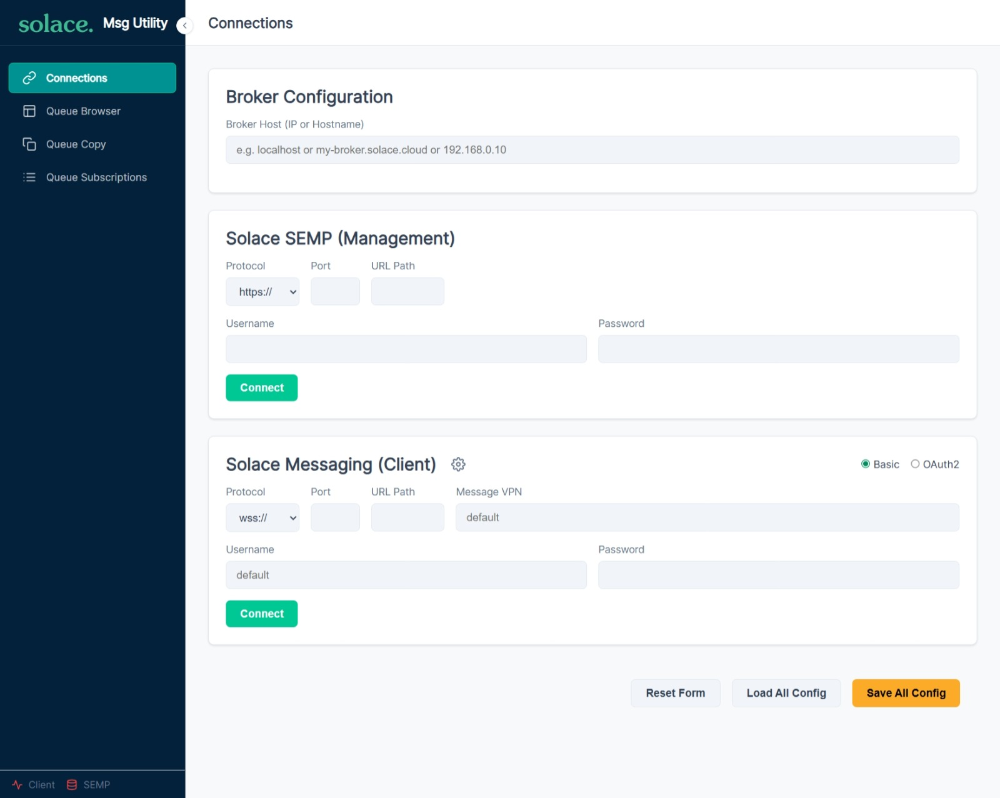
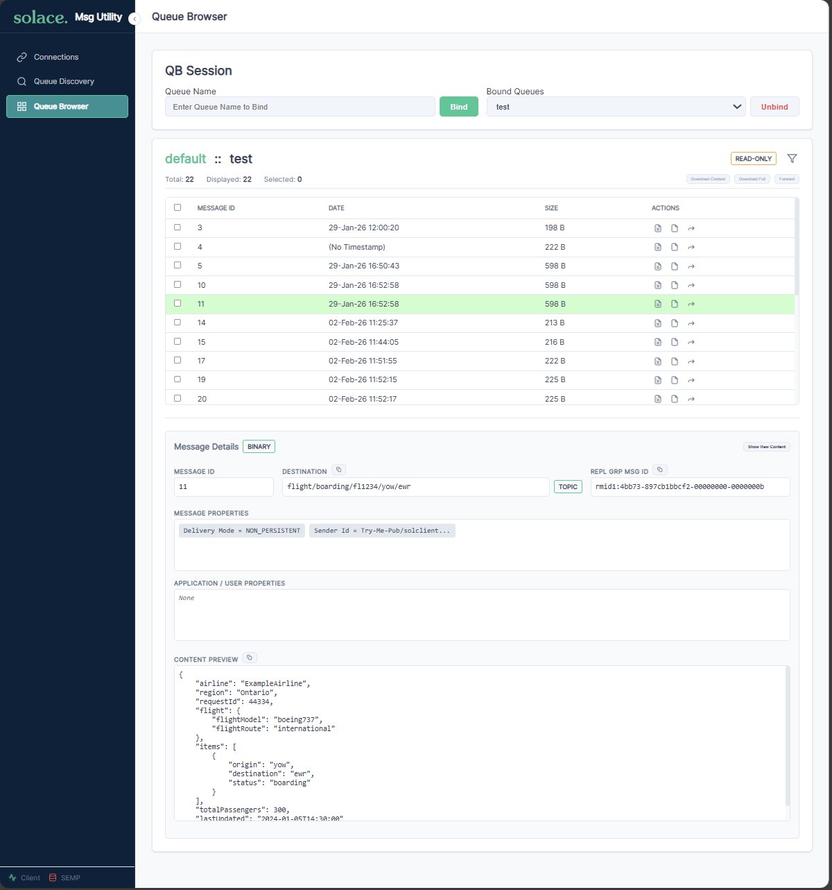
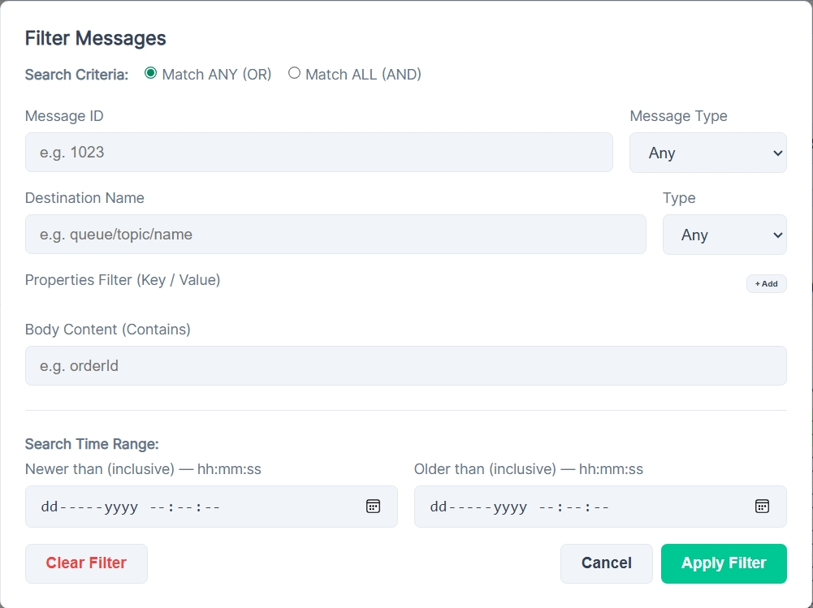
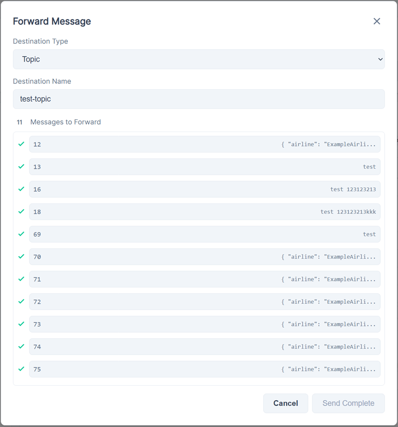
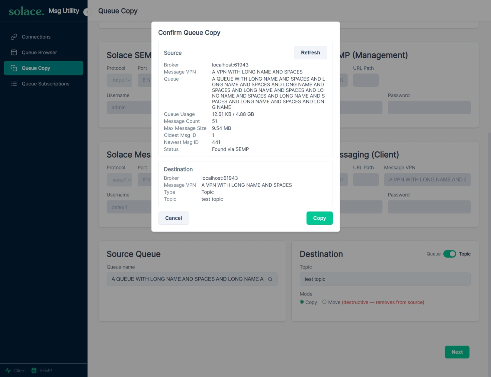
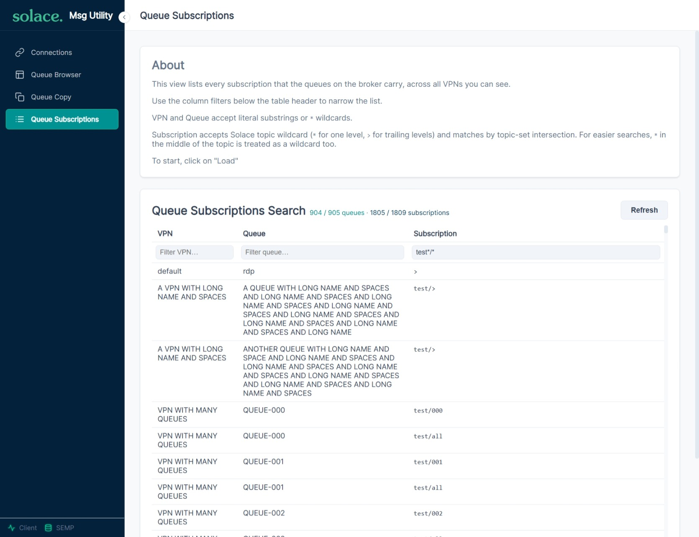

# User Guide

This guide is for people who use Solace Message Utility: operators who browse, forward, copy and delete messages on Solace PubSub+ Event Brokers, and administrators of a Provisioned deployment who manage users, brokers and gateway settings. It describes every screen and what each control does. To install or host the app, read [deployment.md](deployment.md). To stand up a Provisioned deployment, read [provisioned-mode.md](provisioned-mode.md).

## Contents

- [Overview](#overview)
- [Module 1: Connections](#module-1-connections)
  - [Solace Client Connection (Web Messaging)](#solace-client-connection-web-messaging)
  - [SEMP Connection (Management API)](#semp-connection-management-api)
  - [Connection Profiles](#connection-profiles)
  - [Startup Messages and Banners](#startup-messages-and-banners)
  - [Status Indicators](#status-indicators)
- [Module 2: Queue Browser](#module-2-queue-browser)
  - [Binding to a Queue](#binding-to-a-queue)
  - [Message Table](#message-table)
  - [Message Details](#message-details)
  - [Filtering Messages](#filtering-messages)
  - [Forwarding Messages](#forwarding-messages)
  - [Deleting Messages](#deleting-messages)
  - [Downloading Messages](#downloading-messages)
  - [Keyboard Shortcuts](#keyboard-shortcuts)
- [Module 3: Queue Copy](#module-3-queue-copy)
  - [Two-column layout](#two-column-layout)
  - [Destination connection (Provisioned sessions)](#destination-connection-provisioned-sessions)
  - [Destination target](#destination-target)
  - [Important considerations](#important-considerations)
  - [Confirm Queue Copy modal](#confirm-queue-copy-modal)
  - [Refreshing source stats inside the modal](#refreshing-source-stats-inside-the-modal)
- [Module 4: Queue Subscriptions](#module-4-queue-subscriptions)
  - [Workflow](#workflow)
  - [Filter syntax](#filter-syntax)
  - [Caching](#caching)
- [Tips](#tips)
- [Provisioned Connections](#provisioned-connections)
  - [Signing in and connecting](#signing-in-and-connecting)
  - [Two-factor sign-in](#two-factor-sign-in)
  - [What you can see and do](#what-you-can-see-and-do)
- [Administration (`/solAdmin`)](#administration-soladmin)
  - [Opening the admin app](#opening-the-admin-app)
  - [User Management](#user-management)
  - [Connection Management](#connection-management)
  - [Gateway Settings](#gateway-settings)
  - [Certificates](#certificates)
  - [Backup & Restore](#backup--restore)
  - [Restart gateway](#restart-gateway)
  - [Searching the lists](#searching-the-lists)
  - [Saving at the same time as someone else](#saving-at-the-same-time-as-someone-else)
  - [Messages about the gateway's files](#messages-about-the-gateways-files)

---

## Overview

Solace Message Utility is a browser-based tool for managing Solace PubSub+ Event Brokers. It runs as a single HTML page: you need only a web browser and network access to your broker.

The interface has a **sidebar** on the left for navigation and a **main content area** on the right. The modules are:

1. **Connections** -- configure and manage broker connections
2. **Queue Browser** -- inspect, filter, forward, delete and download messages
3. **Queue Copy** -- copy or move messages from a source queue to a destination queue or topic (same broker or another broker)
4. **Queue Subscriptions** -- search every queue subscription on the broker by VPN, queue or topic

Which modules appear depends on the build variant your deployment serves (the variants are listed in [deployment.md](deployment.md)).

The app runs in one of three modes:

| Mode | How you reach the broker | Where to read more |
| --- | --- | --- |
| **Standalone** | The HTML file is opened or hosted on its own; your browser connects to the broker itself | [Module 1: Connections](#module-1-connections) |
| **Gateway** | The gateway container serves the app and connects to the broker for you | [Module 1: Connections](#module-1-connections), [Tips](#tips) |
| **Provisioned** | You sign in and pick from the brokers an administrator granted you | [Provisioned Connections](#provisioned-connections) |

In Standalone and Gateway mode you type the broker's details on the **Direct** form. [deployment.md](deployment.md#choosing-a-mode) explains how each mode is set up.

---

## Module 1: Connections

This is the first screen you see. It manages two independent connections.



> **Both connections use the same hostname or IP address.** The Broker Host field is shared between the Solace Client and SEMP connections.
>
> Connection status indicators are at the bottom-left of the sidebar (see [Status Indicators](#status-indicators)).

### Solace Client Connection (Web Messaging)

This connection uses the Solace Web Messaging protocol (WebSocket) for message operations: browsing, forwarding and deleting.

**Fields:**

| Field | Description | Example |
| --- | --- | --- |
| Broker Host | IP address or hostname of your broker | `my-broker.solace.cloud`, `192.168.0.10` |
| Protocol | `ws://` (unencrypted) or `wss://` (TLS). A page served over `https://` without the gateway offers only `wss://`: the browser blocks unencrypted connections from it. Behind the gateway both are offered, because the gateway makes the connection to the broker. | `wss://` (recommended) |
| Port | WebSocket port | `8008` (ws) or `1443` (wss) |
| URL Path | Optional path appended after the port (for example when the broker sits behind a reverse proxy). Hidden until you click **+ URL path**; the **x** in the field clears it and hides it again. A saved or loaded path always shows the field. Leave it out for a direct broker URL. | `/solace`, `/ws` |
| Message VPN | The Solace VPN to connect to | `default` |
| Username | Client username | `default` |
| Password | Client password or OAuth2 token | |

**Auth modes:**

- **Basic** -- username and password
- **OAuth2** -- token-based; the Username field becomes "Client ID" and Password becomes "Access Token"

**Advanced Settings** (gear icon):

| Setting | Default | Description |
| --- | --- | --- |
| Connect Retries | 0 | Times to retry the initial connection |
| Connect Timeout | 3000 ms | How long to wait for the connection |
| Reconnect Retries | 1 | Retries after a disconnect (-1 = infinite) |
| Reconnect Wait | 3000 ms | Delay between reconnect attempts |
| Max Messages per Queue | 100 | Per-queue message cap (1 to 10 000). When a queue exceeds it, the oldest message is dropped from the in-memory store and the table as new ones arrive. A higher cap keeps more history at the cost of browser memory. The cap takes effect when you click **Connect**: the live input is read at connect time, with no Save needed. |
| Client Name Identifier | (auto-generated UUID) | Identifier embedded in the broker session's `clientName`. Any alphanumerics or `!@#$%^&*-=_+/.,` (max 100 characters). Surrounding whitespace is trimmed on blur; a blank field is filled with a fresh UUID. The full `clientName` is composed at Connect time as `SolMsgUtil/YYYYMMDDHHMMSS/{identifier}`, so each session is distinguishable in broker tooling. |

**SSL/TLS certificate trust.** If you connect over `wss://` to a broker with a self-signed certificate, the browser blocks the connection. A helper dialog explains how to trust the certificate:

1. Click **Open Broker URL** to open the broker in a new tab.
2. Accept the certificate warning in that tab.
3. Close the tab and reconnect.

### SEMP Connection (Management API)

This connection uses the SEMP v2 REST API for management operations: discovering VPNs and queues.

> [!IMPORTANT]
> SEMP connections are made over HTTP or HTTPS from your browser. Your broker must allow **CORS** for this to work. Behind the gateway, the gateway makes the call and CORS is not involved.

> [!NOTE]
> SEMP calls are REST requests, not a persistent connection: each action sends a new HTTP request with the configured credentials. The "connection" is kept as a concept so the page looks the same as the other modules.

**Fields:**

| Field | Description | Example |
| --- | --- | --- |
| Protocol | `http://` or `https://`. As for Messaging, a page served over `https://` without the gateway offers only `https://`. | `https://` |
| Port | SEMP port | `8080` (http) or `1943` (https) |
| URL Path | Optional path appended after the port and before `/SEMP/v2/...` (for example when SEMP is exposed behind a reverse proxy). Hidden until you click **+ URL path**, as in the Messaging card. Leave it out for a direct SEMP URL. | `/api`, `/management` |
| Username | SEMP admin username | `admin` |
| Password | SEMP admin password | |

The SEMP connection shares the Broker Host with the Solace client connection.

### Connection Profiles

- **Save All Config** -- saves all connection fields to browser localStorage. If localStorage is unavailable or its quota is exceeded, an error toast appears instead of a success toast.
- **Load All Config** -- restores the saved fields. A saved `ws://` or `http://` that the page cannot use (served over `https://` without the gateway) loads as `wss://` or `https://`, with a warning toast: check the port, which is likely still the unencrypted one. The same happens when the app opens with saved fields.
- **Reset Form** -- clears all fields back to their defaults.

### Startup Messages and Banners

- **Loading.** The content area shows "Loading..." until the first module's view appears. If no module is available it reads "No modules are available. Check the browser console." A module that fails to install shows an error toast, `Module "<name>" failed to install. See the browser console for details.`, and the other modules still start.
- **Solace library banner.** While the page loads, a neutral banner at the top reads "Loading the Solace library...". It disappears once `solclient.js` has loaded. If the file is not found, or loads but defines no `window.solace`, the banner turns into a "not found" error and **Connect** reports the missing library. If the SDK is older than the required version, the banner names the required version and **Connect** refuses with the same message. If nothing settles within 30 seconds the banner reads "The Solace library did not finish loading. Check that solclient.js is next to this page." (a late result still replaces it). Put the file in place to clear an error. A **Connect** pressed while the file is still loading waits for it. Both demos remove the banner, and the admin app has none. Where to get `solclient.js` is in [deployment.md](deployment.md#vendor-libraries).
- **Gateway check.** The page asks the gateway once whether it is served by one. When that check cannot be completed (no answer in time, a network error or a 5xx answer) the page says "Could not check whether this page is served by the gateway." with a **Retry** button that reloads the page. In the Direct build the form stays usable meanwhile, as for a standalone page. In the Provisioned build the notice replaces the connection panels, since there is no Direct-only fallback to offer. A plain 404 is not a failure: it means no gateway and shows no notice.

### Status Indicators

The sidebar shows two colored dots:

- **Client** -- green when the Solace client is connected
- **SEMP** -- green when the SEMP management API is connected

---

## Module 2: Queue Browser

Requires an active **Solace Client connection**. If disconnected, a "Connection Required" message is shown.



### Binding to a Queue

1. Enter a queue name in the "Queue Name" input.
2. Click **Bind** (or press Enter).
3. A `Queue "<name>" bound` toast confirms the bind, the queue appears in the "Bound Queues" dropdown, and messages begin arriving in real time.

You can bind up to **3 queues at once**. Switch between them with the dropdown. Each queue keeps its own message store. The per-queue moving-window cap is **Max Messages per Queue** in the Connections module's Advanced Settings.

To stop receiving messages, select a queue and click **Unbind**.

If the broker ends a binding for good (the queue is deleted or its egress is disabled, your permissions change, or an administrator unbinds the client), a toast says `Queue "<name>" was disconnected: <reason>. Bind it again to continue.` The queue leaves the Bound Queues dropdown and frees its slot; if it was on screen, the view moves to the next bound queue. Bind it again once the cause is fixed.

### Message Table

Messages are shown in a scrollable table:

| Column | Description |
| --- | --- |
| Checkbox | Select individual messages for bulk operations |
| Message ID | The Guaranteed Message ID assigned by the broker |
| Date | Sender timestamp (or "No Timestamp" if not set) |
| Size | Message size in bytes |
| Actions | Per-row buttons: Download Content, Download Full, Forward, Delete |

The **Select All** checkbox in the header selects or deselects all visible messages.

The info bar shows counts: **Total** (all messages in the store), **Displayed** (after filtering) and **Selected** (checked messages).

### Message Details

Click any row to see its details in the panel below:

- **Message ID** -- the Guaranteed message ID
- **Destination** -- topic or queue name with a badge showing the type
- **Replication Group Message ID** -- if the broker provides it
- **Message Properties** -- standard Solace properties (Delivery Mode, TTL, Priority, Correlation ID, and so on)
- **Application Properties** -- user-defined key/value properties set by the publisher
- **Content Preview** -- the payload as text: TEXT messages, XML content, and binary attachments that hold UTF-8 text. A binary attachment that is not text shows only its size, for example `[Binary payload: 1,234 bytes]`, next to the **Binary** type badge, and its Copy button stays disabled; use **Download Content** to get its bytes.
- **Show Raw Content** -- opens a modal with the full raw message dump

Copy buttons next to Destination, Repl Grp Msg Id and Content copy to the clipboard in one click.

### Filtering Messages

Click the **filter icon** in the header bar to open the filter modal.



**Filter criteria:**

| Field | Description |
| --- | --- |
| Search Criteria | **Match ANY (OR)** or **Match ALL (AND)** |
| Message ID | Filter by message ID (contains) |
| Message Type | Any, Text, Binary, Map or Stream |
| Destination Name | Filter by destination (contains, supports `*` wildcard) |
| Destination Type | Any, Topic or Queue |
| Body Content | Filter by payload content (contains, supports `*` wildcard). Never matches a binary payload that is not text |
| Properties Filter | Add key/value rows to filter by standard or application properties |

The property filter autocompletes the standard Solace properties (App Msg Id, Cache Id, Corr Id, Delivery Count, Delivery Mode, HTTP Encoding, HTTP Type, Priority, Reply To, Sender Id, SeqNumber, TTL, TopicSeqNum).

**Wildcard semantics:**

- `*` matches any sequence of characters, including spaces and symbols.
- For **Body Content** the wildcard is applied for you: entering `match text` behaves as `*match text*` (substring match).
- For Message ID and Destination Name, wildcards are explicit: use `*` where you want one. Without one, the filter is an exact match.

**Buttons:**

- **Apply Filter** -- filters the displayed messages (the original data is kept)
- **Clear Filter** -- removes all filters and shows all messages
- **Cancel** -- closes the modal without applying

Every modal (filter, forward, raw content, delete confirmation, settings, certificate trust helper) also closes with **Escape** or a click outside the modal box.

### Forwarding Messages

Forward one or more messages to a different destination.



> **Forwarded messages are sent in PERSISTENT delivery mode** to get delivery confirmation, even if the original message was DIRECT. The forwarded message is a new message that copies all properties from the original: application message ID, correlation ID, delivery mode, priority, TTL, reply-to, user properties and the rest.

1. Select messages with the checkboxes and click **Forward** in the toolbar (bulk forward), or click the forward button on one row.
2. The Forward modal opens and lists the messages queued for forwarding.
3. Choose a **Destination Type** and, where applicable, enter a **Destination Name**:
   - **Topic** -- fan-out to subscribers of the named topic
   - **Queue** -- point-to-point delivery to the named queue
   - **Original Destination** -- each message goes to the destination it was received on. The Destination Name input is disabled in this mode; the destination is read from each message's broker metadata.
4. Click **Send**.

While the send runs, the type and name inputs are locked and the button shows **Sending...**. They unlock when the batch reaches a final state.

Each message shows a status:

- **QUEUED** -- waiting to be sent
- **SENDING** -- in transit
- **SUCCESS** -- the broker acknowledged receipt
- **FAILED** -- the broker rejected the message (the reason is shown), the client disconnected mid-send, or the broker did not acknowledge within 30 seconds ("Timed out waiting for broker acknowledgement.")

If any messages fail, **Send** changes to **Resend failed messages (N)**, N being the failure count. It retries only the failed items; successful messages keep their green check and are not forwarded again. You can change the destination type or name (or switch to or from Original Destination) before resending, so a retry can target a different destination.

> **Note:** Closing the Forward modal (Close button, X, Escape or a click outside) discards the in-modal queue. Reopening it from the message list rebuilds the queue with new tracking IDs; pending acknowledgements from the earlier attempt do not update the new view.

### Deleting Messages

> [!IMPORTANT]
> Delete is available only when the queue binding has **read-write** permissions (Consume, Modify, Delete, Owner). On read-only queues the delete button is hidden from each row.

- **Single delete**: click the delete button on a message row. A dialog asks `Delete message <id>?`.
- **Bulk delete**: select messages with the checkboxes, then click **Delete** in the toolbar. The dialog shows the count.

**Delete** in the dialog sends the removal; **Cancel**, Escape or a click outside the dialog sends nothing. A toast then reports `Removal requested for N message(s).` and those rows leave the table. The broker does not confirm a removal: a message it did not remove shows up again the next time you bind the queue. If a removal could not be requested, the toast is red and adds `M could not be requested: <reason>`; those rows stay in the table.

### Downloading Messages

Two download formats are available:

- **Download Content** -- the message payload only. Each message becomes a separate file in a ZIP archive, named `solace-message-{id}`. A binary attachment is saved byte for byte (a per-row download is typed with the publisher's HTTP Content-Type, else `application/octet-stream`); TEXT and XML messages are saved as UTF-8 text. The saved file has no extension: rename it (for example to `.pdf` or `.png`) before opening.
- **Download Full** -- the complete message as JSON, with all properties, headers, destination, timestamp and content. Each message becomes `solace-message-{id}-full.json` in a ZIP archive. The JSON shape is:

  ```json
  {
    "messageProperties":     { ... standard Solace properties + destination + messageType ... },
    "applicationProperties": { ... user/custom properties ... },
    "payload":               "..."
  }
  ```

  > [!IMPORTANT]
  > This JSON structure is specific to this tool and may change in a future release. If you build automation against it, pin the tool's version.

  A binary payload that is not text is carried as base64, with `"payloadEncoding": "base64"` next to `"payload"`. A text payload stays text and has no `payloadEncoding`.

Both are available as per-row buttons and as bulk toolbar buttons (when messages are selected).

ZIP download needs `jszip.min.js` next to the app (the gateway image includes it; see [deployment.md](deployment.md#vendor-libraries)). Without it the app runs and only ZIP download is disabled. If a ZIP cannot be built, a red toast says why.

### Keyboard Shortcuts

- **Enter** in the Queue Name input -- Bind
- **Enter** in the Forward Destination input -- Send
- **Escape** -- closes the open modal

---

## Module 3: Queue Copy



Requires an active **primary Solace connection**. If the primary client is disconnected, a "Connection Required" message is shown.

Queue Copy copies or moves messages from a source queue to a destination queue (or topic). The destination can be on the **same broker** as the primary connection or on a **different broker**.

### Two-column layout

The form is split into Source (left, a read-only mirror of the primary connection) and Destination (right, editable):

- **Source** cards mirror the primary Broker, SEMP and Client values. Only the Source Queue field is editable. Each card has an **Edit in Connections** button that jumps to the Connections module for credential changes.
- **Destination** cards take the broker host, SEMP credentials, Solace client credentials and the destination target. As in the Connections form, a page served over `https://` without the gateway offers only `wss://` and `https://` there. Two shortcuts sit at the top of the Destination Broker card:
  - **Same Solace Broker as source** -- the destination reuses the primary host and SEMP credentials.
  - **Same Message VPN as source** -- the destination reuses the primary VPN and Solace credentials (this implies Same Broker).

When Same VPN is on, the destination uses the primary Solace session directly and no second connection is made.

While the destination connection is connecting, the Same Broker and Same VPN shortcuts are locked (hover them for the reason); in a Provisioned session the card's Broker and Message VPN pickers and its Connect button are locked too. Connect cannot be pressed twice: it reads "Connecting..." until the attempt ends. If the destination changes before the connection comes up (for example a refresh of your entitlements withdraws the Message VPN), the connect is cancelled, the late connection is dropped with "The destination changed while connecting. Connect again.", and Start refuses a run whose destination connection does not match the destination shown.

### Destination connection (Provisioned sessions)

The Destination follows the primary connection.

- **Direct primary connection** (Standalone or Gateway mode): the Destination keeps the typed Broker, SEMP and Client cards.
- **Provisioned primary connection**: the Destination is one **Destination Connection** card. Pick a **Broker** and a **Message VPN** from the ones you are entitled to and press **Connect**. There are no password fields: the gateway issues the credential for the Message VPN. The card follows the same rule as the Provisioned tab: it is connected only when everything it needs is up, and a failure shows one line per connection (**SEMP (management)** and **Messaging (client)**) with the full text in the notification bell (see [Signing in and connecting](#signing-in-and-connecting)). When the broker differs from the source's, the destination needs its own SEMP connection through the gateway, which feeds the queue picker, besides its messaging connection; when the broker is the source's, the source's SEMP serves and only messaging is opened. There is no half-connected destination: if the messaging connection drops later, the destination's SEMP closes with it. While Same Solace Broker is on, the card offers only the source's broker; while both Same Broker and Same Message VPN are on, the card gives way to a note, because the destination is the source connection. **Disconnect** closes both destination connections, and pressed while Connect runs it cancels the attempt and closes whatever had come up.

If the primary connection mode changes while the page is open, the destination connection and the chosen target are dropped.

On a provisioned destination you can only copy **into queues you hold Operate on**, and **Topic destinations are unavailable**: entitlements are defined per queue, and a topic delivers to every queue subscribed to it, so the gateway cannot check it. Use a Direct connection to publish to a topic.

### Destination target

Choose one of two targets:

- **Queue** -- point-to-point delivery. Pick an existing destination queue or type the name. The **Pick** button opens a queue selector filled through SEMP. In a Provisioned session it lists only the queues you may **write** to on the destination broker.
- **Topic** -- fan-out to subscribers of the named topic.

The destination name is checked as you type against the rules the messaging API applies: no empty level (a `/` at the start, at the end, or doubled), a `*` only at the end of a level, no reserved `#P2P/` prefix, and at most 250 bytes for a topic or 241 for a queue. A name that breaks one shows the reason under the field and keeps **Next** disabled.

Each run is either a **Copy** (messages stay on the source) or a **Move** (messages are removed from the source after a successful publish).

**Move removals are not confirmed by the broker.** Each removal is a client acknowledgement the broker does not answer, so a removal that fails on the broker side cannot be detected. After a Move, check the source queue's message count (in the Queue Browser, or with **Refresh** in the modal) to confirm the messages are gone.

### Important considerations

The modal's top card lists these constraints:

- Do not run this on a live queue with active publishers or consumers.
- The run stops on the first error (for example quota exhausted, permission denied, destination rejects).
- The module snapshots the source queue before starting, so the run is bounded.
- The destination needs enough spool quota, an equal or larger max message size, and ingress enabled.
- The source queue needs egress enabled.

### Confirm Queue Copy modal

Clicking **Start Copy** opens a two-phase modal:

1. **Verify** -- SEMP v1 is probed for the source queue's count, size, quota, max-msg-size, oldest-msg-id, newest-msg-id and access-type. If SEMP is unavailable, the module falls back to a temporary QueueBrowser bind that accumulates the count and oldest and newest IDs from the browsed messages and reads the access type from the SDK. The temporary bind must answer within 10 s; once bound it keeps counting until no message has arrived for 2 s, however deep the queue. On a queue that is still being fed, stop it with **Cancel** or Escape.
2. **Run** -- after you confirm, messages stream from source to destination. Progress counters update live, and each publish is acknowledged before the next. In Move mode each source message is removed as soon as its publish acknowledgement lands, not in a batch at the end. The run stops when the recorded newest-msg-id is reached, then completes.

The snapshot from step 1 is fixed: the run copies oldest to newest in one pass, then stops. Messages that arrive on the source after Verify are out of scope for that run.

**Banners that block the run:**

- **Empty queue** -- if Verify reports zero messages, a red "Queue is empty" banner appears and the Copy/Move button stays disabled.
- **Move on read-only** -- if you choose Move and the source queue's access type is read-only, a red "Move requires consume permission" banner appears and the button is disabled. Switch to Copy, which needs no consume permission.
- **No access** -- if the source queue's `<others-permission>` is `No-Access` and your client session username does not match the queue's `<owner>`, a red "You don't have access to this queue" banner appears and both Copy and Move are blocked. Reconnect as the queue owner or as a user with at least Read-Only permission, then click **Refresh**.

**Owner override.** When SEMP is connected and the queue's `<owner>` matches your client session username, you have full access whatever the queue's `<others-permission>` says. The modal lifts the effective access type to read-write, so Copy and Move are both enabled. (The QueueBrowser fallback needs no explicit owner check: the SDK already reports the owner's permission.)

**Final statuses.** A run ends in one of three states:

- **Completed** -- every message from oldest to newest was copied or moved.
- **Cancelled** -- you clicked Cancel or pressed Escape; the modal shows the partial count. Escape behaves exactly like Cancel: during Verify it stops the probe and closes the dialog; during a run it asks the run to stop, and the dialog stays open until it has.
- **Failed** -- a specific error message is shown. The most common causes:
  - *Source drift:* the first browsed message ID does not match the recorded oldest, so the queue changed between Verify and the run.
  - *Recorded newest consumed:* a message ID greater than the recorded newest arrived before the run reached the recorded newest itself, so someone else consumed it.
  - *Count mismatch:* the run drained without reaching the recorded count, so another consumer drained messages from the source mid-run.
  - *Publish error:* the destination broker rejected a publish (full quota, missing permission, max message size exceeded and so on).

### Refreshing source stats inside the modal

The Confirm Queue Copy modal has a **Refresh** button next to the Source heading. After the first Verify probe completes (successful or not), click it to re-fetch the source queue's count, size, oldest and newest message IDs and so on before you start the copy. The button is disabled while a probe is in flight and hidden once the run starts. To recover from drift during a run, cancel and start again from **Next**.

---

## Module 4: Queue Subscriptions



Requires an active **SEMP connection**. If SEMP is not connected, a "Connection Required" message is shown.

This view lists every `(VPN, queue, topic-subscription)` triple visible to your SEMP user. It answers "which queues subscribe to topic X?" without walking every queue by hand. Queues with no topic subscriptions are omitted. In a Provisioned session it lists only the queues your entitlements let you see, in the VPNs you can pick for the connected broker (see [Provisioned Connections](#provisioned-connections)).

### Workflow

1. **Click Load** to fetch the full subscription list from the broker. The button label changes to **Refresh** once the load completes; click it again at any time to re-fetch.
2. **Filter the table** by typing in one or more of the column-filter inputs under the column headers. Filters are AND-combined: a row must match every non-empty filter.
3. With all three filters empty, the table prompts *"Type in any column above to start searching."* The filtered table is drawn only once you start typing, so the page never dumps thousands of rows by accident.

### Filter syntax

| Column | Match rule |
| --- | --- |
| **VPN** / **Queue** | Case-insensitive substring by default: `def` matches `default`. Type `*` anywhere in the input to switch to anchored wildcard matching: `def*` matches names starting with `def`, `*ult` matches names ending with `ult`, `def*ult` matches names that start with `def` and end with `ult`. |
| **Subscription** | Solace topic-set intersection. Both your input and the stored subscription may use Solace wildcards: `*` matches one level, `>` matches one or more trailing levels. A row is included when the two patterns describe overlapping topics. Typing `orders/new` matches a stored subscription `orders/*`; typing `orders/>` matches `orders/new/details`; typing `topic` matches a stored subscription `*`. |

### Caching

The loaded list is held in memory for the session. Changing a filter never contacts the broker again. Click **Refresh** to re-fetch (for example after a queue or subscription was added or removed). The cache is dropped if your SEMP connection drops.

---

## Tips

- **Cross-module flow**: once the primary connection is up, the **Pick** buttons in Queue Browser and Queue Copy let you choose a queue from a SEMP-driven dropdown without leaving the module.
- **Connection profiles**: save your connection settings before closing the browser. They persist in localStorage and restore with one click.
- **Multiple queues**: bind up to 3 queues and switch between them. Messages accumulate separately per queue. Unbinding a queue removes its messages from the table, but the data stays in memory until you bind again or disconnect.
- **Filtering is non-destructive**: filters change only what is displayed. All messages stay in memory. Clear the filter to see everything.
- **Wildcard search**: use `*` in content and destination filters for glob-style matching (`order*` matches "orderCreated" and "orderUpdated").
- **Verbose troubleshooting logs**: append `?logLevel=DEBUG` to the URL (for example `dist/index.html?logLevel=DEBUG`) to see fine-grained flow logs in DevTools. Accepted values are `DEBUG`, `INFO` (default), `WARN`, `ERROR` and `SILENT` (mutes everything). An invalid value falls back to the default.
- **Gateway mode**: when the gateway container serves the app, the gateway connects to the broker for you, so the broker need not be reachable from your browser. You still enter the broker's protocol, host, port and path as if connecting directly, and the page shows those same values.

---

## Provisioned Connections

**Provisioned** mode is for users who should not handle broker credentials. Instead of typing connection details, you **sign in** and pick from the brokers and Message VPNs an administrator has granted you.

It appears as a tab in the **Connections** module: **Direct** (type your own credentials) and **Provisioned** (sign in). The deployment decides which tabs you see: you may get both, or only one. Provisioned runs **only behind the gateway container in Provisioned mode**; the standalone HTML files and the gateway in Gateway mode have no Provisioned tab. See [provisioned-mode.md](provisioned-mode.md) to stand one up, and [demo.md](demo.md#provisioned-demo-provisioned-demohtml) to try it with no gateway.

### Signing in and connecting

1. **Sign in.** On a deployment that offers only Provisioned, opening the app takes you straight to the sign-in page. Otherwise open **Connections**, choose the **Provisioned** tab and click **Sign in**. Enter the username and password your administrator gave you; you return to the app with the **Provisioned** tab open.
2. **First sign-in of a new deployment.** The bootstrap `admin` account is asked to choose a new password (at least the gateway's **Minimum password length**, 12 by default, and at most 128 characters) before anything else.
3. Pick a **Broker** and **Message VPN** from the dropdowns. They list only what you are entitled to, by name. You never see or type the broker's address or credentials.
4. Click **Connect**. It opens both connections a provisioned connection needs (see below). From here the **Queue Browser** and **Queue Copy** work as usual, scoped to your entitlements.
5. **Refresh** re-fetches your entitlements and brokers without signing out (useful right after an administrator grants you access).

**Connect opens two connections, and you are connected only when both are up.** **SEMP (management)** fills the queue lists and **Messaging (client)** browses and publishes. If either fails, the one that came up is closed again, so nothing stays half-connected. While Connect runs, the card's status line shows the step ("Connecting SEMP (management) to broker ..." and then "Connecting messaging (client) to broker ..., VPN ...") and Connect stays disabled. Messaging is tried even when SEMP failed, so one attempt shows both reasons.

When Connect fails, the card shows one line per failure, naming the connection and a short reason, and a line for a connection that came up and was closed again:

```
SEMP (management): broker not reachable
Messaging (client): connected, closed because SEMP failed
```

The full text of each failure is in the notification bell. The short reasons:

| Reason on the card | What it means |
| --- | --- |
| broker not reachable (SEMP also "(timed out)"; messaging "timed out") | The gateway could not reach the broker in time. Try again; if it persists, tell your administrator. |
| broker refused the gateway's account | The broker rejected the account the gateway holds for it. Your administrator must fix the connection. |
| not available to your account | The gateway does not offer you that broker or Message VPN. Press **Refresh**, or ask your administrator. |
| too many attempts, wait a minute | The gateway limits how often you can connect. Wait, then try again. |
| gateway not reachable | The page could not reach the gateway. Check your network. |
| the gateway could not complete it | The gateway failed on its side. Its log has the cause. |
| the broker's own reason, when short | For example a refused client login. A longer one reads "failed, details in the log". |

If your session has ended instead, you return to **Sign in** and the card shows nothing.

**One connection afterwards.** If the messaging connection drops unexpectedly, SEMP closes too and the card says "Messaging (client): connection dropped, so SEMP was closed too"; press **Connect** again. **Disconnect** and **Sign out** are not faults: the card just reads Disconnected. When Queue Browser or Queue Copy asks to switch the Message VPN and you confirm, messaging reconnects on the new VPN while SEMP stays up; if that reconnect fails, SEMP closes too and the card says why.

While you are signed in, the top of the sidebar, above the page items and separated from them by a thin line, shows three icons: **Change password** (the key: the gateway's password page), **Two-factor sign-in** (the lock: the gateway's two-factor page) and **Sign out** (the exit). Your username (tagged *admin* for an administrator) sits to their right. They stay there on every page and while you are connected; signing out while connected disconnects first. In a collapsed sidebar the icons stack and the username hides.

**Your session** survives a page refresh (F5). It ends after 10 minutes without activity or 30 minutes after you signed in (your deployment may set other limits), when you sign out, and when an administrator changes your password or your administrator flag or deletes your account. You then see *Your session has ended. Sign in again.* the next time the app asks the gateway (for example on **Refresh**). Too many wrong passwords in a row lock sign-in for a while; the page says how long.

**One mode at a time.** Connecting on the Provisioned tab drops a Direct connection, and connecting on the Direct tab ends your Provisioned session, because your entitlements must not apply to a connection they were never issued for. Switching tabs changes nothing; only Connect does.

### Two-factor sign-in

Your administrator may ask for a second proof after your password: a six-digit code from an authenticator app on your phone. You can always set it up yourself, your administrator may require it, and it applies to the app and to `/solAdmin` alike. [provisioned-mode.md](provisioned-mode.md#two-factor-sign-in) describes what the administrator sets.

**Setting it up.** If the gateway requires it, sign-in continues to **Set up two-factor sign-in** after your password. Scan the picture with the app, or type the key under it ("Key:", in groups of four) into the app, then enter the six-digit code the app shows in **Code** and press **Turn on two-factor sign-in**. If the picture cannot be drawn the page says "The picture could not be drawn. Type the key into your app instead." Until you finish, you are not signed in; a wrong code answers "The code is not correct." and shows the same key again.

**Recovery codes.** The next page, **Recovery codes**, lists ten codes such as `ABCD-EFGH-JKLM-NPQR` and says "Two-factor sign-in is on. Keep these recovery codes somewhere safe: each works once if you lose your authenticator. They are shown only now." Write them down or save them somewhere other than your phone, then press **Continue** (to the password page first if you must choose a new password). They are not shown again.

**Signing in afterwards.** After the password you see **Two-factor sign-in**: "Enter the 6-digit code from your authenticator app, or one of your recovery codes." Type the current code (spaces or hyphens between the digits are fine), or a recovery code (case and hyphens do not matter; each recovery code works once), and press **Continue**. A wrong or already-used code answers "The code is not correct." and counts like a wrong password: after a few, the page says "Too many attempts. Try again in N seconds." A code works once, so if you sign in twice in a row, wait for the app's next code. **Start again** goes back to the password. A half-finished sign-in is dropped after the gateway's **Time to finish two-factor after the password** (10 minutes by default).

**Setting it up again** (a new phone, or you chose to turn it on yourself while it is optional). While signed in, press the lock icon at the top of the sidebar (in the main app and in `/solAdmin` alike). The page asks for your **Password** and, if two-factor is already on, **Current code or a recovery code**; a wrong answer to either says "The password or the code is not correct." Then you scan a new picture and confirm a code as above. The new key and ten new recovery codes replace the old ones, and your other sessions are signed out; this browser stays signed in.

**Lost phone.** Sign in with a recovery code and set it up again. With none left, ask an administrator to reset your two-factor: you are signed out everywhere and set it up again (or, if the gateway does not require it of you, sign in with your password). You cannot remove two-factor yourself.

### What you can see and do

Your entitlements come in two levels, **Operate** (browse and delete) and **Read-only** (browse only). Operate includes everything Read-only does. They are evaluated per broker, VPN and queue:

- The **VPN picker** lists exactly the VPNs you can connect to, the same set as the **Connections** dropdown (the VPNs your administrator added for you), not every VPN that exists on the broker. The **queue picker** lists only the queues you are entitled to on the chosen VPN.
- Typing or selecting a queue you are not entitled to **fails to bind**, with an error.
- On a **read-only** queue, **Delete** is hidden and the queue shows a "Read-Only" badge; **Forward** is still available. On an **Operate** queue, Delete is available.
- In **Queue Copy**, the destination queue must be one you hold **Operate** on, because copying into a queue is a write. See [Destination connection](#destination-connection-provisioned-sessions).
- **Which modules you see is up to your administrator.** Besides Connections, a Provisioned session shows only the modules you were given (any of Queue Browser, Queue Copy and Queue Subscriptions). A module you were not given is not in the sidebar; a change shows after your next **Refresh** or page reload.
- **Queue Subscriptions** lists only subscriptions on queues you may see, in the VPNs you can pick for the broker you are connected to. It reads the broker's whole list and narrows it in your browser, like the queue lists. Queue Discovery is never shown in a Provisioned session.

If your entitlements change while you work (you or an administrator hit Refresh, or you sign out), anything that depended on what was withdrawn stops: a copy or move run in progress halts as if you pressed Cancel, and if a provisioned Queue Copy destination falls outside your entitlements, the chosen destination queue is cleared so you cannot start a run against it.

**Messages from the gateway:**

| Message | Meaning |
| --- | --- |
| The gateway relays SEMP reads only; this request would change the broker. | Something asked the broker for a change, which a Provisioned session never makes. |
| The broker refused the credential the gateway holds for it | The connection needs your administrator. |
| The gateway could not reach the broker... | The connection needs your administrator. |

If the gateway takes your access away while you are connected (you signed out in another tab, your password or administrator flag changed, or an administrator removed your access to that VPN or broker), the connection closes. When your session itself has ended, the app's next request to the gateway returns the Provisioned tab to **Sign in**.

> The gateway connects you only to the brokers and Message VPNs you are entitled to, and its management (SEMP) connection is **read-only**: the app only reads through it. The queue-level limits above are guardrails in the app, on top of least-privilege broker accounts. If your deployment offers **both** tabs, the Direct tab is outside this model entirely; see [Connection modes](provisioned-mode.md#connection-modes).

---

## Administration (`/solAdmin`)

This part is for administrators of a Provisioned deployment. It covers the admin app's pages and what each button does. The settings in detail, the environment variables and the recovery steps behind them are in [provisioned-mode.md](provisioned-mode.md).

### Opening the admin app

Administration is a **separate app**, not extra sidebar entries in the main one. Open `https://<your-gateway>/solAdmin`. Without a session you are sent to the sign-in page first, and an ordinary account gets an *Administrator access required* page instead of the app. Once you are signed in the console opens on **User Management**, and the sidebar's top block holds your username with **Change password**, **Two-factor sign-in** and **Sign out** (the same three icons as in the main app; the gateway's pages return you to the console). The **Administration** page is only the signed-out screen: **Sign in** and, when the gateway refuses the session, the reason.

The admin app never connects to a broker. It edits the deployment's users, connections and gateway settings, and backs them up. It exists only on a gateway running in Provisioned mode; anywhere else the URL answers 404. `/solAdmin/` (with a trailing slash) redirects to `/solAdmin`. The page loads neither `solclient.js` nor `jszip.min.js` and shows no library banner.

Once signed in you get five modules, each laid out as cards that stack at full width (short fields such as numbers and choices sit side by side):

| Module | What it does |
| --- | --- |
| [User Management](#user-management) | Users, their modules and their entitlements; a permission test |
| [Connection Management](#connection-management) | The brokers users can reach |
| [Gateway Settings](#gateway-settings) | The gateway's own settings, plus Restart gateway |
| [Certificates](#certificates) | The gateway certificate and the trusted broker CAs |
| [Backup & Restore](#backup--restore) | Encrypted backups, schedule and restore |

Errors name their cause: for example *At least one administrator must remain.* or the gateway's reason for a rejected field. Entitlement changes reach a signed-in user on their next **Refresh** or sign-in. Glob matching is **case-sensitive** and supports `*` anywhere (leading, middle, trailing, multiple).

### User Management

List, add, edit and delete users. Each row's pencil icon edits the user and the red bin icon deletes them after a confirmation (hover for the name).

**The user form** is three cards: the account, **Modules** and **Entitlements**.

| Field | Rules |
| --- | --- |
| Username | Letters, digits and `. _ @ -`, up to 64 characters, not only dots |
| Password | At least the gateway's **Minimum password length** (12 by default), at most 128 characters. Leave it blank when editing to keep the current one |
| **Administrator** | Gives access to `/solAdmin`, and no broker access by itself: an administrator needs entitlement rows like anyone else |
| **Operate** / **Read-only** rows | One row is a *brokers / msgVpns / queues* glob, for example `* / vpn-prod / orders.*`, under the column names **Brokers**, **Message VPNs** and **Queues** |

An empty list says what it means: with no Operate rows the user changes no queue, and with no Read-only rows either, they can sign in but reach no broker.

**Modules card.** **Deployment default:** (selected for new users), followed by the module names it gives, gives the user whatever the gateway settings give everyone; those modules show as pills with no remove button. Select **Choose for this user** to pick their own: each chosen module is a pill with a remove button (**Remove Queue Browser**, say), and **+ Add module** opens a menu of the offered modules not yet chosen (Escape closes it). With none chosen the card says "No modules." A pill marked *not offered* is a module the deployment does not offer in Gateway Settings: it has no effect until offered, and can be removed.

**Rules the gateway enforces:**

- **Add user** refuses a username that already exists; use that user's pencil icon to change them.
- The last remaining administrator cannot be deleted or have the flag removed, so nobody is locked out.
- Setting a user's password, changing their Administrator flag or deleting them signs that user out everywhere.
- Saving a user never changes their two-factor.

**Two-factor column.** It shows **On** or **Off**: whether the user has set up two-factor sign-in. A row that is On has a shield icon, **Reset two-factor for user "name"**, beside the pencil and the bin. After a confirmation ("Reset two-factor sign-in for "name"? They will have to set it up again.") it removes their two-factor, signs them out everywhere and shows the toast "Two-factor sign-in reset". The user sets it up again at the next sign-in where the gateway requires it. Resetting your own asks "Reset your own two-factor sign-in? You will be signed out and must set it up again." and ends with "Two-factor sign-in reset. You have been signed out." If the user was deleted meanwhile, the console says so and reloads the list.

**Permission test.** The card under the list shows what a saved user gets. Pick the user, type a broker, Message VPN and queue, and it shows one of:

| Result | Meaning |
| --- | --- |
| **Operate** | Browse, forward, delete, copy into the queue |
| **Read-only** | Browse and forward |
| **Queue hidden** | The VPN is reachable but no row's queue pattern matches |
| **No access** | No row reaches the broker and VPN |

It also names the row that decides the result and the modules the user may open. It matches names exactly, as the gateway and the app do (case-sensitive; `*` is a wildcard only in the rows). The broker's own queue permissions still apply, and the broker and VPN must be in Connection Management to be reached.

**Changing your own account.** Changing your own password or Administrator flag signs you out: as soon as the save succeeds the admin app shows *Password changed. Sign in again.* (or *Administrator flag changed. Sign in again.*) and returns to its signed-out view, because the gateway has ended your session. Deleting your own account signs you out the same way (the confirmation says so). Editing your own entitlements without entering a password keeps you signed in. To change only your own password, **Change password** on the Administration page is shorter and keeps you signed in.

### Connection Management

List, add, edit and delete broker connections, with the same pencil and bin icons on each row.

| Field | Rules |
| --- | --- |
| Broker name | **Add connection** refuses a name that already exists |
| Hostname | A bare host name or IP address: no `https://`, port or path |
| **SEMP** account | **Scheme** (`https` is the default and uses TLS; `http` is plain, for a broker whose SEMP port is not TLS), port, username, password. The port is required once a SEMP username is set |
| **Client** (messaging) | **Scheme** (`wss` is the default and uses TLS; `ws` is plain) and port, chosen to match the broker's messaging port. The port is required once a Message VPN is listed |
| **Message VPNs** | Columns **Message VPN**, **Client username**, **Client password**. A broker with none is reachable by no one |

- Use a **read-only or least-privilege SEMP account**.
- Passwords travel to the gateway over TLS and are kept in its encrypted store; they are never shown again. Leave a password field blank when editing to keep the stored one.
- A Message VPN's stored password is matched by its name, so a VPN you add or rename needs its password typed in.
- A connection with no scheme stored shows `https` and `wss`.
- The gateway refuses a save that breaks these rules, or any other scheme value, and the editor shows its reason under the form.

### Gateway Settings

The gateway's own settings, one card each: Connections, Access, Sessions, Sign-in throttle, Passwords and two-factor sign-in, Modules, Logging, Audit trail and Broker trust. Then **Save**, then a **Gateway** card with **Restart gateway** (see [Restart gateway](#restart-gateway)). What the settings do, with their defaults and recommended values, is in [provisioned-mode.md](provisioned-mode.md#configure); the log level and the broker certificate check are in [deployment.md](deployment.md#settings).

| Card | What you set |
| --- | --- |
| Connections | Which connection tabs the app offers: Provisioned only, or Direct and Provisioned. Leaving Provisioned mode is not done on this page; see [provisioned-mode.md](provisioned-mode.md#connection-modes) |
| Access | The client access list (**Allowed clients**) and the **Trusted reverse proxies**. It opens with one line, "Your address as the gateway sees it", naming your address and whether it is the TCP peer or came from X-Forwarded-For through a trusted proxy. If it shows a proxy's address, see [Client addresses behind Docker and proxies](deployment.md#client-addresses-behind-docker-and-proxies) |
| Sessions | Idle and absolute session limits, and **Broker connects per user per minute**: how many credential requests and messaging sockets one user may open in a minute (a user may also hold at most 20 open sockets, and the gateway 1000) |
| Sign-in throttle | **Failed sign-ins per account before a back-off**, the checkbox **Count failures per client address**, **Failed sign-ins per client before a back-off** and **Forget failures after (minutes)**, then the back-off waits and **Requests and sign-in attempts per minute per client**. A successful sign-in clears the account's count, never the client's. Turn the per-client count off only where every user reaches the gateway from one address |
| Passwords and two-factor sign-in | **Minimum password length** (12 to 128; a raised minimum applies at the next password change, and passwords already set keep working), **Time to finish two-factor after the password (minutes)**, and the two-factor mode (code from an authenticator app): *Optional* (the default), *Administrators must use it* or *Everyone must use it*; applies at the next sign-in |
| Modules | **Modules signed-in users may be given** is a row of toggle tiles, one per module, each with its name and a line saying what it does (Queue Browser: "Browse, inspect and delete queued messages."; Queue Copy: "Copy or move messages between queues."; Queue Subscriptions: "See which topics each queue subscribes to."). A pressed tile is offered; a click or the Space or Enter key toggles it. **A user without a list of their own gets** is *Every offered module* or *No modules* |
| Logging | The log level |
| Audit trail | Two checkboxes, **Copy audit lines to the gateway log (stdout)** and **Also audit broker access: dials, SMF sockets and SEMP relay requests**, and a choice, **If the audit log cannot be written**: *Carry on, and log the lost record* (the default) or *Refuse changes until it can be written* (reads, Restart gateway and a normal sign-in are not refused; certificate changes are, like the rest). The trail itself is always written to `/data/audit.log` on the gateway; the options only add to it, and all apply at once. See [Audit trail](provisioned-mode.md#audit-trail) |
| Broker trust | One checkbox, **Skip broker certificate checks (insecure)**, which applies on Save with no restart. The gateway's certificate and the trusted broker CAs are on the [Certificates](#certificates) page; their file paths come only from the gateway's environment, so no setting shows them |

**Saving.** **Save** applies every change at once.

**Refused saves:**

- The gateway refuses an access list that would shut out your own address (the error names it).
- If someone else saved the settings after you opened the page, your save is refused and the page offers **Reload** (see [Saving at the same time as someone else](#saving-at-the-same-time-as-someone-else)).
- If the settings file was changed on the gateway host, outside the console, the gateway refuses every save: a banner says so and Save stays off until the gateway is restarted. The file is the gateway's own and is not meant to be edited.
- If the gateway cannot read its settings file, the page says so instead of showing the settings.

The users and connections stores and the store key have no setting: they always live in the gateway's `/data` folder, and [Backup & Restore](#backup--restore) is how you move them.

### Certificates

The gateway's own certificate and the CA certificates it trusts when it connects to brokers. A change applies at once: new connections use it, open ones carry on. **Reload** reads them again.

**Gateway certificate card.** It shows the **Subject**, **Names** (the DNS names and addresses it covers, or "None listed"), **Issuer**, **Valid from** and **Valid to** (in UTC) and the **Fingerprint (SHA-256)**. A mark after **Valid to** reads **Expired**, or **Expires in N days** when 30 days or fewer remain. A note says when it is the self-signed certificate the gateway makes at first start (browsers warn about it until you replace it).

To replace it:

1. Choose a **Certificate file** and a **Key file**, or paste the PEM into **Certificate (PEM)** and **Private key (PEM)**. The certificate may carry its chain, leaf first.
2. Press **Replace certificate**. The gateway checks the pair first and the page shows what will be installed: subject, names, issuer, validity and fingerprint.
3. It asks "Install this certificate?" with the subject, expiry and fingerprint. **Install** replaces the certificate, with the toast "Certificate replaced. New connections use it now."

The key is sent once and never kept; its field and file choice are emptied after every attempt, whether it worked or not. A refused pair says why under the form, for example that the key does not match the certificate or that the certificate has expired.

**Trusted broker CAs card.** It lists each file with its certificates' subject, expiry and SHA-256 fingerprint. A file with no certificate in it says "No certificate from this file:" and why; an empty folder says "No CA files in the trust directory."

- **Delete** on a file asks "Delete "name" from the trusted CAs? Brokers that rely on it stop verifying for new connections at once." and, once confirmed, removes it (toast "Deleted name").
- **Add CA certificate** takes a **CA certificate file** or pasted PEM and an optional **File name** (ends in `.crt` or `.pem`; left empty, the gateway names it after the certificate's subject). It ends with the toast "CA certificate added. New broker connections trust it now." Only certificates are accepted: a private key is refused.

**Read-only host.** When the gateway cannot write the files (a read-only mount) the page says "The certificate files are read-only on the gateway host, so the certificate cannot be replaced here." and "The trust files are read-only on the gateway host, so CA certificates cannot be added or deleted here.", and the replace, add and delete controls are disabled. The administrator of the host decides this; see [Certificates from the console](provisioned-mode.md#certificates-from-the-console).

### Backup & Restore

Copies of the users, connections and settings, each encrypted with a passphrase (12 to 128 characters) that you need again to restore it. The page has two cards.

**Configuration** moves the configuration in and out of the gateway:

- **Export** downloads one.
- **Import** takes a file, or a saved backup's restore icon, and its passphrase. **Preview** lists what each section would add, change and remove, and you choose per section: **Skip**, **Merge** (add and update, keep the rest) or **Replace** (settings: Skip or Replace). Every choice starts at Skip, and **Import** asks before it applies anything.
- If the users, connections or settings you are importing changed after the preview (anyone's save, a password change included), the import is refused with *The gateway's data changed since the preview. Run the preview again.* and the preview is cleared. Press **Preview** again, check the new result and choose again; the file and passphrase stay filled in.
- A warning shows when the users choice would change your own account; the import then signs you out.

**Schedule** looks after the backups the gateway writes by itself:

- **Scheduled backup** sets how often the gateway writes a backup into its backup directory (hourly, daily, weekly or monthly, in UTC), how many to keep, and the passphrase (leave it blank when editing to keep the current one). **Back up now** writes one at once; **Remove schedule** stops them after a confirmation (saved backups stay). The page shows the next and last backup, and a banner when the gateway cannot write to the directory.
- **Saved backups** lists the backups in the gateway's backup directory. Each one's download icon saves it as written (it opens with the schedule's passphrase); its restore icon fills in the import in the Configuration card.

How backups are stored and restored on the host is in [Back up and restore](provisioned-mode.md#back-up-and-restore).

### Restart gateway

The last card of Gateway Settings, **Gateway**, holds the **Restart gateway** button. The gateway starts its own program again in place, which signs everyone out and closes open broker connections.

1. Press it. The page asks "Restart the gateway? Everyone is signed out and open broker connections close. It is back in a few seconds."
2. After you confirm, the page says "Restarting the gateway. This page goes to the sign-in when the gateway answers again." and takes you to the sign-in once the gateway answers.
3. If it has not answered after a minute, the page says "The gateway has not answered after a minute. Check it on its host, then reload this page."

You rarely need it: settings, certificates and trusted CAs apply without it.

### Searching the lists

The search box above the users list (by username) and the connections list (by broker or hostname) narrows it as you type. It finds the text anywhere in the name, ignores case, and `*` matches any run of characters in between: `ops*prod` finds `ops-eu-prod` but not `prod-ops`. The search keeps its text across **Refresh**. It only narrows what is shown; it is not the stricter matching of entitlement rows.

### Saving at the same time as someone else

**When someone else changed it first.** If another administrator saved the same user, connection, the gateway settings or the backup schedule after you opened it, your save is not applied. A dialog says *This user was changed by someone else since you opened it.* (*This connection ...*, *This settings page ...*, *This schedule ...*) with two buttons:

- **Reload** loads the current values (the list for a user or connection, the form for settings and schedule) and closes the form, so you redo your edit on top of theirs.
- **Cancel** keeps your form and what you typed, in case you want to copy it before reloading.

Nothing you typed is lost until you reload. The same happens on **Delete** when the row changed since you loaded it. Two people editing different records never meet this; two people editing different fields of one record do, because a record is saved whole.

**When someone else deleted it.** If the user or connection was deleted after you opened it, a save or delete shows *This user was deleted by someone else.* (or *This connection ...*) and the list reloads without it. Adding a name that already exists says it already exists, even if it was added a moment ago by someone else.

### Messages about the gateway's files

| Message | Meaning and what to do |
| --- | --- |
| *A data file (users, connections or backup settings) was edited on the gateway host since the gateway loaded it ...* (and the same for the settings file) | A file was changed outside the console. Nothing for that file can be saved until the gateway is restarted. |
| *The gateway could not write its data files, so nothing was changed* | The write failed (for example a full disk) and was rolled back. Try again once the cause is fixed. |
| *The gateway cannot write its audit log and is set to refuse changes until it can* | Gateway Settings has *Refuse changes until it can be written* and the audit log is failing. Ask whoever runs the gateway. |
| *The gateway's certificate or trust files are read-only on its host, so they cannot be changed here.* | The host's mounts forbid it. Nothing to retry until whoever runs the gateway makes `/tls` writable. |
| *The gateway could not write its certificate or trust files, so nothing was changed. Its log has the cause.* | The write failed and was rolled back, so the old certificate and CAs still stand. |

In each case the gateway's log has the cause. [Troubleshooting](provisioned-mode.md#troubleshooting) lists the operator's side.
